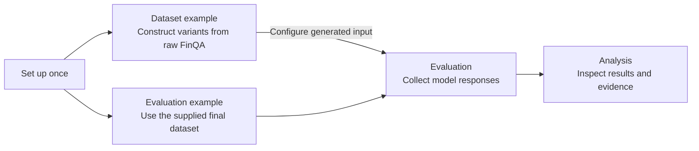

# FInject

## 1. FInject overview

FInject (Finance Inject) evaluates whether a financial question-answering model's **numeric answer or abstention is supported by the supplied context**. Seven controlled variants introduce conflicting values or relationships, change source attribution, or remove information from verified original questions.


**Figure 1 — Illustration of FInject.** Contextual evidence must support the model's explanation, and the explanation must justify its final decision. A correct number or an abstention alone does not establish that the decision is supported.

This repository provides:

- **Data:** 1,354 originals and 9,478 linked variants, plus a small source sample and file/schema descriptions. See the [released dataset](data/final/README.md).
- **Reusable pipelines:** input adapters, Dataset construction, target-model Evaluation, and Analysis of saved responses and their evidence.
- **Viewers:** construction evidence in the Dataset viewer, and model inputs, responses, and Analysis in the experiment viewer. An optional [macOS app](apps/README.md) starts these servers.

## 2. User guide



Choose either entry point: construct data from the ten-question FinQA example in [Dataset](#4-dataset), or evaluate one supplied, completed family in [Evaluation](#5-evaluation) and continue to [Analysis](#6-analysis). The Evaluation example does not require running the FinQA example first. Each section gives the sample command, what to check, and a link to details.

Adapter code generation, live construction and Evaluation use your own credentials and incur provider charges. Converting data with an installed adapter, planning, request preparation, and viewing saved files need **no API key**. The Analysis example aggregates saved responses locally; model-assisted assessment has the compatibility requirement described in Section 6.

<a id="installation-and-credentials"></a>

## 3. Prerequisites

Requirements: **Python 3.11+**, **Node.js** for the experiment viewer, and a POSIX shell. Open a terminal at the repository root and run:

```sh
python3 -m venv .venv
. .venv/bin/activate
python -m pip install -e '.[viewer]'
python -m pip check
export PYTHONPATH="$PWD/src"
```

Keep this terminal for the pipeline commands below. In a new terminal, activate `.venv` and set `PYTHONPATH` again.

For live model calls, create `.env` if it does not already exist:

```sh
if [ ! -f .env ]; then cp .env.example .env; fi
```

Open `.env` and set `OPENAI_API_KEY=your-key`. Keep it private. Your account must support the configured models. See [credentials and configuration](config/README.md) for provider options and model settings.

## 4. Dataset

### Generate an adapter from the FinQA example

The [FinQA sample](data/sample/finqa_10.json) contains **ten unchanged raw
questions in one JSON array**. Source, selection and license details are in the
[sample guide](data/sample/README.md). With the API key configured, run:

```sh
.venv/bin/python -B src/finarch/dataset/0-template/make_adapter.py \
  data/sample/finqa_10.json --name finqa --output data/prepared/finqa_10
```

This calls `gpt-6.1-sol` with reasoning effort `low` to generate and check three
code additions. Normally there are three calls, with at most nine attempts
across the three stages. Subsequent conversion uses Python only.

| Code location | Change made after all checks pass |
| --- | --- |
| `src/finarch/dataset/00-input/finqa.py` | New source reader, preprocessor and conversion runner. |
| `src/finarch/dataset/00-input/adapters.py` | Append `finqa(record, question, source)`; existing functions are preserved. |
| `src/finarch/dataset/schemas/prepared.py` | Add `FinqaProvenance` and its union member; common fields and validators are preserved. |

`finqa` names the reusable source format; `finqa_10` names this sample's output
folder. The generated FinQA registration is intentionally absent from a fresh
checkout so this command can create it. Prompts and templates stay in
`src/finarch/dataset/0-template/`. See the [adapter guide](src/finarch/dataset/0-template/README.md)
for the complete generated-file list, validation and rerun behavior.

### Inspect the converted input and continue

A successful conversion reports `PASS`, `records: 10`, and `excluded: 0`.
Inspect these files against the raw questions:

- `data/prepared/finqa_10/intermediate.json`: `question`, `context`, `reference_answer`, `reference_precision`.
- `data/prepared/finqa_10/input.json`: complete common input for Preparation.

Source records, manifests and validation results go to
`reports/run/finqa_10/00-input/`; code-generation requests, checks, original-code
backups and `changes.patch` go to `reports/run/finqa_10/adapter-generation/`.
Keep the original raw file and both output directories. No hand-written source
catalog or manifest is needed.

Follow the [construction commands](src/finarch/dataset/README.md) to inspect the
plan, run Preparation, then run Generation with the **actual construction run**.
These later stages make additional model calls using their configured profiles.
Input conversion PASS does not guarantee all generated variants pass.
Completed consolidation writes `data/generated/<construction-run>/dataset.jsonl`,
including failures and selection metadata.

### Reuse the adapter with more data

For another file with the same FinQA layout, call the installed `finqa.py` with
that file and a new output folder. Do not regenerate or edit the adapter just
because the data changed. For example, reconvert the supplied sample without
model calls:

```sh
.venv/bin/python -B src/finarch/dataset/00-input/finqa.py \
  data/sample/finqa_10.json --output data/prepared/finqa_10-repeat
```

For a different source layout, follow the [new-format guide](src/finarch/dataset/0-template/ADAPTER.md).
The existing FinanceReasoning/TAT-QA [two-source check](data/sample/README.md#built-in-financereasoning-and-tat-qa-check)
remains available without adapter authoring or API calls.

### View construction results

In a separate terminal at the repository root:

```sh
PYTHONPATH=src .venv/bin/python -B -m finarch.dataset.viewer.server --open
```

Open the [Dataset viewer](http://127.0.0.1:8893/?lang=en), choose **Select a run**,
then the construction run, round, case and variant. Inspect Preparation first,
then Generation; **Generated dataset archive** exposes the consolidated JSONL.
Source conversion alone does not create a viewer construction run. See the
[viewer guide](viewer/dataset/README.md) for the screens and saved evidence.

## 5. Evaluation

### Sample command

Prepare one family from the supplied final dataset: **one original + seven variants**, with two prompt conditions and two reasoning modes (**32 requests**). Preparation makes no model calls and saves the run path in `EVAL_RUN`:

```sh
EVAL_RUN=$(python -B -m finarch.experiments.pipeline prepare \
  --config config/experiments/reviewer-smoke.toml)
printf '%s\n' "$EVAL_RUN"
```

With your API key configured, execute those requests:

```sh
python -u -B -m finarch.experiments.pipeline run \
  --evaluation-only --run "$EVAL_RUN"
```

This uses the configured Batch transport and can take time to finish. Keep the printed run path; reuse it to resume rather than preparing another run. This example uses the **supplied release**, independently of the source-conversion check in Section 4. To evaluate fresh generated data, follow the [input configuration guide](src/finarch/experiments/01-evaluation/README.md#1-choose-an-input-and-inspect-the-configuration).

### What to check

Start the experiment viewer in another terminal:

```sh
PYTHONPATH=src .venv/bin/python -B -m finarch.experiments.viewer.server --open
```

Open the [experiment viewer](http://127.0.0.1:8894/?lang=en), select your run in **Run records**, then **Browse cases → Case comparison**. Compare the original and variants, prompt conditions, Reasoning OFF/ON, and actual responses. Before execution, **Not run** is expected.

Outputs remain in the printed `reports/experiments-run/<run-id>/` folder. Check `state.json` and `01_evaluation/04_validation/summary.json`. Continue to Analysis only when every selected model is **FINISHED**; failed or uncollected requests are not accuracy results.

**Details:** [Evaluation steps and resumption](src/finarch/experiments/01-evaluation/README.md) · [Sample configuration](config/experiments/reviewer-smoke.toml) · [Experiment viewer](viewer/experiments/README.md)

## 6. Analysis

### Sample command

After Evaluation finishes, use the **same `EVAL_RUN`** to aggregate its saved responses without new model calls:

```sh
python -B -m finarch.experiments.pipeline analysis \
  --aggregate-only --run "$EVAL_RUN"
```

### What to check

The command should report **AGGREGATES_REFRESHED** and `new_model_calls: 0`. Outputs include `02_analysis/01_results/responses.jsonl` and `02_analysis/02_comparison/comparisons.json`. If Evaluation is unfinished, the command reports **WAITING / WAIT_EVALUATION**.

In the same experiment viewer, select **02 Analysis** and inspect the available result/comparison views. Local aggregation does not create semantic assessments or research findings. Those require model-assisted Analysis; their views remain incomplete until the corresponding records exist.

**Model-assisted Analysis:** the supplied `gpt-6.1-sol` API profile is rejected before Batch submission by the current cache policy; adding an API key alone does not resolve this. Codex Analysis uses a separate backend that requires an installed Codex CLI and ChatGPT login and records provider-managed caching. Follow the [Analysis guide](src/finarch/experiments/02-analysis/README.md) for backend requirements, full assessment stages, and evidence inspection.

**Details:** [Analysis steps and outputs](src/finarch/experiments/02-analysis/README.md) · [Analysis configuration](config/README.md) · [Read the Analysis screens](viewer/experiments/README.md#read-the-screens)
