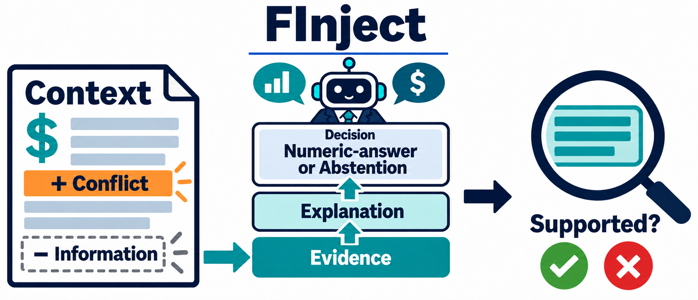
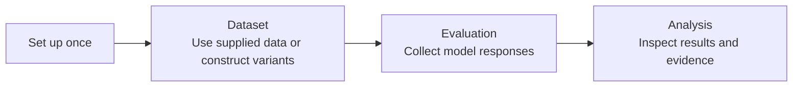

# FInject

## 1. FInject overview

FInject (Finance Inject) evaluates whether a financial question-answering model's **numeric answer or abstention is supported by the supplied context**. Seven controlled variants introduce conflicting values or relationships, change source attribution, or remove information from verified original questions.



**Figure 1 — Illustration of FInject.** Contextual evidence must support the model's explanation, and the explanation must justify its final decision. A correct number or an abstention alone does not establish that the decision is supported.

This repository provides:

- **Data:** 1,354 originals and 9,478 linked variants, plus a small source sample and file/schema descriptions. See the [released dataset](data/final/README.md).
- **Reusable pipelines:** input adapters, Dataset construction, target-model Evaluation, and Analysis of saved responses and their evidence.
- **Viewers:** construction evidence in the Dataset viewer, and model inputs, responses, and Analysis in the experiment viewer. An optional [macOS app](apps/README.md) starts these servers.

## 2. User guide



For a first pass, check the two source examples in [Dataset](#4-dataset), then use one supplied, completed family for [Evaluation](#5-evaluation) and [Analysis](#6-analysis). Reconstructing the full dataset is not required. Each section gives the sample command, what to check, and a link to details.

Source conversion, planning, request preparation, and viewing saved files need **no API key**. Live construction and Evaluation use your own credentials and incur provider charges. The Analysis example aggregates saved responses locally; model-assisted assessment has the compatibility requirement described in Section 6.

<a id="installation-and-credentials"></a>

## 3. Prerequisites

Requirements: **Python 3.11+**, **Node.js** for the experiment viewer, and a POSIX shell. Open a terminal at the repository root and run:

```sh
python3 -m venv .venv
. .venv/bin/activate
python -m pip install -e '.[viewer]'
python -m pip check
export PYTHONPATH="$PWD/src"
```

Keep this terminal for the pipeline commands below. In a new terminal, activate `.venv` and set `PYTHONPATH` again.

For live model calls, create `.env` if it does not already exist:

```sh
if [ ! -f .env ]; then cp .env.example .env; fi
```

Open `.env` and set `OPENAI_API_KEY=your-key`. Keep it private. Your account must support the configured models. See [credentials and configuration](config/README.md) for provider options and model settings.

## 4. Dataset

### Sample command

Convert the two supplied source examples into common pipeline inputs and validate their format. These commands make no model calls:

```sh
python -B -m finarch.cli prepare \
  --sources data/sample/source-catalog.json \
  --output data/prepared/reviewer-sample \
  --per-source 1 --seed reviewer-sample-v1

python -B -m finarch.dataset.schemas.validation \
  --schema 01-preparation.01-source.prepared-input \
  --input data/prepared/reviewer-sample/input.json
```

Use a new `--output` folder if you run source conversion again.

### What to check

`data/prepared/reviewer-sample/preparation-result.json` should report **PASS**, **two inputs**, and **zero model calls**. Read `input.json` for the selected questions and contexts. These are source inputs; the seven variants are created during Preparation and Generation.

To construct fresh variants, follow [Preparation and Generation](src/finarch/dataset/README.md). Inspect its plan before live calls. Construction evidence goes to `reports/run/<run-id>/`; completed consolidation writes `data/generated/<run-id>/dataset.jsonl`.

For construction screens, start the server in a separate terminal:

```sh
PYTHONPATH=src .venv/bin/python -B -m finarch.dataset.viewer.server --open
```

Open the [Dataset viewer](http://127.0.0.1:8893/?lang=en), select the construction run, round, case, and variant. Source conversion alone does not create a viewer run. Section 5 provides the route for viewing supplied final examples.

**Details:** [Sample files](data/sample/README.md) · [Construction steps](src/finarch/dataset/README.md) · [Write an adapter](src/finarch/dataset/00-input/README.md) · [Dataset viewer](viewer/dataset/README.md)

## 5. Evaluation

### Sample command

Prepare one family from the supplied final dataset: **one original + seven variants**, with two prompt conditions and two reasoning modes (**32 requests**). Preparation makes no model calls and saves the run path in `EVAL_RUN`:

```sh
EVAL_RUN=$(python -B -m finarch.experiments.pipeline prepare \
  --config config/experiments/reviewer-smoke.toml)
printf '%s\n' "$EVAL_RUN"
```

With your API key configured, execute those requests:

```sh
python -u -B -m finarch.experiments.pipeline run \
  --evaluation-only --run "$EVAL_RUN"
```

This uses the configured Batch transport and can take time to finish. Keep the printed run path; reuse it to resume rather than preparing another run. This example uses the **supplied release**, independently of the source-conversion check in Section 4. To evaluate fresh generated data, follow the [input configuration guide](src/finarch/experiments/01-evaluation/README.md#1-choose-an-input-and-inspect-the-configuration).

### What to check

Start the experiment viewer in another terminal:

```sh
PYTHONPATH=src .venv/bin/python -B -m finarch.experiments.viewer.server --open
```

Open the [experiment viewer](http://127.0.0.1:8894/?lang=en), select your run in **Run records**, then **Browse cases → Case comparison**. Compare the original and variants, prompt conditions, Reasoning OFF/ON, and actual responses. Before execution, **Not run** is expected.

Outputs remain in the printed `reports/experiments-run/<run-id>/` folder. Check `state.json` and `01_evaluation/04_validation/summary.json`. Continue to Analysis only when every selected model is **FINISHED**; failed or uncollected requests are not accuracy results.

**Details:** [Evaluation steps and resumption](src/finarch/experiments/01-evaluation/README.md) · [Sample configuration](config/experiments/reviewer-smoke.toml) · [Experiment viewer](viewer/experiments/README.md)

## 6. Analysis

### Sample command

After Evaluation finishes, use the **same `EVAL_RUN`** to aggregate its saved responses without new model calls:

```sh
python -B -m finarch.experiments.pipeline analysis \
  --aggregate-only --run "$EVAL_RUN"
```

### What to check

The command should report **AGGREGATES_REFRESHED** and `new_model_calls: 0`. Outputs include `02_analysis/01_results/responses.jsonl` and `02_analysis/02_comparison/comparisons.json`. If Evaluation is unfinished, the command reports **WAITING / WAIT_EVALUATION**.

In the same experiment viewer, select **02 Analysis** and inspect the available result/comparison views. Local aggregation does not create semantic assessments or research findings. Those require model-assisted Analysis; their views remain incomplete until the corresponding records exist.

**Model-assisted Analysis:** the supplied API profile and Codex CLI backend are currently rejected by the pipeline's cache policy (`CACHE_POLICY_BLOCKED`). Adding an API key alone does not resolve this requirement. Follow the [Analysis guide](src/finarch/experiments/02-analysis/README.md) for the full assessment stages, configuration compatibility, and evidence inspection.

**Details:** [Analysis steps and outputs](src/finarch/experiments/02-analysis/README.md) · [Analysis configuration](config/README.md) · [Read the Analysis screens](viewer/experiments/README.md#read-the-screens)
