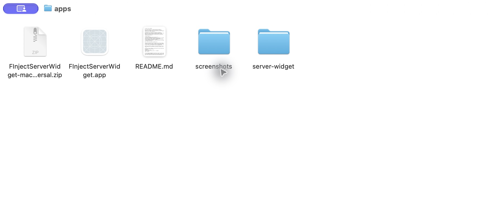
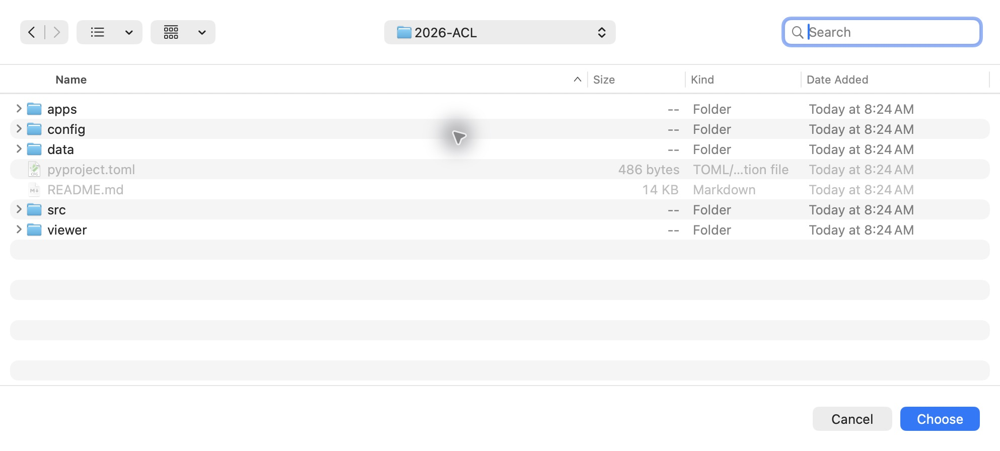
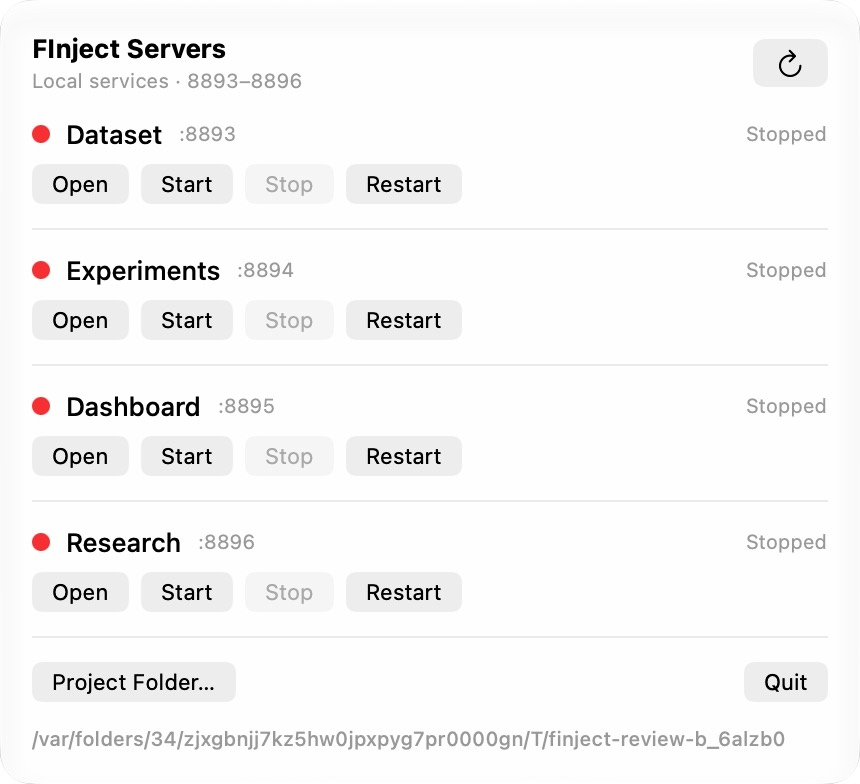

# FInject Server Widget

Use the macOS menu bar to start and open the Dataset, Experiments, Dashboard, and Research viewers. The widget controls local viewer servers; its buttons do not start dataset construction or model experiments.

The widget does not request Accessibility, Automation / AppleScript, Screen Recording, or administrator privileges. You select the repository folder through the standard folder chooser. The app runs from the extracted ZIP; no system-wide installation is required.

| Item | Purpose |
| --- | --- |
| [FInjectServerWidget-macos-universal.zip](FInjectServerWidget-macos-universal.zip) | Ready-to-run macOS app. Extract it to obtain `FInjectServerWidget.app`. |
| [server-widget/](server-widget/) | Widget source and Xcode project. Building from source is optional. |
| [screenshots/](screenshots/) | Actual installation and widget screenshots used below. |

## 1. Prepare the viewer environment once

The app is a Universal build for Apple Silicon and Intel Macs, targeting macOS 13 or later. The viewer servers require Python 3.11 or later. The Experiments viewer also requires Node.js 20 or later. Xcode is not required to use the packaged app.

Download the complete repository. The app ZIP does not contain Python, Node.js, or the viewer server code. In Terminal, run:

```sh
git clone --branch 2026-ACL --single-branch https://github.com/pnu-clink/finject.git 2026-ACL
cd 2026-ACL
python3 -m venv .venv
.venv/bin/python -m pip install -e '.[viewer]'
node --version
```

If you already downloaded the repository, skip `git clone` and run the remaining commands from its root folder. Install Python from [python.org](https://www.python.org/downloads/macos/) and Node.js from [nodejs.org](https://nodejs.org/en/download) if needed.

## 2. Extract and launch the app

1. Open the repository's `apps` folder.
2. Double-click `FInjectServerWidget-macos-universal.zip`.
3. Open the extracted `FInjectServerWidget.app`. You can keep it there or move it to a user-owned folder such as `~/Applications`. The `server-widget` folder contains source files.
4. Click the server-rack icon in the macOS menu bar. The app uses a menu-bar panel rather than a normal main window or Dock icon.



This build has an ad-hoc code signature and is not Developer ID signed or notarized by Apple. If macOS blocks it, verify its source and follow [Apple's instructions for opening apps](https://support.apple.com/en-ie/102445).

## 3. Choose the repository folder

Keep the checkout in a regular directory, for example `~/Projects/2026-ACL`. Avoid symlinked paths and macOS temporary directories such as `/tmp` or `/var`: the current widget compares repository paths to identify its servers, and these paths can prevent a running server from being recognized.

1. Click **Project Folder…** at the bottom of the widget.
2. Select the complete repository root, containing `src`, `viewer`, `data`, and `.venv`. Do not select its `apps` or `server-widget` subfolder.
3. Click **Choose**, then check the path shown at the bottom of the widget. Repeat this step if you move the repository.



## 4. Open a viewer from the widget

Click **Open** on the required row. The widget starts the server if necessary, waits for it to respond, and opens your browser. It reuses an existing server belonging to the selected repository.



The screenshot illustrates the controls. Select your own checkout in a regular directory as described in step 3.

| Viewer | Port | Address |
| --- | ---: | --- |
| Dataset | 8893 | [Dataset viewer](http://127.0.0.1:8893/) |
| Experiments | 8894 | [Experiment viewer](http://127.0.0.1:8894/) |
| Dashboard | 8895 | [Project dashboard](http://127.0.0.1:8895/dashboard/03-project/) |
| Research | 8896 | [Research viewer](http://127.0.0.1:8896/viewer/research/) |

This submission excludes `docs/`, historical construction and experiment runs, and paper-editing materials. A server can therefore be running while its historical run list or research content is empty. The app does not download or recreate these materials.

## 5. Buttons and status indicators

| Control | Action |
| --- | --- |
| Open | Start the server if needed, then open it in your browser. |
| Start | Start the server without opening a browser. |
| Stop | Stop that server. |
| Restart | Stop and start that server. |
| Refresh icon | Check the current server status again. |
| Project Folder… | Choose the repository containing the viewer code and data. |
| Quit | Close the widget. To stop the servers too, click **Stop** on each row first. |

- **Green — Running:** the selected repository's server responds correctly.
- **Red — Stopped:** no server is listening on that port.
- **Orange — Not responding:** a verified Experiments server is unresponsive. Use Stop, Restart, or Open to attempt recovery.
- **Orange — Port in use / unverified:** another service or repository owns the port, or the server cannot be identified. Its controls are disabled.
- **Gray:** a status check, start, or stop is in progress.

## Troubleshooting

1. Use **Project Folder…** to check that you selected the repository root.
2. Check that `.venv/bin/python` exists there and that the installation command completed.
3. If only Experiments fails, check `node --version`.
4. Read the error shown in the widget and the repository's `log/server-widget/` folder. The per-server output files are `dataset.log`, `experiments.log`, `dashboard.log`, and `research.log`; `events.jsonl` records widget actions and errors.
5. For **Port in use / unverified**, check the selected repository and the existing program using that port.

Generated from `src/finarch/documentation/templates/apps.md`.
