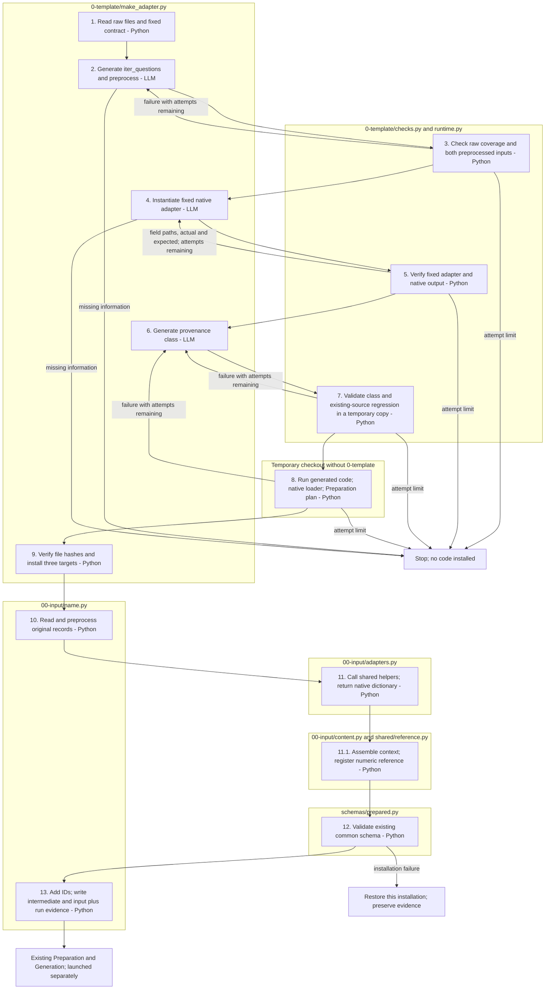

# Generate a reusable dataset adapter

The tool learns the source layout once, writes actual Python code, and checks
that it produces the existing common input schema. Read the
[input and output contract](CONTRACT.md) for the exact three interfaces.
Once installed, the adapter handles more files with the same layout through
Python conversion; changing data does not require regenerating the adapter.

## 1. Run the supplied ten-question example

Complete [installation and credentials](../../../../README.md#installation-and-credentials).
From the repository root:

```sh
.venv/bin/python -B src/finarch/dataset/0-template/make_adapter.py \
  data/sample/finqa_10.json --name finqa --output data/prepared/finqa_10
```

The raw sample contains ten complete original records in one JSON array.
The [sample guide](../../../../data/sample/README.md) explains its source,
selection, gold answer fields and license. `finqa` is the reusable adapter
name; `finqa_10` is the name of this sample's output directory. A fresh checkout
has no generated FinQA registration, so the example can create it.

Adapter authoring uses `gpt-6.1-sol` with reasoning effort `low` via the
`sol61-low-api` profile by default. It sends raw excerpts to the API and makes
billable calls: normally three, with at most three attempts per stage (nine
calls total). `--profile` or `--model` overrides authoring only; Preparation
and Generation resolve their own model settings. API responses retain usage
records; actual cost depends on model pricing and tokens.

To inspect the files without a model call or any file changes:

```sh
.venv/bin/python -B src/finarch/dataset/0-template/make_adapter.py \
  data/sample/finqa_10.json --name finqa --inspect
```

## Files created or modified

After all three stages and integration checks pass, **only these three code
locations are installed** for `--name finqa`:

| Path, relative to the repository root | Change |
| --- | --- |
| `src/finarch/dataset/00-input/finqa.py` | Create source selection/preprocessing functions and the fixed conversion runner. |
| `src/finarch/dataset/00-input/adapters.py` | Append `finqa(record, question, source)`, callable as `adapters.finqa(...)`. Preserve existing functions. |
| `src/finarch/dataset/schemas/prepared.py` | Add `FinqaProvenance` and its discriminated-union member. Preserve existing classes, fields and validators. |

The generated source runner reads raw records, uses the installed function and
validates through `PreparedSample` before writing common input. The adapter
uses the existing shared `assemble` and `extract_reference` helpers. Generated
code has no dependency on `0-template/`; integration checks remove that folder
from a temporary checkout before executing the generated implementation.

Prompts, templates and authoring guides remain in `0-template/`. Raw files,
configuration and later pipeline code are not edited by `make_adapter.py`.
Adding a provenance type changes the schema fingerprint: older prepared
bundles may need rebuilding, and their manifests are never silently rewritten.

With `--output data/prepared/finqa_10`, the persistent output layout is:

```text
data/prepared/finqa_10/
├── intermediate.json
└── input.json

reports/run/finqa_10/
├── 00-input/
│   ├── provider-records.json
│   ├── selection-manifest.json
│   ├── selection-log.json
│   ├── input-schema.json
│   ├── preparation-result.json
│   └── README.md
└── adapter-generation/
    ├── execution.json
    ├── result.json
    ├── changes.json
    ├── changes.patch
    ├── originals/src/finarch/dataset/
    │   ├── 00-input/adapters.py
    │   └── schemas/prepared.py
    ├── baseline/src/finarch/dataset/
    │   ├── 00-input/adapters.py
    │   └── schemas/prepared.py
    ├── stage-1/attempt-1/
    ├── stage-2/attempt-1/
    └── stage-3/attempt-1/
```

Each attempt contains the request, raw API response, usage and checked code:

```text
attempt-<n>/
├── 01-input.json
├── 01-input/
│   ├── request-draft.json
│   └── api-start.json
├── 02-raw-response/api-execution.json
├── 03-result/usage.json
├── response.json
├── implementation.txt
└── check.json
```

Stage 3 also writes `source-metadata-check.json`, `integration.json` and
`input-preview.json`. Retry attempts use `attempt-2/` and `attempt-3/`.
Failures preserve whatever evidence exists when the attempt stops. HTTP
errors add `02-raw-response/api-http-error.json`. Resumed stages can have
`reused-response.json` instead of a new API request. `existing-manifests.json`
is written if older bundles may be affected by schema registration.
When replacing a previous generated adapter, `originals/` also backs up the
previous source runner. Temporary candidate checkouts are removed on exit.

If `--output` is omitted, the default directory is
`data/prepared/<name>-<UTC-date-time>-<unique-suffix>/`, with matching run
evidence under `reports/run/`. Use a new output directory for every conversion.

## 2. Inspect the result

A successful FinQA sample conversion reports `PASS`, `records: 10` and
`excluded: 0`. Read the raw sample alongside these files:

- `intermediate.json`: `question`, `context`, `reference_answer`, `reference_precision`.
- `input.json`: the existing complete 11-field prepared-input records, including `id`.
- `reports/run/finqa_10/00-input/preparation-result.json`: native schema/loader validation.
- `reports/run/finqa_10/adapter-generation/changes.patch`: exact installed code changes.

Hashes and source pointers are generated from the real files. Keep the raw
files at their recorded paths and preserve the matching `reports/run/` evidence;
the native loader checks both. No hand-written catalog or manifest is needed.

Proceed to the [Preparation and Generation commands](../README.md). Adapter
conversion does not launch those stages. The construction run they create is
separate from `reports/run/finqa_10/`; select that construction run in the
[Dataset viewer](../../../../viewer/dataset/README.md).

## 3. Reuse the adapter with new data

Pass new files with the **same source layout** to the generated source runner.
It makes no model calls and edits no code. For example, reconvert this sample
into a different output directory:

```sh
.venv/bin/python -B src/finarch/dataset/00-input/finqa.py \
  data/sample/finqa_10.json --output data/prepared/finqa_10-repeat
```

One file can hold several questions. Several paths are accepted when the files
share a layout; each file can hold one or more records. Do not pass both a
combined file and its split copies, because that repeats the same questions.
JSON, JSONL and CSV are supported by the reader scaffold. A new raw layout may
need its own generated source reader; identical field names alone do not
establish identical structure. Missing or ambiguous required fields stop
conversion rather than becoming fabricated values.

For your own format, pass its real file paths and a distinct `--name` to
`make_adapter.py`. The [manual guide](ADAPTER.md) and
[coding-agent prompt](ADAPTER-PROMPT.md) use these same three native interfaces.

## Checks, repair and reruns

Each stage is generated, executed and checked before proceeding. The response
schema requires Python code plus a separate source-field declaration. Checks
compare every supplied record with the raw source, verify complete selection
coverage, displayed answers/precision, original context and exact locations,
and validate against the existing common schema. A bad candidate is retried
with its actual failure, up to the configured limit. Location-mapping failures
include the differing field paths, actual values and expected values; the
original checker reason reaches the next attempt without being replaced by a
generic process error. Exact ID conventions and fixed metadata are defined in
[the adapter contract](CONTRACT.md#2-adapter-checked-inputs-to-native-sample-fields).
Stage 1 checks both normalized adapter arguments against every raw record;
stage 2 checks the fixed implementation and common output. Missing essential
source information stops the run. Later stages remain unevaluated when an earlier
stage fails. PASS is structural and source-preservation evidence, not proof
that the raw gold answer is semantically correct.

Generated function bodies have a limited import/operation policy. Candidate
execution uses a separate child process, a stripped environment and a timeout;
these checks are not an operating-system sandbox. The model cannot edit the
checker, common schema, existing adapter functions or the fixed runner scaffold.
Installation verifies that the target files have not changed during authoring;
failed installation restores only this invocation's unchanged written files.

Resume passed code-generation stages after a failed authoring run:

```bash
.venv/bin/python -B src/finarch/dataset/0-template/make_adapter.py \
  data/sample/finqa_10.json --name finqa --output data/prepared/finqa_10-resumed \
  --resume "${PREVIOUS_RUN:?Set PREVIOUS_RUN to an existing authoring run}"
```

Set `PREVIOUS_RUN` to the actual prior adapter-authoring run path before this
command. The shell stops with that instruction if the variable is unset.
The cached code is re-executed and checked against the current raw files.
Older raw-only readers have no `preprocess` function or `fields` declaration and
cannot be resumed into this interface. Start a new authoring run for them.
Mapping-only responses are also unsupported. Previous evidence is preserved.

By default, an existing adapter is never overwritten. To regenerate the three
files installed by a previous successful run, explicitly identify that run:

```bash
.venv/bin/python -B src/finarch/dataset/0-template/make_adapter.py \
  data/sample/finqa_10.json --name finqa --output data/prepared/finqa_10-rebuilt \
  --replace-from "${PREVIOUS_RUN:?Set PREVIOUS_RUN to an existing authoring run}"
```

Replacement requires all three current file hashes to match that previous
run's recorded outputs, and all saved originals to match their recorded
hashes. User-edited files are not replaced. Adding a new provenance member
changes the schema fingerprint; existing prepared manifests are preserved and
may need rebuilding. No loader rule is relaxed to conceal that change.

## Responsibilities and execution order

| File | Responsibility |
| --- | --- |
| `CONTRACT.md` | Fixed inputs, output fields and nested location requirements for all three stages. |
| `template1_source.py`, `prompt1.md` | Source selection/preprocessing and the fixed reader, literal answer helper and runner. |
| `template2_adapter.py`, `prompt2.md` | Complete fixed adapter using the TAT-QA argument pattern and shared helpers. |
| `../00-input/content.py` | Shared context/number locations; its parts path accepts preprocessed pieces without dataset-specific branches. |
| `template3_schema.py`, `prompt3.md` | Minimal provenance class and exact registration contract. |
| `contracts.py` | Nonempty response schemas, including Python implementations. |
| `make_adapter.py` | Call models, preserve structured checker feedback for retries and install only three targets. |
| `checks.py`, `runtime.py` | Authoring-time independent checks and reference calculations, with exact field differences on mapping failures; not installed adapter dependencies. |
| `regression.py`, `test_make_adapter.py` | Existing-source regression and offline behavior tests using handwritten code fixtures. |
| `run-readme-template.md` | Template embedded in generated runners for the output README. |



All nodes use the default color. LLM and Python labels identify execution type;
there are no collapsed detail links or pink expansion nodes. Original source,
authoring evidence and prepared pipeline input remain separate.

Offline checks use handwritten Python responses and make no live model calls:

```bash
.venv/bin/python -B src/finarch/dataset/0-template/test_make_adapter.py
```
