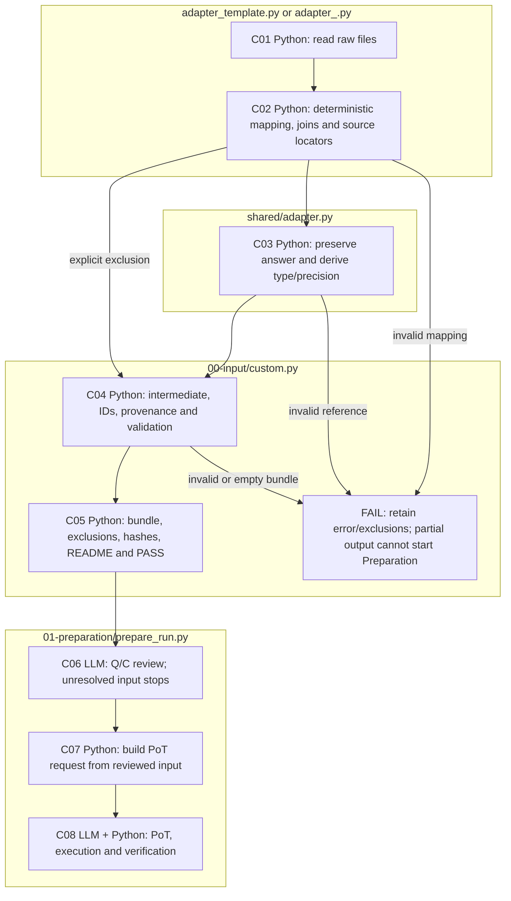

# Write an adapter for a new dataset

An adapter reads your raw files and maps their question, context and numeric gold
answer into five standard fields. The common builder then produces `input.json`
and the files needed by the existing Dataset pipeline. You supply the adapter
and raw file paths; no hand-written source catalog or manifest is required.

Complete the [installation](../../../../README.md#installation-and-credentials)
first. Conversion and the offline checks below require no API key. All commands
run from the repository root. For the supplied FinanceReasoning and TAT-QA
sources, use the separate [built-in conversion guide](README.md).

## 1. Prepare your raw files

Identify the files containing questions, contexts and numeric gold answers.
Keep the original files unchanged. For multiple files, identify the key that
connects each question to its context. Supply any available field definitions,
table layout or numeric-format documentation to the coding agent. If a mapping
is unclear, the agent should ask you instead of guessing.

The adapter performs deterministic Python transformations: field mapping,
record iteration, documented joins and context rendering. It preserves question
wording, answer values and precision. Later Preparation handles LLM review and
solution generation.

## 2. Create the adapter with a coding agent

1. Open this checkout in a coding agent such as Codex.
2. Copy the prompt from [ADAPTER-PROMPT.md](ADAPTER-PROMPT.md). Fill in your
   dataset name, ordered raw file paths, and known field mapping or documentation.
3. Ask the agent to use [adapter_template.py](adapter_template.py) to create
   `src/finarch/dataset/00-input/adapter_<dataset_slug>.py`. The prompt tells the
   agent to inspect the actual files and leave existing pipeline code unchanged.
4. Review the returned mapping rules, exclusions, adapter path and exact commands.
   The agent should verify conversion, schema validity and the offline Preparation
   plan, without starting live model stages.

You can also copy the template and implement `adapt(sources)` yourself using the
interface below. The template's current field mapping is specific to the supplied
FinanceReasoning example; update it for your actual raw format. To see a working
conversion first, use [Try the supplied template](#try-the-supplied-template).

## 3. Convert your dataset

Use the exact command returned by your coding agent. For example, after creating
`adapter_my_dataset.py`, replace `/path/to/raw.json` with your real file path:

```sh
PYTHONPATH=src .venv/bin/python -B -m finarch.cli prepare-custom \
  --adapter src/finarch/dataset/00-input/adapter_my_dataset.py \
  --input /path/to/raw.json \
  --name my-dataset \
  --output data/prepared/my-dataset
```

For multiple files, repeat `--input` in the order expected by the adapter, such as
`--input /path/to/questions.json --input /path/to/documents.json`. Use a new output
directory for each attempt. There is no implicit sampling or context-only
deduplication. The command executes the local adapter you specify.

A successful conversion writes `intermediate.json`, `input.json`, source records,
manifest, status, exclusion log and README under the selected output directory.

## 4. Inspect, validate and continue

Read the generated README and `preparation-result.json`, then compare
`intermediate.json` with `provider-records.json` and the original files. `origins`
lists all contributors to joined inputs. `selection-log.json` records exclusions.
Keep the complete output bundle and the unchanged raw files.

```sh
PYTHONPATH=src .venv/bin/python -B -m finarch.dataset.schemas.validation \
  --schema 01-preparation.01-source.custom-input \
  --input data/prepared/my-dataset/input.json

PYTHONPATH=src .venv/bin/python -B -m finarch.dataset.01-preparation.prepare_schedule \
  --input data/prepared/my-dataset/input.json \
  --config config/llm.json --plan-only
```

Both checks are offline. A successful plan verifies entry into Preparation,
not semantic correctness or completed model execution. Continue with the
[construction runbook](../README.md#2-inspect-the-preparation-plan-without-model-calls),
replacing its sample input path with your new input path in every command.
Configure credentials before starting its live model stages. Its later LLM review
may revise Q/C; the adapter intermediate remains separate from reviewed input and
the PoT request.

The generic bundle maps positions in normalized C, not original table cells.
Raw joined records remain in `origins`. Built-in raw-comparison panels target
FinanceReasoning/TAT-QA; inspect these records directly for custom layouts.
The Dataset viewer lists subsequent construction runs, not conversion folders.

## Adapter input and output contract

| Component | Responsibility |
| --- | --- |
| Your adapter | Read actual records, map Q/C/A, assemble context, identify contributing source records. |
| Shared helpers | Preserve numeric tokens and derive answer type/precision. |
| Common builder | Validate intermediate records; assign IDs, calculate hashes, preserve sources/exclusions, write the complete input bundle. |
| Existing Preparation | Review Q/C with an LLM, then generate/execute PoT and verify results. This is separate from conversion. |

`adapt(sources)` receives an ordered tuple of `RawSource` objects and yields
`make_record(...)` results. See [shared/adapter.py](../shared/adapter.py).
`source.json()` preserves JSON numeric tokens; `source.text()` supports explicit
text/CSV/JSONL parsing. For joins, attach all contributing `source.origin(...)`
records to each converted question.

The intermediate has exactly five fields:

| Field | Meaning |
| --- | --- |
| `q` | Original question text. |
| `c` | Context assembled mechanically, preserving labels, units and order. |
| `a` | Original numeric answer as a decimal string. |
| `a_precision` | Decimal places derived from the source answer token. |
| `a_type` | `integer` or `float`, derived from its numeric representation. |

`make_record(q=..., c=..., a=..., origins=[...])` derives the answer fields.
For example, raw JSON `10.00` becomes `a="10.00"`, `a_precision=2`, `a_type="float"`.
Use values from `source.json()` or unambiguous numeric strings. Ordinary Python
floats are rejected because their original precision may be lost. Booleans,
lists, and ambiguous strings such as `"1,234"` or `"12%"` are not silently converted.

Question instructions do not alter A: the adapter does not infer a scale, rescale
percentages, round gold, or revise Q/C to match gold. There is no `a_scale` field.
The compatible `input.json` sets `answer_metadata.scale` to `null` and derives
the sign from A. Original annotations remain in the preserved source records.
No source URL, version, difficulty or Finance/TAT-QA identity is fabricated.

Origins are separate bookkeeping: source identity, actual record snapshot and
locator (for example `/0/questions/2` or `CSV row 5`). Use question-specific
locators for documents with several questions. Optional `index` means the actual
top-level JSON array index. IDs and hashes are automatic. Yield
`exclude(reason, origins=...)` for explicitly unsupported question kinds;
malformed required fields should fail visibly rather than be silently skipped.

## Try the supplied template

The template maps the **actual supplied FinanceReasoning sample**, ignoring its
solution code and difficulty. It demonstrates the generic route; the existing
Finance/TAT-QA commands in the [built-in conversion guide](README.md) remain
available. From the repository root:

```sh
PYTHONPATH=src .venv/bin/python -B -m finarch.cli prepare-custom \
  --adapter src/finarch/dataset/00-input/adapter_template.py \
  --input data/sample/finance-easy.json \
  --name reviewer-example \
  --output data/prepared/reviewer-custom
```

Expected: one converted question, zero exclusions, `model_calls: 0`. Use a new
output directory each time. The command executes the local Python adapter you
specify; review generated adapter code before running it.

## Execution flow


