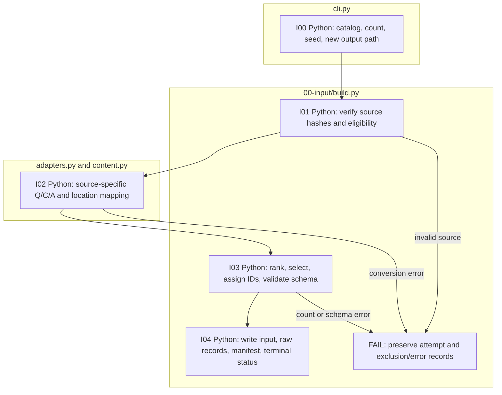

# 00-input: source conversion implementations

This directory holds executable source-conversion implementations. Prompts,
authoring guides and templates are in [0-template](../0-template/README.md).
For a new source layout, run `make_adapter.py` as shown in that guide. It adds
`<name>.py`, appends `adapters.<name>()` and registers provenance in
`../schemas/prepared.py`; existing Finance/TAT-QA functions are preserved.
The [ten-question FinQA example](../../../../data/sample/README.md) demonstrates
this route. Once an adapter is installed, reuse its source runner with new
files of the same layout; no new code or model call is required for conversion.

The rest of this page describes the preexisting FinanceReasoning/TAT-QA
catalog-based runners. Their catalog requirement does not apply to the
generated source runner.

For example, `finance(record, source)` receives a FinanceReasoning record and pinned source metadata. It returns the original question, rendered context, numeric reference fields, source locations, and provenance. The builder adds the common item ID and validates the result. It does not solve the question, call a model, or execute an upstream solution program.

Start with the [two-source sample](../../../../data/sample/README.md#built-in-financereasoning-and-tat-qa-check). The common command is `python -m finarch.cli prepare --sources CATALOG --output NEW_DIRECTORY --per-source N --seed SEED`, with `PYTHONPATH=src` and the repository's `.venv/bin/python`. Catalog paths are relative to the catalog's directory. SHA-256 must match the exact local file bytes.

## Existing adapters and selection

| Catalog adapter | Function in `adapters.py` | Accepted input |
| --- | --- | --- |
| `finance` | `finance(record, source)` | Native FinanceReasoning records; the common builder excludes embedded sources. |
| `tatqa` | `tatqa(record, question, source)` | A document and one arithmetic question from its `questions` list. |

`build.py` explicitly recognizes these two names. It filters unsupported questions, excludes duplicate contexts within a source, ranks deterministically using the seed and raw ID, selects the requested count, and rejects duplicate IDs. The full four-source catalog is [config/source-catalog.json](../../../../config/source-catalog.json). Its `--total` mode requires a positive multiple of ten and the fixed easy:medium:hard:TAT-QA ratio 3:2:1:4; the two-source sample uses `--per-source` instead.

Source-specific alternatives remain in `full_finance.py` and `tatqa_full.py`. The former accepts `--catalog` and `--output`; the latter accepts an output directory as its sole positional argument and reads `config/source-catalog.json` from the repository root. Their cohort policies differ from the common sampler and are not interchangeable paper-reproduction commands.

## Code and failure flow

The legacy conversion steps in this diagram use Python without model calls. Its input files and five output files are explained in the [sample guide](../../../../data/sample/README.md). Keep that complete bundle together for the next stage. For a different raw format, follow [Write an adapter](../0-template/ADAPTER.md).
