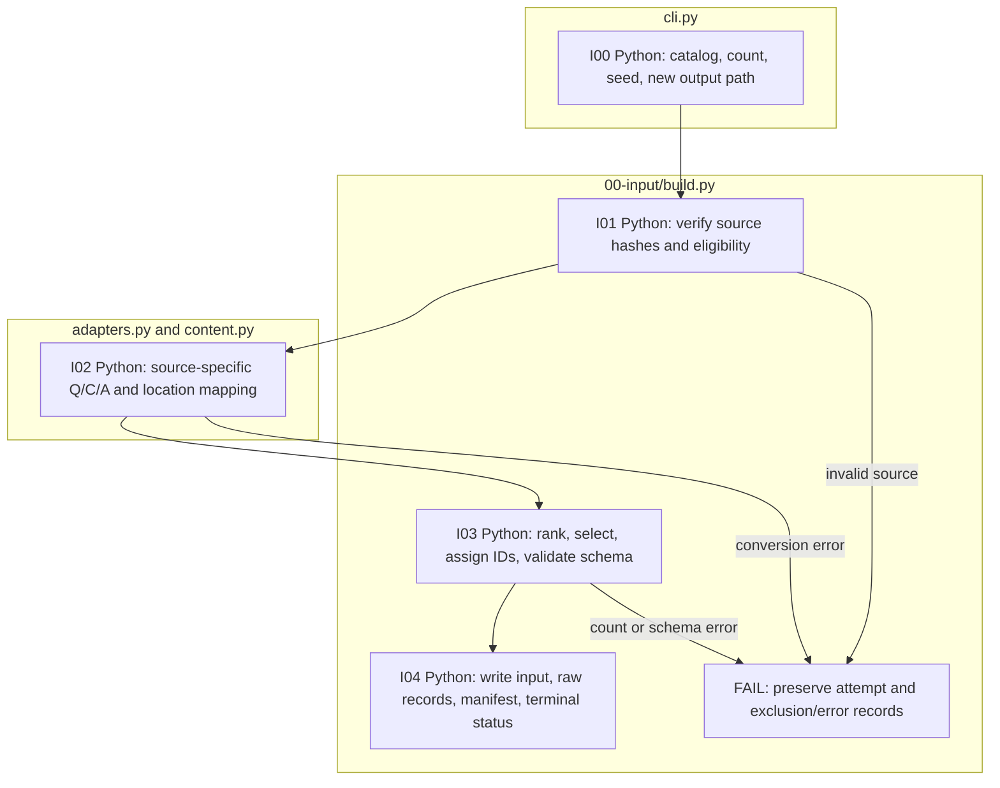

# 00-input: source conversion and adapter guide

For example, `finance(record, source)` receives a FinanceReasoning record and pinned source metadata. It returns the original question, rendered context, numeric reference fields, source locations, and provenance. The builder adds the common item ID and validates the result. It does not solve the question, call a model, or execute an upstream solution program.

Start with the actual [two-source sample](../../../../data/sample/README.md). The common command is `python -m finarch.cli prepare --sources CATALOG --output NEW_DIRECTORY --per-source N --seed SEED`, with `PYTHONPATH=src` and the repository's `.venv/bin/python`. Catalog paths are relative to the catalog's directory. SHA-256 must match the exact local file bytes.

## Existing adapters and selection

| Catalog adapter | Function in `adapters.py` | Accepted input |
| --- | --- | --- |
| `finance` | `finance(record, source)` | Native FinanceReasoning records; the common builder excludes embedded sources. |
| `tatqa` | `tatqa(record, question, source)` | A document and one arithmetic question from its `questions` list. |

`build.py` explicitly recognizes these two names. It filters unsupported questions, excludes duplicate contexts within a source, ranks deterministically using the seed and raw ID, selects the requested count, and rejects duplicate IDs. The full four-source catalog is [config/source-catalog.json](../../../../config/source-catalog.json). Its `--total` mode requires a positive multiple of ten and the fixed easy:medium:hard:TAT-QA ratio 3:2:1:4; the two-source sample uses `--per-source` instead.

Source-specific alternatives remain in `full_finance.py` and `tatqa_full.py`; inspect their `--help` before use. Their cohort policies differ from the common sampler and are not interchangeable paper-reproduction commands.

## Add a new adapter

There is no automatic plugin discovery. A catalog edit alone does not register a new source family.

1. Preserve a small actual raw record and its source URL, commit/version, SHA-256, and redistribution terms. Add a separate catalog with a path relative to that catalog. Do not rewrite source answers to fit computed results.
2. Implement the conversion in [adapters.py](adapters.py). Preserve a stable `raw_id`, the question, numeric reference and precision, sign/scale metadata, and provenance. Use the existing `extract_reference` helper rather than rounding values yourself.
3. Extend the adapter allowlist, record/question iteration, dispatch, and explicit exclusion reasons in [build.py](build.py). A document with multiple questions needs question-level iteration, as TAT-QA does.
4. Extend [content.py](content.py) for the new layout. Preserve tables/paragraphs and source pointers. Every `context_span` uses Unicode code points and a half-open interval `[start, end)`; `context[start:end]` must equal the stored fragment. JSON rendering uses [json_context.py](json_context.py). Do not reuse a renderer that drops evidence.
5. Extend the typed provenance union in [schemas/prepared.py](../schemas/prepared.py) for a genuinely new source family, and update the registered JSON schema using `finarch.dataset.schemas.registry --output src/finarch/dataset/schemas/json` with the repository Python. The current union accepts FinanceReasoning and TAT-QA only. A generic Q/C/A object does not satisfy this contract.
6. Run the new catalog through the offline builder in a new directory. Validate `input.json` with the command below; inspect source hashes, exclusions, IDs, reference precision/sign, tables, and source spans against the raw record. Include repeated-context, unsupported-question, and invalid-location cases when checking an adapter change. Schema PASS does not certify financial meaning.

```sh
PYTHONPATH=src .venv/bin/python -B -m finarch.dataset.schemas.validation \
  --schema 01-preparation.01-source.prepared-input \
  --input PATH_TO_NEW_INPUT_DIRECTORY/input.json
```

## Code and failure flow



All steps above use Python without model calls. Input files and the five actual outputs are explained in the [sample guide](../../../../data/sample/README.md). Keep all five files together for the next stage.
