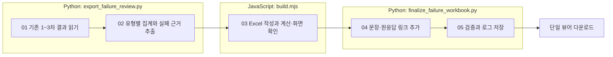

# {run} 실패 검토 엑셀

## 읽는 순서

1. `012-failure-review.xlsx`의 **유형별 요약**에서 정확한 유형별 통과·실패 수를 확인합니다.
2. **100문항 매트릭스**의 빨간 FAIL 셀을 눌러 **문장 비교**로 이동합니다.
3. **실패 상세**에서 실제 검사 이유, 원인 검토, 해결안, 요청·원응답·판정 파일을 확인합니다.
4. **앞단계 제외**는 문장 실패와 별도로 읽습니다. 기존 GOLD_MISMATCH 제외 결정을 변경하지 않았습니다.

PASS 533개, FAIL 35개, 기록된 미평가 5개입니다. 앞단계 제외는 26문항이며 문항×유형 셀의 제외 수와 구분합니다. 조건 없음은 해당 최종 유형의 기록이 없는 경우입니다.

문장 비교의 주황색 `【 】`는 패치 위치를 표시하기 위한 표식입니다. 원응답에 추가한 문자가 아니며, 생성 본문은 별도 열에 그대로 있습니다. 실패 응답 적용본은 진단용이며 최종 통과 산출물로 저장하지 않았습니다. 검토 의견은 기존 LLM 판정을 덮어쓰지 않습니다.

## 자료와 재생성

- `review-data.json`: 차수별 기록을 읽어 만든 집계·원문·생성문·패치·출처.
- `verification.json`, `workbook-checks.json`: 100행, 실패 35건, 제외 26문항, 링크와 집계 검증.
- 로그: `log/run/{run}/default.log`에서 `review.export_failure_workbook`을 검색합니다.
- 단일 뷰어에서 실행을 선택한 후 **실패 검토 엑셀**을 누르면 이 파일을 내려받습니다.

이 과정은 저장된 기록만 읽습니다. LLM 호출, 재시험, 생성 문장 보정 또는 판정 변경은 하지 않습니다.
