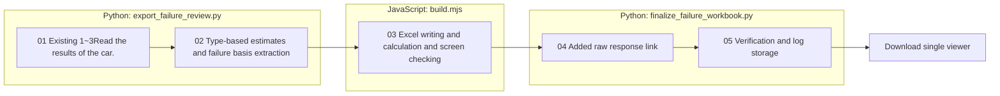

# {run} Failure review workbook

## Reading order

1. `012-failure-review.xlsx` **Summary of each type**Check the exact pass-through rate by type.
2. **100The matrix**Press the red cell of the FAIL **Comparison of phrases**We move to.
3. **Failure details**Check the actual check in the cause, cause review, unsolved, request, raw response, judgment file.
4. **Except for the front.**The decision to exclude existing GOLD_MISMATCH has not been changed.

PASS 533, FAIL 35items, recorded under-reporting. 5It's a items. 26It's a case, and it's a set of exclusions of the case x-type cells.

Orange comparison of the phrases `【 】`It's not a text added to the raw response, and the generated text is in the separate column. The failed response application copy is for diagnostic purposes and not stored as a final pass output. The review comment does not overwrite the existing LLM judgment.

## Data and renewability

- `review-data.json`: statistics, sources of data, and patches.
- `verification.json`, `workbook-checks.json`: 100rows, failed 35That, except for 26The cases, the links and the statistical verification.
- Log: What are you doing? `log/run/{run}/default.log`in `review.export_failure_workbook`I'm looking for it.
- After selecting to run from a single viewer **Failure review workbook**Click on this and you'll download this file.

This process only reads the saved records, and does not call, retest, create sentence corrections or change judgments.
