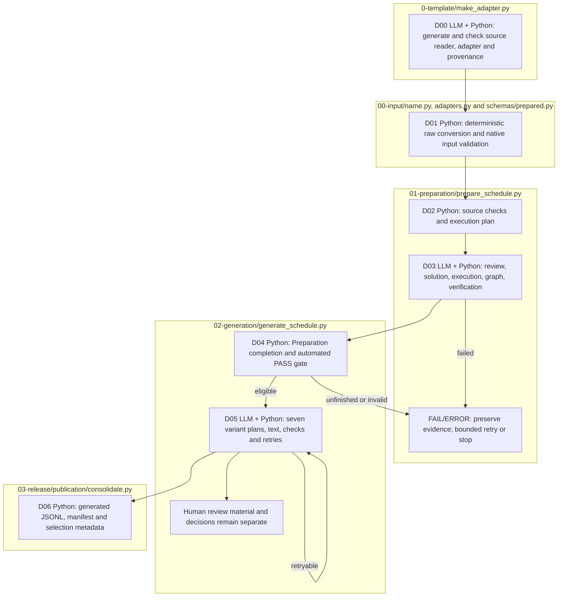

# Dataset construction: raw input to generated variants

Complete [installation and credentials](../../../README.md#installation-and-credentials).
Run commands from the repository root. Adapter authoring, Preparation and
Generation use models at separate stages; converting more files with an
installed adapter and inspecting a plan use Python only.

## 1. Create the FinQA adapter and input once

The [FinQA example](../../../data/sample/README.md) supplies ten unchanged raw
records in `data/sample/finqa_10.json`. On a fresh checkout:

```sh
.venv/bin/python -B src/finarch/dataset/0-template/make_adapter.py \
  data/sample/finqa_10.json --name finqa --output data/prepared/finqa_10
```

The command creates `00-input/finqa.py`, appends `adapters.finqa()` and adds
`FinqaProvenance` in `schemas/prepared.py`. See the
[exact changes and outputs](0-template/README.md#files-created-or-modified).
It reports PASS only after source mapping, native schema and loader checks.
Inspect `intermediate.json` and `input.json`; both should contain ten records.
This is source conversion, not yet a generated seven-variant dataset.

If `finqa.py` is already installed, use it directly with your raw file and a
new output directory. Do not run adapter authoring again merely to change data:

```sh
.venv/bin/python -B src/finarch/dataset/00-input/finqa.py \
  data/sample/finqa_10.json --output data/prepared/finqa_10-repeat
```

For that repeated conversion, use its `input.json` path below. For another
source layout, use the [new-format guide](0-template/ADAPTER.md).

## 2. Inspect the Preparation plan without model calls

For the first command's output, set:

```sh
export INPUT_PATH='data/prepared/finqa_10/input.json'

PYTHONPATH=src .venv/bin/python -B -m finarch.dataset.01-preparation.prepare_schedule \
  --input "$INPUT_PATH" --config config/llm.json --plan-only
```

Check `case_count` (10 for the sample), `roles`, `parallelism`, `schedule` and
maximum call counts. A null cost means no price estimate is available.
Adapter authoring defaults to `gpt-6.1-sol` / `low`; the models used here and in
Generation are resolved separately from [pipeline configuration](../../../config/README.md).
Shared API settings currently select concurrency 200; the active case count is
bounded by the selected inputs. Do not assume the adapter's model choice also
changes Preparation or Generation.

## 3. Execute Preparation

This command makes live API calls and executes generated Python solutions
locally, using the reviewed configuration and your `.env` credentials:

```sh
PYTHONPATH=src .venv/bin/python -B -m finarch.dataset.01-preparation.prepare_schedule \
  --input "$INPUT_PATH" --config config/llm.json
```

Preparation checks source evidence, generates and executes a solution,
compares it with the displayed reference, constructs a computation graph and
verifies it. Failed calls and bounded retries keep their earlier evidence.
An API failure, an answer mismatch and a semantic failure have different reasons.

It allocates a **new construction run** under `reports/run/` and prints its
`run` path in the final JSON. This is different from `reports/run/finqa_10/`,
which holds adapter/source-conversion evidence. Wait for Preparation to finish
before starting Generation for that run.

The terminal prints the plan and final result; intermediate progress is saved
in `01-preparation/queue.json`, `schedule-state.json`, `summary.json` and each
case's `run.json`. A quiet terminal alone does not mean execution stopped.
Use the viewer below to inspect active stages and saved responses. Do not
start a duplicate scheduler while the current one is active.

To resume unfinished Preparation, use `--run` with the actual construction
path and `--resume`. Resumption restarts unfinished cases from source; it does
not promise to continue inside an interrupted API call. Finished failures are
preserved and are not automatically unfinished work.

## 4. Find the construction run and execute Generation

The following read-only lookup finds the completed Preparation run whose
`input-selection.json` points to `INPUT_PATH`. It avoids copying a placeholder
or accidentally using a run from another sample. If multiple runs match,
it stops and lists their paths; choose the intended run explicitly.

```sh
RUN_PATH=$(.venv/bin/python -B - <<'PYRUN'
import json
import os
from pathlib import Path

expected = Path(os.environ['INPUT_PATH']).resolve()
matched = []
for selection in Path('reports/run').glob('*/input-selection.json'):
    data = json.loads(selection.read_text())
    if data.get('input_path') and Path(data['input_path']).resolve() == expected:
        matched.append(selection.parent)
if len(matched) != 1:
    raise SystemExit('Expected one matching construction run; found: ' +
                     ', '.join(str(path) for path in matched))
run = matched[0]
summary = json.loads((run / '01-preparation/summary.json').read_text())
if summary.get('status') != 'COMPLETED':
    raise SystemExit('Preparation is not complete: ' + str(run))
if not (run / 'config.json').is_file():
    raise SystemExit('Missing construction configuration: ' + str(run))
print(run)
PYRUN
)

if [ -n "$RUN_PATH" ] && [ -f "$RUN_PATH/config.json" ]; then
  printf 'Generation run: %s\n' "$RUN_PATH"
  PYTHONPATH=src .venv/bin/python -B -m finarch.dataset.02-generation.generate_schedule \
  --run "$RUN_PATH"
fi
```

Generation makes additional API calls. It requires completed, intact
Preparation artifacts and proceeds with automated PASS items. Failed inputs
remain recorded. It generates IC-VALUE before/after, IC-SOURCE Type 1/2,
IC-RELATION and EA-01/02, with validation and bounded retries in the same run.
Human review decisions remain separate from automated validation.

A terminal status such as `LIMIT_REACHED` preserves failed variants; it does
not mean every record passed. The scheduler still consolidates its completed
attempts. Inspect each family's selection status before using generated data.
The full scheduler's `--plan-only` is not a standalone dry run: that option
requires an explicit stage range. Do not add it to the command above.

## 5. Read the outputs and viewer

| Location | Contents |
| --- | --- |
| `data/prepared/finqa_10/` | Only `intermediate.json` and `input.json`. |
| `reports/run/finqa_10/00-input/` | Raw-record copies, manifest, exclusions, schema, validation and README. |
| `reports/run/finqa_10/adapter-generation/` | Authoring requests/responses, checks, code backups and changes. |
| `reports/run/<construction-run>/01-preparation/` | Solutions, executions, graphs, verification and retries. |
| `reports/run/<construction-run>/02-generation/` | Seven variant types, validation, retries and human review material. |
| `data/generated/<construction-run>/dataset.jsonl` | Consolidated selected cases, including failures/rejections and selection metadata. |

Read each run's README and summaries before individual prompts, raw responses
and execution artifacts. Consolidation occurs after the full Generation
scheduler finishes. A generated selected record is not automatically a
human-approved final release. The supplied frozen release remains in
[data/final](../../../data/final/README.md).

In another terminal at the repository root:

```sh
PYTHONPATH=src .venv/bin/python -B -m finarch.dataset.viewer.server --open
```

Open [the Dataset viewer](http://127.0.0.1:8893/?lang=en), choose **Select a run**
and the construction run found above, then a round and case. Inspect the
Preparation question/context, Python solution, graph and verification; select
one of the seven Generation types to inspect the variant and its evidence.
**Include Preparation failures** exposes failed inputs. **Generated dataset
archive** displays/downloads the consolidated JSONL. If a viewer for this
checkout is already running, reuse it rather than starting a second server.
See the [screen guide](../../../viewer/dataset/README.md).

Evaluation and Analysis follow the separate
[Evaluation runbook](../experiments/01-evaluation/README.md) and use the
[experiment viewer](../../../viewer/experiments/README.md).

## File responsibilities and execution order



Boxes group the responsible files. Node labels distinguish Python processing
from LLM calls. All nodes use the default color; no collapsed detail links or
pink expansion nodes are used. Later stages remain unevaluated when a required
earlier stage fails.
