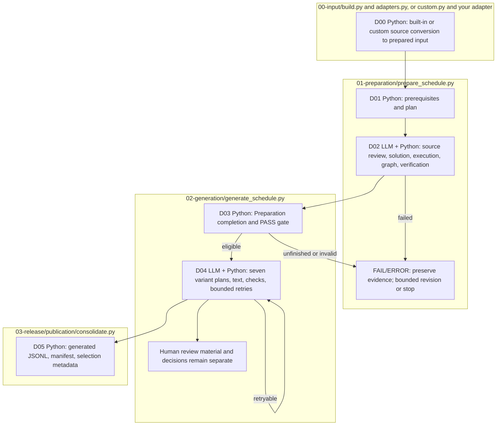

# Dataset construction runbook

Complete the [installation and credentials setup](../../../README.md#installation-and-credentials) first. Construction creates and checks data; it is separate from target-model Evaluation and Analysis.

## 1. Prepare real source inputs without model calls

Run the [source sample](../../../data/sample/README.md). It produces `data/prepared/reviewer-sample/input.json` and its integrity/provenance files. The existing FinanceReasoning/TAT-QA conversion is explained in the [built-in adapter guide](00-input/README.md). Prepared source input is not a generated seven-variant dataset.

### Use your own raw data: write an adapter

Follow [Write an adapter](00-input/ADAPTER.md) to turn your own raw files into
pipeline inputs. The guide explains how to give the supplied template and English
prompt to a coding agent, create your adapter, run conversion and validate the
result. One or multiple raw files are supported; no hand-written catalog or
manifest is required.

The adapter produces `q`, `c`, `a`, `a_precision` and `a_type` deterministically.
The common builder saves these in `intermediate.json` and creates `input.json`
with its supporting files. Continue at Step 2 below, replacing
`data/prepared/reviewer-sample/input.json` with your generated input path in each
command. The remaining Preparation, Generation and viewer steps are the same.

## 2. Inspect the Preparation plan without model calls

```sh
PYTHONPATH=src .venv/bin/python -B -m finarch.dataset.01-preparation.prepare_schedule \
  --input data/prepared/reviewer-sample/input.json \
  --config config/llm.json --plan-only
```

The plan lists selected cases, models, reasoning settings, concurrency, rounds, and estimated call counts. Inspect `roles`, `parallelism`, and `schedule` before execution. The supplied two-input sample plans up to 24 model calls plus 6 handler calls; Generation has additional calls. A null cost means no price estimate is available.

Shared API settings currently select concurrency **200**, overriding the smaller values in `llm.json`. See [configuration](../../../config/README.md) for the files used to resolve schedules and model profiles.

## 3. Execute Preparation after configuring credentials and model usage

The following command makes live model calls and executes generated Python solutions locally. Use it only after reviewing the plan, configured models, account limits, and expected usage.

```sh
PYTHONPATH=src .venv/bin/python -B -m finarch.dataset.01-preparation.prepare_schedule \
  --input data/prepared/reviewer-sample/input.json --config config/llm.json
```

Preparation verifies source evidence, obtains and checks a Python solution, compares the computed answer with the reference, builds a computation graph, and verifies it. Bounded revisions/rounds and exception handling preserve earlier attempts. The output prints a newly allocated `reports/run/YYYYMMDD-NNN` path. Keep that exact run path for Generation.

Read the run's `README.md`, `config.json`, `input-selection.json`, `01-preparation/summary.json`, and each selected item's `run.json`, then the saved source review, prompts, schemas, raw responses, Python execution, graph, and verification artifacts for its round. A computation/reference mismatch is distinct from an API failure. Automated PASS and a human review decision are distinct records.

To resume unfinished Preparation, inspect `--help` and use `--run RUN_PATH --resume` with the original input/config. The resume path restarts unfinished cases from source; it is not a guarantee of continuing inside an interrupted individual model call. Do not create a second concurrent scheduler for the same run.

## 4. Execute Generation in the same run

```sh
RUN_PATH=reports/run/REPLACE_WITH_PRINTED_RUN_ID
PYTHONPATH=src .venv/bin/python -B -m finarch.dataset.02-generation.generate_schedule \
  --run "$RUN_PATH"
```

This command makes further model calls. Generation checks that all selected Preparation items have finished and their required artifacts are intact. Only automated PASS items proceed; failed/error items remain recorded. Unfinished or invalid prerequisite artifacts block entry.

The seven variants are IC-VALUE before/after, IC-SOURCE Type 1/2, IC-RELATION, and EA-01/02. Outputs and bounded retry records stay under the same run's `02-generation`, with exception handling and `05-human-review` materials. Read its README, round summaries, item/type `run.json`, perturbation plan, actual generated Q/C, validation, and human decisions. Retryable failures differ from terminal limits or cases requiring plan review. Reuse the same run to inspect/resume it; preserve previous rounds.

The Generation `--plan-only` flag requires an explicit stage range (`--start-stage`, `--stop-after`, or `--only-stage`); it is not a standalone dry run of the full Generation scheduler. Check `--help` rather than adding it to the command above.

## 5. Locate generated data and distinguish the final release

| Location | Role |
| --- | --- |
| `data/prepared/<name>/` | Source conversion, reference values, source locations, and provenance; no generated variants. |
| `reports/run/<run-id>/01-preparation/` | Construction checks and their saved evidence. |
| `reports/run/<run-id>/02-generation/` | Variant plans, text, validation, retries, and human review materials. |
| `data/generated/<run-id>/dataset.jsonl` | Automatically consolidated records after Generation completes, including failures/rejections and selection metadata. |
| `data/final/finject-20261007/` | Supplied frozen release: 1,354 families selected after the recorded construction and human-review criteria. |

Completion triggers consolidation into `data/generated/<run-id>/`; merely starting Generation does not create a completed dataset. Read the generated folder's README and manifest before its JSONL. A selected generated record is not automatically a newly human-approved final publication. Use the supplied [final data](../../../data/final/README.md) directly for Evaluation.

## 6. Inspect construction evidence in the viewer

Follow the [Dataset viewer guide](../../../viewer/dataset/README.md). Select the exact construction run, round, case, and variant. The viewer lists construction runs. For supplied final data, prepare an Evaluation run and open its inputs in the [experiment viewer](../../../viewer/experiments/README.md).

## File responsibilities and execution order



The [Evaluation runbook](../experiments/01-evaluation/README.md) starts from a generated-format dataset, independently of construction runs.
