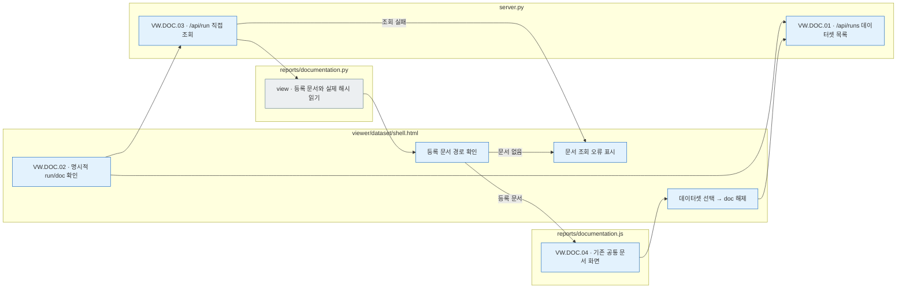
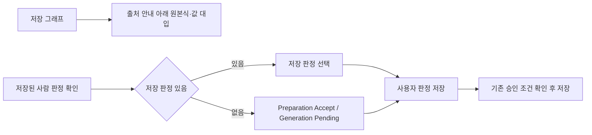
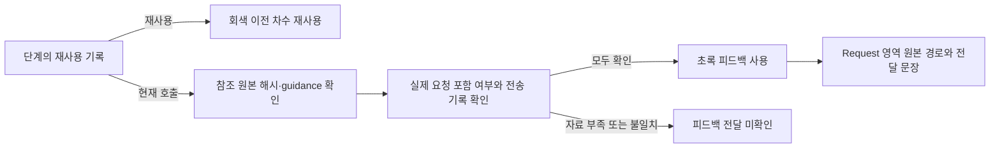
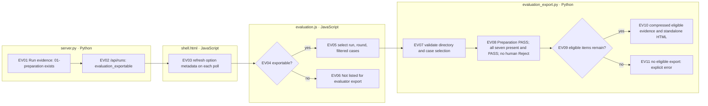
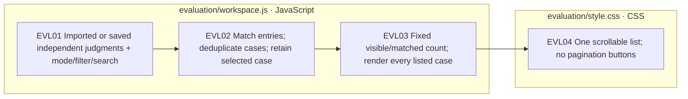

# 데이터셋 뷰어 서버·화면 조립

[전체 소스 구조](../../../../docs/01-dataset/90-operations/05-source-layout.md) · [브라우저 자산](../../../../viewer/dataset/README.md)

`assets.py`는 브라우저 소스를 조립하고, `server.py`는 8893 서버에서 저장된 자료를 제공합니다. 대시보드는 별도 서버(8895)입니다.

## 화면 코드 읽는 순서

이 문서는 `src/finarch/documentation/templates/source-layout/dataset-viewer.md`에서 자동 생성합니다.

1. `menu.js`: Preparation 7개 / Generation 5개 메뉴와 화면 선택.
2. `common/stage-guide.js`: 맨 위의 단계 설명·실제 파일 미리보기, 맨 아래의 결과 파일 트리.
3. `prepare/answer/01-source`부터 `07-human-review`: Preparation 메뉴별 비교 화면.
4. `prepare/generation/IC-value`, `IC-source`, `IC-relation`, `EA`: 유형별 그래프·문장 표시.
5. `prepare/generation/common/01-perturbation`부터 `05-human-review`: 네 유형의 공통 비교·검증·판정 화면. 012의 그래프 비교·색상·검사 근거 표시를 공유하며 선택한 실행의 자료만 사용합니다.
6. `common/saved-calls.js`: 현재 CLI/API의 요청·원응답·응답 검사 연결. `common/raw-exchange.js`: 원문을 펼쳐 표시.
7. `reports/dataset_survey.js`: 데이터셋 조사 결과의 문서 목록·표·출처와 저장 원문. `summary.kind=DATASET_SURVEY`만 표시합니다. 실험 설계 문서 화면은 사용자 요청으로 제거했습니다.
8. `reports/documentation.js`: 현재 파이프라인 문서의 계층 탐색·본문·Mermaid 표시. 생성된 `index.html`을 직접 고치지 않고 이 소스를 수정합니다.
9. `shell.html`: 공통 필터·실행 선택·기존 형식 지원과 위 파일의 포함 위치. `server.py` / `build.py`: 저장 자료 조회.

각 메뉴는 **처리 설명 → 비교·검토 화면 → 결과 파일** 순서입니다. 설명 자체는 실행 완료 증거가 아닙니다. 파일이 없으면 저장 기록 없음으로 표시합니다. 자동 검사는 사람 승인과 구분합니다.

## 차수와 실제 파일 경로

`preparation_paths.py`는 문항 바로 아래 `NN-round`를 찾고, 선택 차수의 파일만 읽도록 연결합니다. 재실행하지 않은 문항은 실제 이전 차수를 표시합니다. `build.py`의 메모리 별칭은 과거 renderer 호환용이며 디스크 파일을 복제·수정하지 않습니다. 코드 `.py`, 요청·원응답·verification 판정·feedback-ref를 실제 경로와 함께 표시합니다. `reports/completion_report.py`는 각 차수의 `run.json`으로 처리 건수를 집계합니다.

최종 취합본이 있는 실행은 `server.py`가 `results/manifest.json`의 해시를 확인하고 `00-input.json`의 `external_knowledge` 두 필드를 읽습니다. `menu.js`는 문제번호 옆에 확인된 외부사용 유형 또는 "외부사용 조건 미충족"을 표시합니다. 이 표시는 최종 취합 기준이며 현재 화면에서 선택한 과거 차수의 새 판정이 아닙니다. 미충족은 비사용의 증명이 아닙니다.

## 화면 갱신

### 명시적 문서 링크 · VW.DOC

`?run=<문서 기록>&doc=<등록된 문서>`를 열면 데이터셋 실행 목록에서 제외된 문서 전용 기록도 공통 문서 화면으로 읽습니다. 데이터셋 선택 목록에는 문서 run을 추가하지 않으며, 문서 열람 중임을 알리는 선택 안내만 표시합니다. 존재하지 않는 문서·문서 기록이 아닌 run은 오류로 표시합니다. 데이터셋을 선택하면 doc 경로를 지우고 일반 문항 화면으로 돌아갑니다.

|번호|실제 파일|책임|
|---|---|---|
|VW.DOC.01|`server.py list_batches()`|데이터셋 목록만 반환. 문서 전용 기록 제외 유지|
|VW.DOC.02|`viewer/dataset/shell.html`의 live controller|명시적 run/doc 유지·직접 run 조회·문서 등록 확인·데이터셋 선택으로 복귀|
|VW.DOC.03|`server.py batch_data()` → `reports/documentation.py view()`|문서 run을 직접 읽고 등록 목록·내용·해시 전달|
|VW.DOC.04|`viewer/dataset/reports/documentation.js`|공통 문서 선택·Markdown·흐름도·원문/해시 표시|
|VW.DOC.05|`assets.py render()`|저장 자료를 읽지 않고 shell과 공통 소스로 단일 index.html 조립|



회색은 파일 조회, 파랑은 Python 서버 또는 브라우저 처리입니다. 분홍색 확장 노드는 없습니다. 조회 실패 후 다음 갱신은 자료만 다시 읽으며 모델 호출·run 재실행을 하지 않습니다. [로컬 검사와 실제 브라우저 확인](../../../../log/viewer-response-grounding-contract-20261003/README.md).

2026-09-17: 첫 조회는 목록·검색용 요약과 선택 문항 상세를 읽고, 번호 전환은 해당 문항 한 건만 요청합니다. 브라우저는 목록을 유지하고 이전 상세는 요약으로 되돌립니다. 전체 집계 갱신 중에도 개별 요청을 시작하며, 늦게 도착한 이전 번호의 응답은 적용하지 않습니다. [구조와 확인 기록](../../../../archive/20260923-documentation-reorganization/docs/55-viewer-speed-and-phi-two.md#2026-09-17-문제별-상세-조회)을 참고하세요.

실행 선택 목록은 서버의 `reports/run` 실제 하위 폴더를 응답 완료 후 10초마다 다시 읽습니다. 선택한 폴더가 사라지면 이전 상세·차수를 비우고 남은 실행을 엽니다. 폴더가 하나도 없으면 빈 화면을 표시합니다. 서버에 연결하지 못한 경우에는 연결 오류와 마지막 자료임을 표시합니다. [실행 목록 조회·삭제 반영](../../../../archive/20260923-documentation-reorganization/docs/62-viewer-menu-layout.md#실행-목록-조회삭제-반영)을 참고하세요.

서버·조회 코드는 이 폴더, 브라우저 소스는 `viewer/dataset`에서 수정합니다. 프로젝트 루트에서 다음 명령을 실행하면 공통 `viewer/dataset/index.html`과 이 README가 갱신됩니다.

```sh
PYTHONPATH=src .venv/bin/python -m finarch.dataset.viewer.assets
```

브라우저를 새로고침하면 변경이 표시됩니다. 결과 폴더별 HTML은 만들지 않으며 원천·생성·판정 파일도 수정하지 않습니다. 화면 조립은 LLM을 호출하지 않습니다.

## 확인

```sh
node src/finarch/dataset/checks/test_viewer_menu.cjs
PYTHONPATH=src .venv/bin/python -m unittest finarch.dataset.checks.test_viewer_server
```

[변경·검사 기록](../../../../outputs/viewer-menu-20260915/README.md)에서 실제 확인 범위와 한계를 읽습니다.

## 메뉴별 실제 소스

- [common/disclosure.js](../../../../viewer/dataset/common/disclosure.js)
- [common/failure-analysis.js](../../../../viewer/dataset/common/failure-analysis.js)
- [common/raw-exchange.js](../../../../viewer/dataset/common/raw-exchange.js)
- [common/saved-calls.js](../../../../viewer/dataset/common/saved-calls.js)
- [common/stage-guide.js](../../../../viewer/dataset/common/stage-guide.js)
- [evaluation.js](../../../../viewer/dataset/evaluation.js)
- [menu.js](../../../../viewer/dataset/menu.js)
- [prepare/answer/01-source/comparison.js](../../../../viewer/dataset/prepare/answer/01-source/comparison.js)
- [prepare/answer/01-source/view.js](../../../../viewer/dataset/prepare/answer/01-source/view.js)
- [prepare/answer/02-review-and-correct/comparison.js](../../../../viewer/dataset/prepare/answer/02-review-and-correct/comparison.js)
- [prepare/answer/02-review-and-correct/view.js](../../../../viewer/dataset/prepare/answer/02-review-and-correct/view.js)
- [prepare/answer/03-calculation/calculation.js](../../../../viewer/dataset/prepare/answer/03-calculation/calculation.js)
- [prepare/answer/03-calculation/evidence.js](../../../../viewer/dataset/prepare/answer/03-calculation/evidence.js)
- [prepare/answer/03-calculation/view.js](../../../../viewer/dataset/prepare/answer/03-calculation/view.js)
- [prepare/answer/04-graph/evidence.js](../../../../viewer/dataset/prepare/answer/04-graph/evidence.js)
- [prepare/answer/04-graph/legacy.js](../../../../viewer/dataset/prepare/answer/04-graph/legacy.js)
- [prepare/answer/04-graph/view.js](../../../../viewer/dataset/prepare/answer/04-graph/view.js)
- [prepare/answer/07-human-review/view.js](../../../../viewer/dataset/prepare/answer/07-human-review/view.js)
- [prepare/answer/common/answer-revision.js](../../../../viewer/dataset/prepare/answer/common/answer-revision.js)
- [prepare/answer/common/external-knowledge.js](../../../../viewer/dataset/prepare/answer/common/external-knowledge.js)
- [prepare/answer/stages.js](../../../../viewer/dataset/prepare/answer/stages.js)
- [prepare/generation/EA/01-perturbation/legacy.js](../../../../viewer/dataset/prepare/generation/EA/01-perturbation/legacy.js)
- [prepare/generation/EA/01-perturbation/review.js](../../../../viewer/dataset/prepare/generation/EA/01-perturbation/review.js)
- [prepare/generation/EA/01-perturbation/view.js](../../../../viewer/dataset/prepare/generation/EA/01-perturbation/view.js)
- [prepare/generation/EA/02-generate-text/diff.js](../../../../viewer/dataset/prepare/generation/EA/02-generate-text/diff.js)
- [prepare/generation/EA/02-generate-text/view.js](../../../../viewer/dataset/prepare/generation/EA/02-generate-text/view.js)
- [prepare/generation/EA/common.js](../../../../viewer/dataset/prepare/generation/EA/common.js)
- [prepare/generation/IC-relation/01-perturbation/formula.js](../../../../viewer/dataset/prepare/generation/IC-relation/01-perturbation/formula.js)
- [prepare/generation/IC-relation/01-perturbation/legacy.js](../../../../viewer/dataset/prepare/generation/IC-relation/01-perturbation/legacy.js)
- [prepare/generation/IC-relation/01-perturbation/view.js](../../../../viewer/dataset/prepare/generation/IC-relation/01-perturbation/view.js)
- [prepare/generation/IC-source/01-perturbation/view.js](../../../../viewer/dataset/prepare/generation/IC-source/01-perturbation/view.js)
- [prepare/generation/IC-source/02-generate-text/comparison.js](../../../../viewer/dataset/prepare/generation/IC-source/02-generate-text/comparison.js)
- [prepare/generation/IC-source/02-generate-text/links.js](../../../../viewer/dataset/prepare/generation/IC-source/02-generate-text/links.js)
- [prepare/generation/IC-source/02-generate-text/segments.js](../../../../viewer/dataset/prepare/generation/IC-source/02-generate-text/segments.js)
- [prepare/generation/IC-value/01-perturbation/view.js](../../../../viewer/dataset/prepare/generation/IC-value/01-perturbation/view.js)
- [prepare/generation/IC-value/02-generate-text/view.js](../../../../viewer/dataset/prepare/generation/IC-value/02-generate-text/view.js)
- [prepare/generation/common/01-perturbation/comparison.js](../../../../viewer/dataset/prepare/generation/common/01-perturbation/comparison.js)
- [prepare/generation/common/01-perturbation/view.js](../../../../viewer/dataset/prepare/generation/common/01-perturbation/view.js)
- [prepare/generation/common/02-generate-text/comparison.js](../../../../viewer/dataset/prepare/generation/common/02-generate-text/comparison.js)
- [prepare/generation/common/02-generate-text/details.js](../../../../viewer/dataset/prepare/generation/common/02-generate-text/details.js)
- [prepare/generation/common/02-generate-text/diff.js](../../../../viewer/dataset/prepare/generation/common/02-generate-text/diff.js)
- [prepare/generation/common/02-generate-text/evidence.js](../../../../viewer/dataset/prepare/generation/common/02-generate-text/evidence.js)
- [prepare/generation/common/02-generate-text/legacy-panel.js](../../../../viewer/dataset/prepare/generation/common/02-generate-text/legacy-panel.js)
- [prepare/generation/common/02-generate-text/legacy.js](../../../../viewer/dataset/prepare/generation/common/02-generate-text/legacy.js)
- [prepare/generation/common/03-validation/audit.js](../../../../viewer/dataset/prepare/generation/common/03-validation/audit.js)
- [prepare/generation/common/03-validation/view.js](../../../../viewer/dataset/prepare/generation/common/03-validation/view.js)
- [prepare/generation/common/05-human-review/view.js](../../../../viewer/dataset/prepare/generation/common/05-human-review/view.js)
- [prepare/generation/common/menu.js](../../../../viewer/dataset/prepare/generation/common/menu.js)
- [reports/coefficient_policy.js](../../../../viewer/dataset/reports/coefficient_policy.js)
- [reports/dataset_survey.js](../../../../viewer/dataset/reports/dataset_survey.js)
- [reports/failure_review.js](../../../../viewer/dataset/reports/failure_review.js)
- [reports/finance_preflight.js](../../../../viewer/dataset/reports/finance_preflight.js)
- [reports/graph_syntax_samples.js](../../../../viewer/dataset/reports/graph_syntax_samples.js)
- [reports/original_baseline.js](../../../../viewer/dataset/reports/original_baseline.js)
- [reports/quality_api_check.js](../../../../viewer/dataset/reports/quality_api_check.js)
- [reports/quality_report.js](../../../../viewer/dataset/reports/quality_report.js)
- [reports/response_screen.js](../../../../viewer/dataset/reports/response_screen.js)
- [reports/source_pair_review.js](../../../../viewer/dataset/reports/source_pair_review.js)
- [vendor/mermaid.min.js](../../../../viewer/dataset/vendor/mermaid.min.js)

## 04-graph 외부 정보·edge 분류

`prepare/answer/04-graph/evidence.js` → `view.js` → `shell.html`의 그래프 그리기 순서로 읽습니다. 외부 정보는 사각형이며 세 근거 분류 밖의 edge는 오류로 표시합니다. 기존 미분류 기록을 추정하여 채우지는 않습니다. [동작과 현재 범위](../../../../archive/20260923-documentation-reorganization/docs/62-viewer-menu-layout.md#ge01-그래프-외부-근거-표시), 검사 로그 `log/viewer-graph-evidence-20260915.log`를 참고하세요.

## Preparation 안내 접기

실제 차수·최종 생성 개수 표·처리 현황·차수별 실행 결과 표를 **Preparation 차수 안내** 하나로 접습니다. `menu.js`가 두 표를 같은 내용 영역에 넣고 `common/disclosure.js`가 기존 `preparation-round` 키로 상태를 저장합니다. 다른 문제·실행·새로고침에도 유지합니다. 별도 처리 현황 접기 버튼은 없습니다.

차수별 실행 결과의 Preparation·Generation 제목 오른쪽에는 소요시간과 동시처리 문항 한도, 실행 중이면 현재 처리 문항 수를 표시합니다. `reports/completion_report.py`가 해당 실행의 `timing.json`과 `queue.json`을 읽고 `shell.html`이 표시합니다. 현재 설정으로 과거 실행을 추정하지 않으며 기록이 없으면 `기록 없음`입니다. Generation 동시처리도 LLM 호출 수가 아닌 문항 단위입니다.

## 계산 화면 표시

03-calculation은 중복된 검증 전 POT·LLM 안내 상자를 표시하지 않습니다. 보존 파일은 하단 결과 파일에서 읽습니다. 기본 코드는 계산 본문이며 전체 실행 코드 보기·복사는 유지합니다. 근거별 원문·표·코드 토큰은 같은 고유 색으로 강조하고 중간 계산 줄은 노란색을 유지합니다. 검사 로그: `log/viewer-calculation-display-20260915.log`.

## 화면 영역 테두리

`menu.js`는 차수 안내 제목·전체 내용을 `div.preparation-overview`에, 문제번호·오류 개수·유형 선택·단계 메뉴를 `div.problem-selection`에 담습니다. `shell.html`의 `.viewer-group`이 흰 배경과 테두리를 표시합니다. 차수별 결과도 흰 배경이며 기존 접힘 상태는 유지합니다.

## 단계 안내·필터 접기

`common/stage-guide.js`의 단계 설명 전체와 `shell.html`의 필터 패널을 각각 접을 수 있습니다. `common/disclosure.js`의 `stage-guide`, `filters` 키로 상태를 따로 저장하며 문제·단계 변경과 새로고침에도 유지합니다. 필터를 접어도 선택 조건은 그대로 적용됩니다.

## 원본 검토 화면

02-review 비교 화면은 원본 검토 결과와 보정 비교를 표시합니다. 중복된 프롬프트 버튼·현재 차수 결과 JSON·Q/C/A 입력 JSON 및 경로 줄은 제거했습니다. 저장 파일은 단계 설명의 미리보기와 하단 결과 파일에서 확인합니다.

## LLM 단계 안내·호출 보기

`common/stage-guide.js`는 LLM 처리 설명을 보라색으로 표시하고 안내 아래에 현재 단계의 저장 프롬프트·입출력 보기 버튼을 제공합니다. `common/saved-calls.js`가 단계 범위 내 원기록을 연결하며 호출 기록이 없으면 없음을 알립니다. 재사용 문장 생성은 저장된 원호출 연결을 따릅니다. 05-verification의 중복 JSON 목록은 제거하고 호출 버튼을 안내 아래로 이동했습니다. 실제 파일은 하단 결과 파일에서 읽습니다.

LLM 호출 보기 버튼은 보라색입니다. `common/raw-exchange.js`의 Response는 `jsonViewer`로 표시하여 JSON 문법 색상·접기·펼치기를 지원합니다. 원문 문자열을 그대로 전달하므로 원문 복사는 보존되며 잘못된 JSON은 원문으로 표시합니다.


## 그래프 수식과 사람 판정 기본 선택 (2026-09-15)

`prepare/answer/04-graph/view.js`는 저장된 그래프에서 원본 계산식과 값 대입식을 읽어 node 출처 안내 바로 아래에 표시합니다. `prepare/answer/07-human-review/view.js`와 `prepare/generation/common/05-human-review/view.js`는 판정 선택과 저장을 분리합니다. 저장된 판정을 우선 선택하며 미저장 Preparation은 Accept, Generation은 Pending입니다. 화면의 기본 선택만으로 판정이 저장되지는 않으며 기존 승인 조건을 유지합니다.



04-graph의 `prepare/answer/04-graph/view.js` 표시 순서: 질문 → 출처 안내·수식 → 그래프 → 원본 정답·골드 → Python 코드·선택 노드 상세. 골드 값은 저장된 원본 정답을 그대로 표시합니다.

사람 검토 메뉴는 저장 판정 또는 오류 여부를 반영한 기본 선택을 읽어 Pending은 노랑, APPROVED는 하늘색, REJECTED는 빨강으로 표시합니다. `menu.js`에서 상태 클래스를 지정하고 `shell.html`에서 활성 탭에도 같은 색상을 유지합니다. 입력 기본 선택은 저장 판정과 구분합니다.

기본 판정 보정: 저장 판정을 우선하며, 미저장 Preparation은 현재 run 상태 FAIL/ERROR이면 Reject, PASS이고 승인 차단 사유가 없을 때만 Accept, 그 외 Pending입니다. Generation은 자동 검사 FAIL/ERROR이면 Reject, 그 외 Pending입니다. 이전 실패 파일을 일괄 검색하지 않고 현재 판정을 사용합니다.

그래프 연결 강조: `04-graph/view.js`는 원본식·값 대입 토큰에 저장 node ID를 연결합니다. `shell.html`의 drawLinkedGraph는 노드·코드·수식의 hover/focus → 입력 의존성 추적 → 그래프 경로·원본식·해당 코드 줄 강조를 수행합니다. 클릭은 선택을 유지하고 마우스가 벗어나면 유지한 선택으로 복원합니다. 변수는 기존 고유 색상, 연산식 토큰은 노랑으로 표시합니다.

`menu.js`의 reviewDefaultDecision을 메뉴와 판정 화면이 함께 사용합니다. 선택 변경 → updateReviewTabColor → 탭 배경 갱신으로 연결하며, 저장 전 선택에도 같은 색상을 표시합니다. 사람 검토 탭에는 일반 실패 테두리 클래스를 중복 적용하지 않습니다.

## 완료 문항 목록

문제번호 옆 숫자는 Preparation 통과 차수이며 ER/ED 배지는 완료 POT에 기록된 외부 공식/외부 데이터입니다. 출처와 통과 차수 체크박스로 검색할 수 있습니다. [표시 기준](../../../../archive/20260923-documentation-reorganization/docs/71-node-provenance.md#vl02-완료-문항의-목록-표시와-필터)을 참고하세요.

외부지식 문항은 선택 영역과 Q/C의 저장된 요구 문구를 강조하며, 계산 수식 위에 외부 공식과 출처를 표시합니다. Accept의 이유는 선택, Reject/Pending의 이유는 필수입니다.

2026-09-16: shell.html의 외부지식 문항 선택 영역과 외부지식 안내 영역은 옅은 회색 배경(#f5f6f7), 회색 테두리(#cbd2d8)를 사용합니다. 안내 글씨 색상은 유지합니다.

## 실제 feedback 표시 기준 (2026-09-16)

`common/saved-calls.js`는 호출의 feedback-ref, 해시가 일치하는 원본 guidance, 저장된 실제 요청의 instructions(CLI는 prompt), 응답/전송 기록을 확인합니다. 원본 guidance 전체가 실제 요청에 포함된 경우만 초록 `피드백 사용`입니다. 자료가 부족하거나 참조 해시가 다르면 `피드백 전달 미확인`입니다. 차수 번호와 파일 존재만으로 사용을 판정하지 않습니다. `run.json.reused_steps` 및 차수 재사용 기록은 회색으로 표시합니다.

`menu.js` 단계 버튼 → `common/stage-guide.js` 개별 LLM 작업 → `common/raw-exchange.js` Request 영역으로 연결합니다. Request 영역은 적용한 guidance, feedback-ref 경로/원본, 실제 전송에 포함된 문장을 보여줍니다. Generation 호출은 자체 피드백 자료만 사용하며 미확인 자료를 Preparation 기록으로 대신하지 않습니다.




동일 run 실패건 재검토: docs/12-pipeline-code-guide.md의 동일 run 실패건 재검토 절을 따릅니다. 실패 대상 snapshot·기존 schedule 호출·stage-history 보존·재검토 별도 집계·Preparation 주황/Generation 빨강 UI를 적용했습니다.

재검토 대상별 결과의 펼침 상태는 실행 이름·Preparation/Generation·재검토 작업 ID를 키로 저장합니다. shell.html의 pipelineRoundSummary → common/disclosure.js의 viewerDisclosure → 메모리/localStorage 저장·복원 순서로 자동 갱신과 페이지 재로딩에도 유지합니다. 최초 상태는 접힘이며 서로 다른 작업은 독립적으로 유지됩니다.

실패건 재검토: menu.js의 failedRecheckButton → confirmFailedRecheck(실행·영역·건수·비용 안내) → Yes일 때만 POST /api/recheck. No·Escape·닫기는 요청 없이 취소하며 기본 포커스는 No입니다. Preparation과 Generation에 공통 적용합니다.

그래프 범례: evidence.js의 graphNodeShape/renderGraphLegend를 기본 그래프와 변경 비교 그래프에서 공유합니다. 문맥 입력은 원, 외부 규칙은 파란 사각형, 외부 데이터는 빨간 사각형, 계산 변수·연산·상수는 육각형입니다. 직접 변경한 노드는 우선하여 보라색 오각형으로 표시하며 단순 후속 값 변화와 구분합니다. 혼합 외부 유형은 외부 데이터 색상을 우선합니다.

사람 검토: 자동 검사 오류가 있어도 검토자가 Accept를 선택하고 검토 항목을 확인하면 판정을 저장할 수 있습니다. 자동 오류는 보존되며 다음 제작 단계의 검증은 별도로 적용됩니다.

실패 해석 표는 문제 번호의 숫자 오름차순으로 표시합니다. 같은 문제는 유형·차수 순으로 정렬하며, 진행 중 부분 결과와 이전 해석에도 동일하게 적용합니다. 저장된 원본 결과 배열은 변경하지 않습니다.

계산 그래프 위의 **크게 보기**를 누르면 브라우저 화면 크기의 팝업으로 볼 수 있습니다. 팝업에서도 범례·확대·축소·전체 맞춤·이동을 사용할 수 있으며 **닫기** 또는 Escape로 돌아옵니다.

Generation에서는 왼쪽 ‘prep 탈락건 포함’이 기본 해제됩니다. 체크하면 탈락 문항도 다시 보이며 Preparation으로 돌아오면 기본 체크됩니다. 목록의 오렌지는 Preparation 탈락, 빨강은 Generation 실패입니다. 크게 보기에서 지정한 확대 배율은 유지되며, 변경 노드는 원본 가까이에 배치됩니다.

변경 그래프에서는 보라색 perturb 노드를 원본 노드 가까이에 표시합니다. Generation 안내는 실제 폴더·파일명과 설명으로 표시하며, 현재 유형과 중복되는 단일 후보 선택 메뉴는 표시하지 않습니다.

Generation 하단 결과 파일은 단계 폴더를 펼치는 트리로 제공합니다. JSON 제목 옆에는 원본 파일 경로를 표시하고, 파일 내부 일부를 표시할 때는 JSON 위치도 함께 표시합니다.

IC-relation은 원본 계산과 관계 적용 계산의 수식을 나란히 보여 줍니다. 수식·그래프·Python 코드를 가리키거나 선택하면 연결된 계산을 강조합니다. 아래 그래프는 좌우 보기(기본)와 위아래 보기를 전환할 수 있습니다.

IC-relation 수식은 원본 아래에 관계 적용 계산을 표시합니다. Generation의 오류 유형 버튼은 선택 여부와 관계없이 굵은 빨간 테두리로 표시합니다.

뷰어 로딩: JSON 경로는 현재 화면의 객체를 한 번 색인하여 찾습니다. 문항·화면 교체 시 색인을 초기화합니다. 자동 확인은 응답 완료 후 10초 간격이며 숨겨진 화면에서는 멈춥니다. 문항·차수 변경 중 도착한 이전 응답은 적용하지 않습니다. 서버는 여전히 선택 문항의 전체 유형 상세와 실행 요약을 반환하므로 큰 실행의 최초 로딩 비용은 남아 있습니다.

EA 그래프는 원본 계산과 근거 삭제 후 계산을 좌우로 표시하며 위아래 보기로 전환할 수 있습니다. 삭제 근거 문단 안에서는 저장된 원문 위치로 대상 표현만 강조합니다. 동일한 fact_id의 양쪽 노드는 빨간 테두리로 표시하고, 근거·노드의 마우스/키보드 초점/클릭을 함께 강조합니다. 위치나 대응 노드가 없으면 미확인 안내를 표시합니다.

키보드 단축키 안내는 기본 접힘 상태이며 제목을 눌러 펼칩니다. 안내를 접어도 단축키는 그대로 작동합니다.

사람 판정 단축키: 1 Accept 승인, 2 Reject 제외, 3 Pending 검토 대기 선택. X는 판정 저장입니다. 숫자 키는 선택만 변경하며, 저장 필수 조건과 입력란·대화상자 보호를 유지합니다. Preparation과 Generation에 동일하게 적용합니다. menu.js가 각 판정 라디오 선택 이벤트를 호출합니다.

Generation 단계별 표시: 02 문장 생성은 문장 비교를 표시하며 프롬프트 버튼은 단계 안내 안에서 제공합니다. 03 검증은 문장 비교를 중복 표시하지 않고 의미 검사 결과를 표시합니다. 05 사람 검토는 문장 비교·의미 검사·검증 원문 버튼을 중복 표시하지 않고 판정 양식을 제공합니다. common/menu.js에서 단계별 표시 함수를 분리하며 결과 파일 트리는 유지합니다.

문항 이동 속도: 같은 실행·차수에서 문항을 바꾸면 detail_only=1로 상세와 목록만 요청합니다. 실행 전체 통계는 기존 값을 유지하고 10초 자동 확인에서 갱신합니다. 판정 저장 후·실행/차수 변경·첫 로딩은 전체 응답을 사용합니다. 문항 상세를 누적 캐시하지 않습니다. server.py의 batch_data는 빠른 요청에서 전체 실패 해석·완료 보고·게이트 집계를 건너뛰며, shell.html은 현재 실행 통계와 새 문항 자료를 합칩니다.

문제 목록 앞의 저장 판정: ✅ 승인, ❌ 제외, 🟡 검토 대기. 구간에 관계없이 문제의 Preparation·Generation 저장 판정을 모아 표시합니다. 서로 다른 판정은 이모지를 함께 표시하고, 각 이모지의 툴팁에서 해당 유형을 확인합니다. 미저장 기본값은 표시하지 않습니다. shell.html의 savedNavigationDecisions가 저장 파일/유형별 목록 요약에서 판정을 읽습니다.

07/05 사람 검토의 전체 판정 저장 (X)은 현재 선택한 판정·검토자·이유·확인 항목을 7개 Generation 유형에 저장합니다. 소문자 x는 현재 판정만 저장합니다. 7개 검토 자료가 모두 있어야 활성화하며 각 유형의 실제 차수·스냅샷으로 기존 저장 API를 호출합니다. 중간 오류는 완료 건수와 중단 이유를 표시합니다. Preparation 자체 판정은 별도입니다. menu.js의 appendBulkReview가 공통 처리를 담당합니다.

v 키는 현재 Generation 유형의 05-human-review로 바로 이동합니다. Preparation에서는 첫 사용 가능한 Generation 유형으로 이동합니다. 생성 자료가 없거나 입력란 작성·대화상자 표시 중이면 이동하지 않습니다.

QI05 quality run: `quality_scope.json`이 있는 실행은 저장된 624건 보고서를 읽기 전용 표로 표시합니다. `reports/quality_report.py`는 저장 JSON·manifest만 읽고, `reports/quality_report.js`는 감사 3축·승인 출처·독립 검토 기록·EA 상태를 분리합니다. 원본 링크는 manifest에 등록된 경로와 해시가 맞을 때만 `/api/quality-source`로 읽습니다. GET에서 분석·승인·모델 호출을 하지 않습니다. 기존 QI01은 새 quality run의 관련 결과 링크로 연결하며 수정하지 않습니다.

QI06 읽기 전용 보고서는 `reports/response_screen.py`와 `reports/response_screen.js`가 저장된 `response_screen.json`을 표시합니다. 공통 실행 선택에서 `20260916-review-v2`를 선택합니다. 실행 상태·독립 cue·UNRESOLVED·원자료 hash 링크를 제공하며 GET에서 분석/쓰기/API 호출을 하지 않습니다.

QI02 `reports/original_baseline.py`/`.js`는 `private/originals.json`을 연구자용으로 읽습니다. 실행 선택 `20260916-original-baseline-v1`: 원문92·변형624·실행보류·NOT_REVIEWED와 hash 근거를 표시합니다. public 모델 입력과 구분합니다.

QI03 `reports/source_pair_review.py`/`.js`는 `pair_manifest.json`의 SOURCE176·정확 매칭·양쪽 상태·cue·미평가를 읽습니다. 실행 선택 `20260916-source-pairs-v1`에서 확인하며 분석/쓰기 없이 hash 근거만 연결합니다.

QI04 `reports/coefficient_policy.py`/`.js`는 `coefficient-policy.json`의 실제 program계획8건·선택계수/SHA/거절·지원제한을 읽습니다. 공통 실행 `20260916-coefficients-v1`; GET에서 프로그램 실행이나 모델 호출을 하지 않습니다.

`reports/quality_api_check.py`/`.js`는 `quality-api-check.json`의 실제4호출·감사/EA차단·비용 및 prompt/schema/raw/usage hash 링크를 읽습니다. 실행 `20260916-luna-low-quality-v2`; GET에서 API를 호출하지 않습니다.

Preparation 단축키 보정: Q/E 문항 이동 시 Preparation과 현재 단계를 유지합니다. V는 Preparation 07, Generation 05 사람 검토로 이동합니다. 문자 단축키는 물리 키 위치로 판별하여 한글 자판에서도 동일하게 작동합니다. 입력 중·대화상자 보호는 유지합니다.

## Annotation 관리자

[공통 관리자 화면](http://127.0.0.1:8893/annotation/)은 `annotation/YYYYMMDD/`의 JSON을 읽습니다. [Annotation 코드](annotation)에서 원본 보존·확정 가능한 형식 보완·현재 로그/요약 저장·유형별 Cohen/Fleiss κ를 처리합니다. [화면](../../../../viewer/dataset/annotation/README.md)은 문제별 7행에 n명 판정·주석을 비교하며 기존 키 위치를 재사용합니다. [요구·파일 책임·실제 흐름](../../../../docs/01-dataset/90-operations/04-viewer.md) · [입력 안내](../../../../annotation/README.md).

## 평가자 배포

`evaluation_export.py`는 Preparation PASS이며 Generation **7유형 모두 존재하고 자동 검증 PASS, 어느 유형에도 Reject가 없는 문항**만 단일 HTML로 내보냅니다. 한 유형이라도 실패·미평가·누락·Reject이면 문항 전체를 제외하며, Preparation Reject도 제외합니다. 사람의 Accept는 필수가 아니며 미판정·Pending도 자동 PASS이면 포함합니다. 선정 단위는 항상 문항의 7유형 묶음입니다(`ALL_SEVEN_AUTOMATIC_PASS_NO_HUMAN_REJECTION`). Reject 값과 저장 위치는 기존 `03-release/export_policy.py`를 재사용합니다. 화면 필터와 독립된 서버 검사이며 원본 판정을 변경하지 않습니다. 선정 기준의 변경은 사용자 확인 후 적용합니다.

`evaluation.js`는 서버 없는 평가·임시 저장·결과 JSON·Import를 담당합니다. Export 목록은 실행 이름 형식으로 제한하지 않습니다. `server.py`의 `/api/runs`가 실제 `01-preparation` 폴더 존재 여부를 `evaluation_exportable`로 전달하고, `shell.html`의 실행 옵션을 통해 `evaluation.js`가 표시합니다. 따라서 `20261003-concat-001`처럼 원본 단계 자료를 포함한 합본도 기존 평가 화면으로 내보냅니다. 결과 합본 파일만 있고 단계 자료가 없는 실행은 제외합니다. [사용 방법·책임·실제 흐름](../../../../docs/01-dataset/90-operations/04-viewer.md).



배포 HTML은 평가자 전용 화면입니다. `evaluation/workspace.js`가 문제별·유형별 목차와 판정 bullet, 큰 Q 질문, 원본/변경 수식, 숫자패드 1·2·3 즉시 판정과 다음 미평가 이동을 제공합니다. Q/E는 문제 번호, A/D는 같은 문제의 유형을 이동합니다. **원본 보기**에서 현재 문제·유형의 기존 단계 화면을 같은 HTML 안에 열고, 돌아오면 원래 평가 항목과 주석·판정을 유지합니다. `menu.js`와 기존 단계 표시 함수를 재사용하며 원본 보기의 판정은 읽기 전용입니다. `evaluation/review.js`는 변경 문장·원문 맥락과 출처 색상을, `evaluation/graph.js`는 기존 모양을 유지한 간략 A/B 그래프를 전체 맞춤으로 표시합니다. 단일 변수 전달만 합치고 실제 계산·조건 연결은 보존합니다. 분석 필터·차수 안내·키보드 도움말·결과 파일 트리는 평가 첫 화면에서 제외합니다. 이름·임시 저장·결과 Export·Import는 최상단에 있으며, 제작 판정과 독립된 JSON을 사용하고 상세는 한 문항씩 압축 해제합니다. `evaluation/style.css`는 배포 화면에만 적용합니다.

`evaluation/graph.js`는 A·B 최종 출력의 수치가 다르면 빨간 안내와 각 최종 노드의 `≠ B` / `≠ A` 표시를 제공합니다. 부동소수점 계산 잡음은 상대 허용 오차 `1e-12`로 비교하며, EA의 근거 없음·계산 불가는 숫자 0이나 수치 불일치로 처리하지 않습니다. 같은 답에는 표시하지 않으며 검증 판정은 변경하지 않습니다.

목록 표시(EVL01~04): `evaluation/workspace.js`는 판정 필터·문제 번호 검색·문제별/유형별 선택을 적용한 문항을 중복 없이 모두 표시합니다. 검색창 아래 고정 위치에 실제 표시 수와 배포본 전체 문항 수를 표시하고 앞/다음 목록 버튼은 사용하지 않습니다. `evaluation/style.css`의 목록 영역만 세로 스크롤합니다. 기존 현재 선택 문항 유지 동작으로 필터 밖 문항이 추가 표시될 때는 실제 목록 수와 필터 일치 수를 구분합니다. Import·판정 저장·유형/필터/검색 변경마다 수량을 다시 계산하며 제작 데이터와 Export 선정 기준은 변경하지 않습니다.



## Dataset / Experiments 작업 공간

데이터셋 배포 화면은 `viewer/dataset`, 실험 화면 파일은 `viewer/experiments`에서 관리합니다. `assets.py`와 `build.py`는 `viewer/dataset/index.html`을 기준으로 조립·조회합니다. [폴더 책임·흐름](../../../../viewer/README.md).

## 화면 언어 · UI-L01~06

[공통 한·영 표시 코드](../../../../viewer/shared/README.md)는 라이브 Dataset과 평가자 HTML에서 같은 사전을 사용합니다. `assets.py`는 `viewer/shared`를 허용된 include 대상으로 조립하고, `evaluation_export.py`는 선택 언어와 자산을 HTML에 포함합니다. `server.py`는 Annotation에 `/i18n.js`, `/i18n.css`만 추가 제공합니다. `annotation/review_export.py`도 자산을 인라인합니다. 질문·본문·원응답·사용자 입력과 제작 파일을 바꾸지 않습니다. [검사 로그](../../../../log/viewer-i18n-20261002/README.md).

## 최종 합본의 검증 화면

`03-release/concat_results.py.materialize_pipeline()`은 문항별 원천에 맞는 Preparation·Generation 단계 폴더를 합본 run에 복제합니다. `server.py`, `shell.html`, `menu.js`의 기존 단계 화면을 그대로 사용합니다. 별도의 간략 뷰어는 만들지 않습니다. 복제 파일에 대한 판정 저장은 합본 run에 기록되며 원천 run은 보존됩니다. 데이터셋 목록은 보고서 폴더를 제외하고 run 이름으로 역순 정렬합니다.
