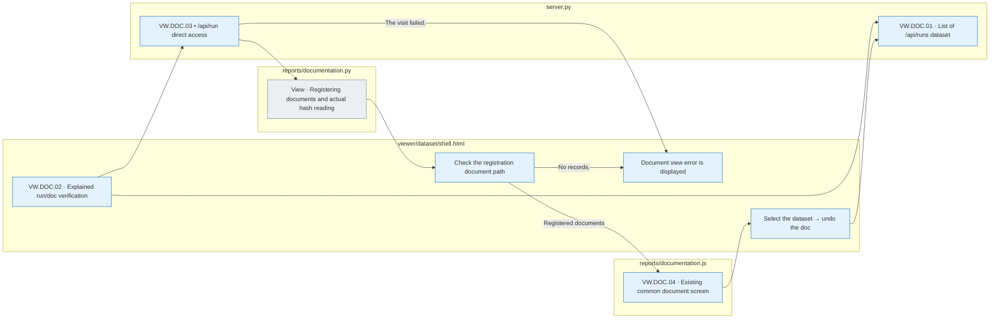
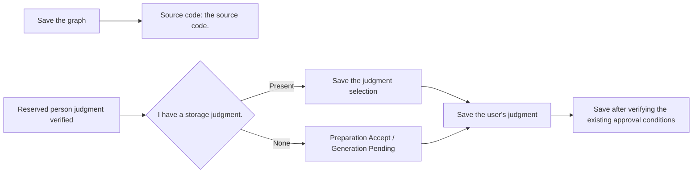
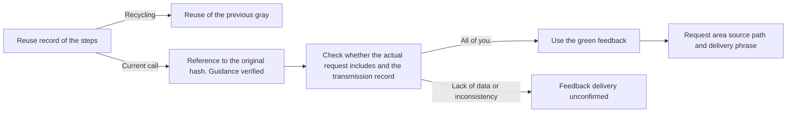
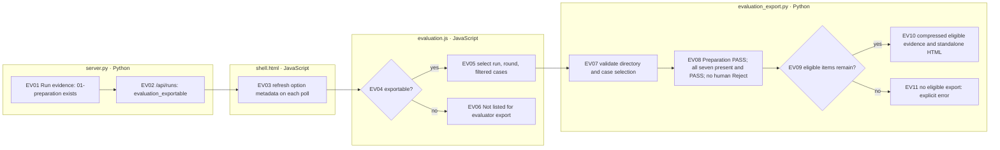
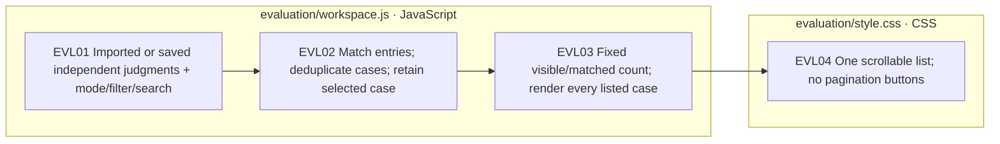

# Data set viewer server screen assembly

[The whole source structure](../../../../docs/01-dataset/90-operations/05-source-layout.md) · [Browser assets](../../../../viewer/dataset/README.md)

`assets.py`And then we're going to build a browser source, `server.py` 8893 It provides data stored on the server.8895).

## The order in which the screen code is read.

This document is generated from `src/finarch/documentation/templates/source-layout/dataset-viewer.md`.

1. `menu.js`: Preparation 7items / Generation 5items menu and screen selection.
2. `common/stage-guide.js`Explain the steps above: Preview of the actual file, result file tree below.
3. `prepare/answer/01-source`through `07-human-review`: Preparation comparison screen by menu.
4. `prepare/generation/IC-value`, `IC-source`, `IC-relation`, `EA`: Type-by-type graphs; field indication.
5. `prepare/generation/common/01-perturbation`through `05-human-review`Four types of common comparison, verification, judgment screen. 012We share the graph comparison, color, and analysis basis markers and we only use the selected execution data.
6. `common/saved-calls.js`: Current CLI/API requests; raw response ·response check connection. `common/raw-exchange.js`: Expand the printing mark.
7. `reports/dataset_survey.js`: List of documents from data set survey results; source and storage of source. `summary.kind=DATASET_SURVEY`The experimental design document screen was removed at user's request.
8. `reports/documentation.js`: Currently, the pipeline document has a layered search; script; Mermaid display. `index.html`I'm not fixing it myself, I'm fixing this sauce.
9. `shell.html`: Common filters; action selections; exist format support and inclusion location of the above files. `server.py` / `build.py`: Storage data consultation.

Each menu is **Processing description → comparison; screenshot → result file** It's in order. The description itself is not proof of completion. Without the files, it's shown as no storage record.

## The chart and the actual file path.

`preparation_paths.py`The following case is `NN-round`So you can find the selected variable and connect it to read only the file of the chosen variable. `build.py`The memory designation is past renderer compatible and does not copy-correct the disk file. `.py`Request, raw response, verification judgment, feedback-ref, along with the actual path. `reports/completion_report.py`is the number of each `run.json`And then we calculate the drainage.

The execution with the final copy is the `server.py` `results/manifest.json`Check the chart of the `00-input.json` `external_knowledge` I read two fields. `menu.js`This indicates the external use type or "external use condition insufficiency" that is identified next to the problem number. This indicates a final fit criterion and is not a new judgement of the past variable selected on the screen.

## The screen is updated.

### Explanatory document links to VW.DOC

`Run=<text sub="clublinks" start="1058.066" dur="0.067"> and document=<text> is included.`When you open the Open Access Access, you will also read the dedicated document record that is not included in the data set execution list as a common document screen. The Data Set selection list does not add a document run, but only shows the selection instructions that indicate that the document is loaded. A run that is not an existing document/text record is shown as an error. Selecting the data set will delete the doc path and return to the normal case screen.

|ID|Actual file|Responsibility|
|---|---|---|
|VW.DOC.01|`server.py list_batches()`|Returns only the list of the dataset.|
|VW.DOC.02|`viewer/dataset/shell.html`The live controller|Keep the explicit run/doc; direct run check; check the mail registration; return to the dataset option|
|VW.DOC.03|`server.py batch_data()` → `reports/documentation.py view()`|Read the document run directly and register the list, input, and output|
|VW.DOC.04|`viewer/dataset/reports/documentation.js`|Common document selection Markdown flow also source/reference|
|VW.DOC.05|`assets.py render()`|Collect a single index.html as a common source without reading the stored data|



The gray is file browsing, the blue is Python server or browser processing. There are no pink extension nodes. After the browsing failure, the next update reads the data and does not re-run the model call-run.](../../../../log/viewer-response-grounding-contract-20261003/README.md).

2026-09-17First consultation: list: Search summary and select phrase readings, and number switching only requests one case. The browser keeps the list and returns the previous details to the summary. It starts individual requests during the entire statistical update, and the response to the previous number that arrived late does not apply.](../../../../archive/20260923-documentation-reorganization/docs/55-viewer-speed-and-phi-two.md#2026-09-17-%EB%AC%B8%EC%A0%9C%EB%B3%84-%EC%83%81%EC%84%B8-%EC%A1%B0%ED%9A%8C)And I want you to look at this.

The list of execution options is the list of the `reports/run` After completing the response to the actual subfolder 10It reads every second. When the selected folder disappears, it empties the previous detail bar and opens the remaining execution. If there's no folder, it shows the blank screen. If you're not connected to the server, it shows a connection error and the last data.](../../../../archive/20260923-documentation-reorganization/docs/62-viewer-menu-layout.md#%EC%8B%A4%ED%96%89-%EB%AA%A9%EB%A1%9D-%EC%A1%B0%ED%9A%8C%EC%82%AD%EC%A0%9C-%EB%B0%98%EC%98%81)And I want you to look at this.

The server-side code is this folder, the browser source, `viewer/dataset`If you run the following command from the project root, you can run the common command from the root. `viewer/dataset/index.html`And this README is updated.

```sh
PYTHONPATH=src .venv/bin/python -m finarch.dataset.viewer.assets
```

When you re-click your browser, you see changes. The result is that you don't create a folder-by-folder HTML, you don's edit the source, the bios, the judgment files, and the screen assembly doesn't call for an LLM.

## Check

```sh
node src/finarch/dataset/checks/test_viewer_menu.cjs
PYTHONPATH=src .venv/bin/python -m unittest finarch.dataset.checks.test_viewer_server
```

[Transformation and inspection records](../../../../outputs/viewer-menu-20260915/README.md)Read the actual verification range and limits.

## The actual source for each menu.

- [common/disclosure.js](../../../../viewer/dataset/common/disclosure.js)
- [common/failure-analysis.js](../../../../viewer/dataset/common/failure-analysis.js)
- [common/raw-exchange.js](../../../../viewer/dataset/common/raw-exchange.js)
- [common/saved-calls.js](../../../../viewer/dataset/common/saved-calls.js)
- [common/stage-guide.js](../../../../viewer/dataset/common/stage-guide.js)
- [evaluation.js](../../../../viewer/dataset/evaluation.js)
- [menu.js](../../../../viewer/dataset/menu.js)
- [prepare/answer/01-source/comparison.js](../../../../viewer/dataset/prepare/answer/01-source/comparison.js)
- [prepare/answer/01-source/view.js](../../../../viewer/dataset/prepare/answer/01-source/view.js)
- [prepare/answer/02-review-and-correct/comparison.js](../../../../viewer/dataset/prepare/answer/02-review-and-correct/comparison.js)
- [prepare/answer/02-review-and-correct/view.js](../../../../viewer/dataset/prepare/answer/02-review-and-correct/view.js)
- [prepare/answer/03-calculation/calculation.js](../../../../viewer/dataset/prepare/answer/03-calculation/calculation.js)
- [prepare/answer/03-calculation/evidence.js](../../../../viewer/dataset/prepare/answer/03-calculation/evidence.js)
- [prepare/answer/03-calculation/view.js](../../../../viewer/dataset/prepare/answer/03-calculation/view.js)
- [prepare/answer/04-graph/evidence.js](../../../../viewer/dataset/prepare/answer/04-graph/evidence.js)
- [prepare/answer/04-graph/legacy.js](../../../../viewer/dataset/prepare/answer/04-graph/legacy.js)
- [prepare/answer/04-graph/view.js](../../../../viewer/dataset/prepare/answer/04-graph/view.js)
- [prepare/answer/07-human-review/view.js](../../../../viewer/dataset/prepare/answer/07-human-review/view.js)
- [prepare/answer/common/answer-revision.js](../../../../viewer/dataset/prepare/answer/common/answer-revision.js)
- [prepare/answer/common/external-knowledge.js](../../../../viewer/dataset/prepare/answer/common/external-knowledge.js)
- [prepare/answer/stages.js](../../../../viewer/dataset/prepare/answer/stages.js)
- [prepare/generation/EA/01-perturbation/legacy.js](../../../../viewer/dataset/prepare/generation/EA/01-perturbation/legacy.js)
- [prepare/generation/EA/01-perturbation/review.js](../../../../viewer/dataset/prepare/generation/EA/01-perturbation/review.js)
- [prepare/generation/EA/01-perturbation/view.js](../../../../viewer/dataset/prepare/generation/EA/01-perturbation/view.js)
- [prepare/generation/EA/02-generate-text/diff.js](../../../../viewer/dataset/prepare/generation/EA/02-generate-text/diff.js)
- [prepare/generation/EA/02-generate-text/view.js](../../../../viewer/dataset/prepare/generation/EA/02-generate-text/view.js)
- [prepare/generation/EA/common.js](../../../../viewer/dataset/prepare/generation/EA/common.js)
- [prepare/generation/IC-relation/01-perturbation/formula.js](../../../../viewer/dataset/prepare/generation/IC-relation/01-perturbation/formula.js)
- [prepare/generation/IC-relation/01-perturbation/legacy.js](../../../../viewer/dataset/prepare/generation/IC-relation/01-perturbation/legacy.js)
- [prepare/generation/IC-relation/01-perturbation/view.js](../../../../viewer/dataset/prepare/generation/IC-relation/01-perturbation/view.js)
- [prepare/generation/IC-source/01-perturbation/view.js](../../../../viewer/dataset/prepare/generation/IC-source/01-perturbation/view.js)
- [prepare/generation/IC-source/02-generate-text/comparison.js](../../../../viewer/dataset/prepare/generation/IC-source/02-generate-text/comparison.js)
- [prepare/generation/IC-source/02-generate-text/links.js](../../../../viewer/dataset/prepare/generation/IC-source/02-generate-text/links.js)
- [prepare/generation/IC-source/02-generate-text/segments.js](../../../../viewer/dataset/prepare/generation/IC-source/02-generate-text/segments.js)
- [prepare/generation/IC-value/01-perturbation/view.js](../../../../viewer/dataset/prepare/generation/IC-value/01-perturbation/view.js)
- [prepare/generation/IC-value/02-generate-text/view.js](../../../../viewer/dataset/prepare/generation/IC-value/02-generate-text/view.js)
- [prepare/generation/common/01-perturbation/comparison.js](../../../../viewer/dataset/prepare/generation/common/01-perturbation/comparison.js)
- [prepare/generation/common/01-perturbation/view.js](../../../../viewer/dataset/prepare/generation/common/01-perturbation/view.js)
- [prepare/generation/common/02-generate-text/comparison.js](../../../../viewer/dataset/prepare/generation/common/02-generate-text/comparison.js)
- [prepare/generation/common/02-generate-text/details.js](../../../../viewer/dataset/prepare/generation/common/02-generate-text/details.js)
- [prepare/generation/common/02-generate-text/diff.js](../../../../viewer/dataset/prepare/generation/common/02-generate-text/diff.js)
- [prepare/generation/common/02-generate-text/evidence.js](../../../../viewer/dataset/prepare/generation/common/02-generate-text/evidence.js)
- [prepare/generation/common/02-generate-text/legacy-panel.js](../../../../viewer/dataset/prepare/generation/common/02-generate-text/legacy-panel.js)
- [prepare/generation/common/02-generate-text/legacy.js](../../../../viewer/dataset/prepare/generation/common/02-generate-text/legacy.js)
- [prepare/generation/common/03-validation/audit.js](../../../../viewer/dataset/prepare/generation/common/03-validation/audit.js)
- [prepare/generation/common/03-validation/view.js](../../../../viewer/dataset/prepare/generation/common/03-validation/view.js)
- [prepare/generation/common/05-human-review/view.js](../../../../viewer/dataset/prepare/generation/common/05-human-review/view.js)
- [prepare/generation/common/menu.js](../../../../viewer/dataset/prepare/generation/common/menu.js)
- [reports/coefficient_policy.js](../../../../viewer/dataset/reports/coefficient_policy.js)
- [reports/dataset_survey.js](../../../../viewer/dataset/reports/dataset_survey.js)
- [reports/failure_review.js](../../../../viewer/dataset/reports/failure_review.js)
- [reports/finance_preflight.js](../../../../viewer/dataset/reports/finance_preflight.js)
- [reports/graph_syntax_samples.js](../../../../viewer/dataset/reports/graph_syntax_samples.js)
- [reports/original_baseline.js](../../../../viewer/dataset/reports/original_baseline.js)
- [reports/quality_api_check.js](../../../../viewer/dataset/reports/quality_api_check.js)
- [reports/quality_report.js](../../../../viewer/dataset/reports/quality_report.js)
- [reports/response_screen.js](../../../../viewer/dataset/reports/response_screen.js)
- [reports/source_pair_review.js](../../../../viewer/dataset/reports/source_pair_review.js)
- [vendor/mermaid.min.js](../../../../viewer/dataset/vendor/mermaid.min.js)

## 04-graph external information edge classification

`prepare/answer/04-graph/evidence.js` → `view.js` → `shell.html`The outer information is square and the edge outside the three base classifications is shown as an error.](../../../../archive/20260923-documentation-reorganization/docs/62-viewer-menu-layout.md#ge01-%EA%B7%B8%EB%9E%98%ED%94%84-%EC%99%B8%EB%B6%80-%EA%B7%BC%EA%B1%B0-%ED%91%9C%EC%8B%9C)- Check the logs. `log/viewer-graph-evidence-20260915.log`So, look at this.

## Preparation lead folding

The actual parameters, the maximum generated parameters, processing conditions, the parameters, and the results of the execution are shown in the table. **Preparation rounds** It folds into one. `menu.js`Put the two tabs in the same content area. `common/disclosure.js`Go to the old one. `preparation-round` It keeps the status key, and other issues, actions, and new information, and no process fold button.

The Preparation·Generation heading of the variable-specific execution results shows the time and synchronized execution phrase limit, and the number of current execution phrases if running. `reports/completion_report.py`The execution of the `timing.json`and `queue.json`Read the article `shell.html`This shows that the current setting does not estimate past execution and that there is no record of `No record`Generation synchronization is a phrase unit, not an LLM call number.

## Calculate the display of the screen

03-calculation doesn't show the POT;LLM guide box before the overwritten verification. The preserve file is read in the bottom result file. The base code is the calculation text and the entire run code is maintained. The base-by-base font mark-code tokens are highlighted in the same unique color and the middle calculation line is maintained in yellow. Check log: `log/viewer-calculation-display-20260915.log`.

## The screen area thedros

`menu.js`The headings and the full text of the chart `div.preparation-overview`E, the problem number, the number of rows, the type selection, the stage menu. `div.problem-selection`is saved in `shell.html` `.viewer-group`This white background and the timeline, the result of the differential equation, is a white background, and the existing folding state is maintained.

## Step guide and filter fold

`common/stage-guide.js`The full step description of the `shell.html`You can fold the filter panels individually. `common/disclosure.js` `stage-guide`, `filters` It saves the key state separately, and keeps it up to the problem, the step change and the new entry.

## The original screen review

02-review comparison screen displays the original review results and correction comparisons. The duplicate prompt button and the current parameter result removed JSON, Q/C/A input JSON and path rows. The saved file is verified in the preview of the step description and the result file below.

## See the LLM step guide.

`common/stage-guide.js`The LLM processing description is displayed in purple and provides a save prompt output view button for the current step below the guide. `common/saved-calls.js`It connects the routing logs within the step range, and it tells you that if there's no call log, there's none. 05The JSON list of the verification duplicates is removed and moved down the call button to the guide. The actual file is read from the result file below.

The LLM call view button is purple. `common/raw-exchange.js`The answer is `jsonViewer`It supports JSON syntax coloring, rendering, and rendering, so the original text is preserved and the wrong JSON is displayed as the original.


## Graphing and human judgement basic selection2026-09-15)

`prepare/answer/04-graph/view.js`The source node is shown just below the source guide to read the original calculation and value input from the stored graph. `prepare/answer/07-human-review/view.js`and `prepare/generation/common/05-human-review/view.js`Select the saved judgment first, and under the Preparation is Accept, and Generation is Pending. The default screen selection alone does not save the judgment and maintains the existing approval conditions.



04- The graph. `prepare/answer/04-graph/view.js` The display order: question → source guide; formula → graph → original answer; gold → Python code; select node details. Gold values represent the exact answer to the original stored.

The person review menu reads the default selection reflecting whether the saved judgment or error is Pending is shown yellow, APPROVED is sky color, and REJECTED is shown red. `menu.js`Set the state class in `shell.html`In the active tab, the same color is maintained.

Basic judgment correction: Save judgment prioritizes, and subfolder Preparation is Reject if the current run is FAIL/ERROR, PASS if there is no Accept, etc. Pending if there is No authorization blocking. Generation is automatically checking FAIL/ErrOR if Reject, etc. It uses the current judgment without searching the previous failure file.

Graph link highlight: `04-graph/view.js`The node ID is connected to the source-value input token. `shell.html`The drawLinkedGraph emphasizes the node-code hover/focus → input dependence tracking → graph path, source language, and line of code per share. The click keeps the choice and restores it to the option kept when the mouse leaves. The variable is the existing unique color, and the activated token is displayed in yellow.

`menu.js`The reviewDefaultDecision uses the menu and the judgement screen together. Select Change → updateReviewTabColor → Tap to update the background, and display the same color as the pre-save selection.

## Finished case list

The number next to the problem number is the Preparation Pass Pass, and the ER/ED badge is the external official/external data recorded in the completed POT. You can search for the source and pass pass pass in the checkbox.](../../../../archive/20260923-documentation-reorganization/docs/71-node-provenance.md#vl02-%EC%99%84%EB%A3%8C-%EB%AC%B8%ED%95%AD%EC%9D%98-%EB%AA%A9%EB%A1%9D-%ED%91%9C%EC%8B%9C%EC%99%80-%ED%95%84%ED%84%B0)And I want you to look at this.

The external knowledge clause emphasizes the selected area and the stored requirements clause of Q/C, and shows the external formula and source above the calculation formula. The reason for accepting is the reason for selecting, the reason for Reject/Pending is the reason.

2026-09-16The external-facing case selection area of shell.html and the external-faced guidance area use the gray background#f5f6f7), the gray threshold#cbd2d8.

## The actual feedback indicator is2026-09-16)

`common/saved-calls.js`The feedback-ref of the call, the hash matches the original guidance, the instructions of the actual request stored, the response/transmission record is checked. `Feedback used`If there's a lack of data or a different reference bar, `Feedback delivery unconfirmed`It doesn't just determine the number of variables and the file presence. `run.json.reused_steps` And the reuse record of the variable is shown in gray.

`menu.js` Step button → `common/stage-guide.js` Individual LLM work → `common/raw-exchange.js` The Request area shows the applied guidance, feedback-ref path/source, the sentences included in the actual transmission. Generation calls only use their own feedback data and do not replace inaccurate data with Preparation records.




The same run failed to re-examine: docs/12It follows the same run-failure review section of pipeline-code-guide.md. It applies the failed snapshot object, the presence schedule call, the stage-history preservation, the review star array, the Preparation contour/Generation red UI.

The unfolded state of the re-examination subject-by-object results stores the run name, preparation, generation, re-exam task ID in the key. The viewerDisclosure → memory, local storage, and recovery sequences of the pipelineRoundSummary → common/disclosure.js in shell.html are also maintained for automatic updating and page reloading. The initial state is folding, and the different tasks are kept independent.

Recheck or fail: menu.js's failedRecheckButton → confirmFailedRecheck (POST /api/recheck) → Yes only when POST /api /recheck. No·Escape: Cancel without request and the default focus is No. It is commonly applied to Preparation and Generation.

Graph category: evidence.js's graphNodeShape/renderGraphLegend is shared in the basic graph and the change comparison graph. Context input is round, external rules are blue squares, external data is red squares, calculation variables are mixed. The direct nodes are hexagonal. The directly changed nodes are shown in a purple rectangle, which distinguishes them from simple subsequent value changes.

Person review: Even if there are automatic checking errors, the reviewer can save the judgement by selecting Accept and checking the review item. The automatic error is preserved and the next manufacturing step of verification is applied separately.

Failure interpretation tables show the problem number in numerical order. The same problem is sorted by type/number order, and the same applies to the ongoing partial results as the previous interpretation. The stored original result array does not change.

So, on the calculation graph, **Enlarge**You can click on this and you can see a browser screen size popup, and you can also use the size, extension, shortcut, and full customization, and you'll see the popup. **Close** Or go back to Escape.

In Generation, the left-handed pre-prep exit or containment is deleted by default. When you check, you see the exit clause again, and when you return to Preparation, it's checked by default. The orange on the list is Preparation exit, the red is Generation failure. The magnification allowance set in the main view is maintained, and the change nodes are placed near the original.

In the change graph, the purple perturb node is shown near the original node. It is shown as the actual folder name and description in the Generation, and the single candidate selection menu that overlaps with the current type is not shown.

The resulting file under Generation provides a tree that unfolds the step folder, alongside the JSON title, which shows the original file path, and alongside the location of the JSON when you show some of the files inside.

IC-relation shows the geometry of the original calculation and the relationship application calculation sequentially. Pointing to or selecting the geometric graph Python code highlights the connected calculation. You can switch the graph below to the left and the top-down view.

The IC-relation formula shows the relationship application calculation below the original. The error type button in Generation shows the red thumb, regardless of whether it's selected.

Viewer Loading: The JSON path is to find the object on the current screen by coloring it once. It initializes the color when you replace the case. 10The previous response that arrived during the case-variable change does not apply. The server still returns the full type of detail and execution summary of the selected case, so the initial loading cost of a large execution remains.

EA graphs show the calculation to the left and then delete the base. In the delete base bar, the object is only represented as the stored base position. Both nodes of the same fact_id are shown in red, and the mouse/keyboard focus/click of the base node is highlighted together. If there is no location or corresponding node, it shows an unknown guide.

The keyboard shortcut is in the default folding state, and you open the title by pressing the guide, and the shortcut works the same way.

The shortcut to "Human Judgment": 1 Accept the approval, 2 Except for the Reject, 3 Pending review state selection. X is the judgment store. The numeric key changes the selection only, maintains the storage requirements and input and variable protection. Applies the same to Preparation and Generation. menu.js calls each judgment radio selection event.

Generation by step: 02 The phrase generator shows the comparison of phrases, and the prompt button is provided in the step guide. 03 The verification does not show the sentence comparison overwriting, but shows the meaning test results. 05 The person review provides a judgment format without duplicating the phrase comparison, meaning check, verification font buttons. It separates the step-by-step display function from common/menu.js and maintains the resulting file tree.

case movement speed: change the case from the same run-particle to detail_only=1Just ask for details and lists. Run the entire statistic and keep the existing value. 10Updates from second automatic verification. Judgment save after; action/variable change; first loading uses the full response. It does not cache the case upstream. Batch_data on server.py skips the full failure interpretation; complete reporting; gate estimate in quick requests, and shell.html combines current execution statistics with new case data.

The storage judgments in front of the problem list: ✅ Approve, excluding, excluding and wait for review. Regardless of the interval, the problem Preparation·Generation save judgments are collected and displayed. The different judgments display the emoji together, and each emoji's tooltip identifies the type. The default subfolder does not display. SaveNavigationDecisions in shell.html read the judgments from the summary of the saved file/mobile list.

07/05 The entire judgment of the person review (X) is stored in the currently selected judgment, examiner, e-review, verification item. 7The minor x only stores the current judgment. 7All of the items review data should be activated, and each type calls the existing storage API with actual parameters and snapshots. The intermediate error indicates the completion of the dry run and the reason for the interruption. Preparation itself is an abstract judgment.

v is the current generation type 05In Preparation, you go to the first available Generation type, and you don't go if there's no generated data or if you're in the write/write dialog.

QI05 quality run: `quality_scope.json`This is the execution that's stored. 624It's a dedicated report reading tab. `reports/quality_report.py`And I'm just reading the JSON manifest and I'm not going to save it. `reports/quality_report.js`Thank You 3It separates the axis, the source of the conquest, the independent review record, the EA status. `/api/quality-source`I don't call the analysis, the alignment, the model in GET.1The link to the relevant results of the new quality run is not corrected.

QI06 Read the report. `reports/response_screen.py`and `reports/response_screen.js`The data is stored `response_screen.json`In the common run option `20260916-review-v2`Select the Running Status, Independent cue, UNRESOLVED resource hash links and do not make analysis/write/API calls from GET.

QI02 `reports/original_baseline.py`/`.js` `private/originals.json`Read for the researcher. `20260916-original-baseline-v1`: source text92· Variable624·Executive_REVIEWED and hash basis. It distinguishes from public model input.

QI03 `reports/source_pair_review.py`/`.js` `pair_manifest.json`The SOURCE176·Read the exact match, the western state,cue, review. `20260916-source-pairs-v1`I'm just going to check and connect the hash base without analyzing/writing.

QI04 `reports/coefficient_policy.py`/`.js` `coefficient-policy.json`The actual programming of8I read the SHA/SHA/Signal/Signals. `20260916-coefficients-v1`GET does not run programs or call models.

`reports/quality_api_check.py`/`.js` `quality-api-check.json`The reality of4Read the call/thank you/EA difference/cost and prompt/schema/raw/usage hash links. Run `20260916-luna-low-quality-v2`It doesn't call the API in GET.

Preparation shortcut key correction: Q/E paragraphs move to Preparation and maintain the current step. 07, Generation 05 It goes to the person review, the character shortcut is assigned to the physical key position, and it works the same way on the hangar sub-tab, and the input and variable protection is maintained.

## Annotation manager

[Public Administrator screen](http://127.0.0.1:8893/annotation/) `annotation/YYYYMMDD/`I read the JSON.](annotation)In the original preservation, verifiable format backup, current log/pharmacy storage, and typology, Cohen/Fleiss κ is processed.](../../../../viewer/dataset/annotation/README.md)The Problems 7We compare the n-number determination and the key position on the row and reuse the existing key position.](../../../../docs/01-dataset/90-operations/04-viewer.md) • [Introduction guide](../../../../annotation/README.md).

## The distribution of ratings

`evaluation_export.py`Preparation PASS and Generation **7All types exist, and automatic verification PASS, and no type of Reject.**If any type fails, reviews, rejects, excludes the entire case, and excludes the Preparation Reject. The person's Accept is not required, and the person's Unreported Pending is included if it's automatic PASS. 7So this is a type set.`ALL_SEVEN_AUTOMATIC_PASS_NO_HUMAN_REJECTION`Reject values and storage location are the same as the previous `03-release/export_policy.py`It re-uses the screen filter and independent server checks and doesn't change the original validation. Changes to the selection criteria apply after user validation.

`evaluation.js`The JSON Import is responsible for the non-server evaluation, temporary storage and output. Export lists are not limited to the run name format. `server.py` `/api/runs`Go to the real thing. `01-preparation` Whether the folder exists or not. `evaluation_exportable`And then we're going to deliver it. `shell.html`Through the execution option of `evaluation.js`So, we're going to show that `20261003-concat-001`Like the original, the copy, including the step data, is also sent out to the existing evaluation screen, except for the execution that has only the resulting copy file and no step data.](../../../../docs/01-dataset/90-operations/04-viewer.md).



The distribution HTML is a screen for evaluators. `evaluation/workspace.js`The problem-specific, type-specific carriage and judgement bullet, large Q questions, original/conversion formula, number pad 1·2·3 It immediately gives you a judgment and then a discount move. Q/E is the problem number, A/D is the same type of problem. **View original**In the current issue-type, the existing step screen opens in the same HTML, and when you return, the original evaluation item and keyword judgment are maintained. `menu.js`And reuse the existing step display function and the original view judgement is read-only. `evaluation/review.js`The text and the source color are changed. `evaluation/graph.js`The A/B graph, which retains its original shape, is displayed as a complete customization. Only a single variable transmission is added and the actual calculation-condition connection is preserved. The analytical filter, the numerical guide, the keyboard help, and the resulting file tree are excluded from the first screen of the evaluation. The name, temporary storage, and export-import results are at the top, using JSON independent of the production decision, and the details are compressed by one case. `evaluation/style.css`It's only applicable to the distribution screen.

`evaluation/graph.js`If the number of final outputs A·B is different, the red guide and the end nodes of each `≠ B` / `≠ A` The noise of the floating point calculation is relative to the permissible oscillation `1e-12`Compared to EA, there's no basis for EA. 0It doesn't treat it as a numerical inconsistency, it doesn't show up in the same answer, and it doesn's not change the validation judgment.

List of characters1~04): `evaluation/workspace.js`All of the cases applied to the query are displayed without overwriting. The actual display number and the entire case number in the distribution are displayed in the fixed position below the search window and the front/next list button is not used. `evaluation/style.css`It only scrolls through the list area. When the existing current selection of phrases is added to the out-of-filter phrases, it distinguishes between the actual list number and the number of filters matched. It recalculates the amount for each import, judgment storage, type/filter/browse change, and the production data and export selection criteria do not change.



## Dataset / Experiments workspace

The data set distribution screen is `viewer/dataset`The experimental screen file is `viewer/experiments`I'm managing it. `assets.py`and `build.py` `viewer/dataset/index.html`[Folder Responsibility Flow](../../../../viewer/README.md).

## Screen language · UI-L01~06

[Common one-wing mark code](../../../../viewer/shared/README.md)It uses the same dictionary in Live Dataset and in evaluator HTML. `assets.py` `viewer/shared`And then we're going to put the incl in the allowed range. `evaluation_export.py`Includes selected language and assets in HTML. `server.py`The Annotation `/i18n.js`, `/i18n.css`It's just an extra. `annotation/review_export.py`It also inlines the assets. Questions, text, raw response, user input and production files don't change.](../../../../log/viewer-i18n-20261002/README.md).

## The final copy of the verification screen

`03-release/concat_results.py.materialize_pipeline()`It's going to copy the Preparation-Generation step folder to the copy run. `server.py`, `shell.html`, `menu.js`It uses the existing step screen as it is. It doesn't create a separate shortcut viewer. The judgment reservation for the copied file is recorded in the copy run and the source run is preserved. The dataset list is reversed by the run name except for the report folder.
