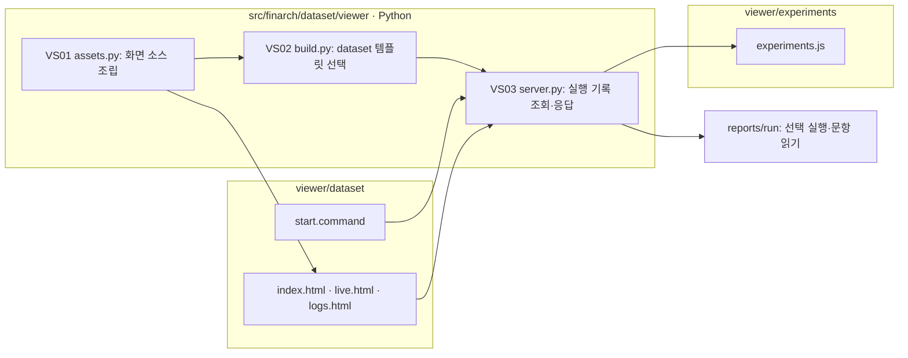

# Viewer 작업 공간

이 안내는 `src/finarch/dataset/viewer/workspaces-readme-template.md`에서 자동 생성합니다.

|폴더|역할|시작점|
|---|---|---|
|[dataset](dataset/README.md)|기존 데이터셋 제작·평가 화면과 로그 화면|[start.command](dataset/start.command)|
|[experiments](experiments/README.md)|실험 화면 작업 공간|기존 `experiments.js` 모듈|

데이터셋 뷰어: http://127.0.0.1:8893/dataset/ . 기존 `/` 주소도 같은 화면을 엽니다.

Python 서버와 데이터셋 화면 조립 소스는 `src/finarch/dataset/viewer`에 있습니다. 화면을 수정한 뒤 `PYTHONPATH=src .venv/bin/python -m finarch.dataset.viewer.assets`를 실행하면 `viewer/dataset/index.html`을 갱신합니다. 실험용 모듈은 `viewer/experiments/experiments.js`에 있으며, 이번 작업에서 새 실험 화면을 만들지는 않았습니다.

파일 박스는 실제 파일/폴더입니다. 모델 호출이나 제작·실험 재실행은 하지 않습니다. [이동 확인 로그](../outputs/viewer-split-20260920/validation.json)를 참조하세요.
