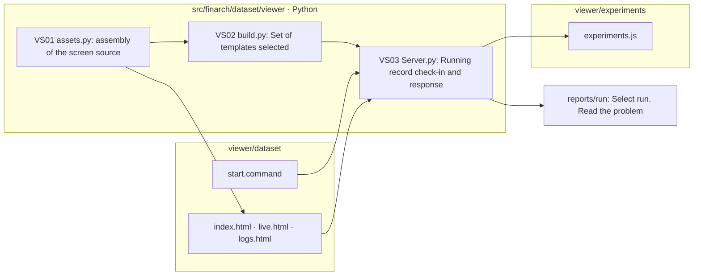

# Viewer workspace

This is not the place. `src/finarch/dataset/viewer/workspaces-readme-template.md`It's generated automatically.

|The folder.|Role|The starting point.|
|---|---|---|
|[dataset](dataset/README.md)|The existing data set creation and evaluation screen and log screen|[start.command](dataset/start.command)|
|[experiments](experiments/README.md)|The experimental screen workspace|Existing `experiments.js` Module|

The data set viewer: http://127.0.0.1:8893/dataset/ The old one. `/` And the address will open up the same screen.

Python servers and the data set screen assembly source `src/finarch/dataset/viewer`And then I'm going to look at the screen. `PYTHONPATH=src .venv/bin/python -m finarch.dataset.viewer.assets`If you run it, `viewer/dataset/index.html`The experimental modules are the `viewer/experiments/experiments.js`And we're not making a new test screen in this work.

The file box is the actual file/folder. It doesn't call models or do production/experiment re-enactments.](../outputs/viewer-split-20260920/validation.json)See also:
