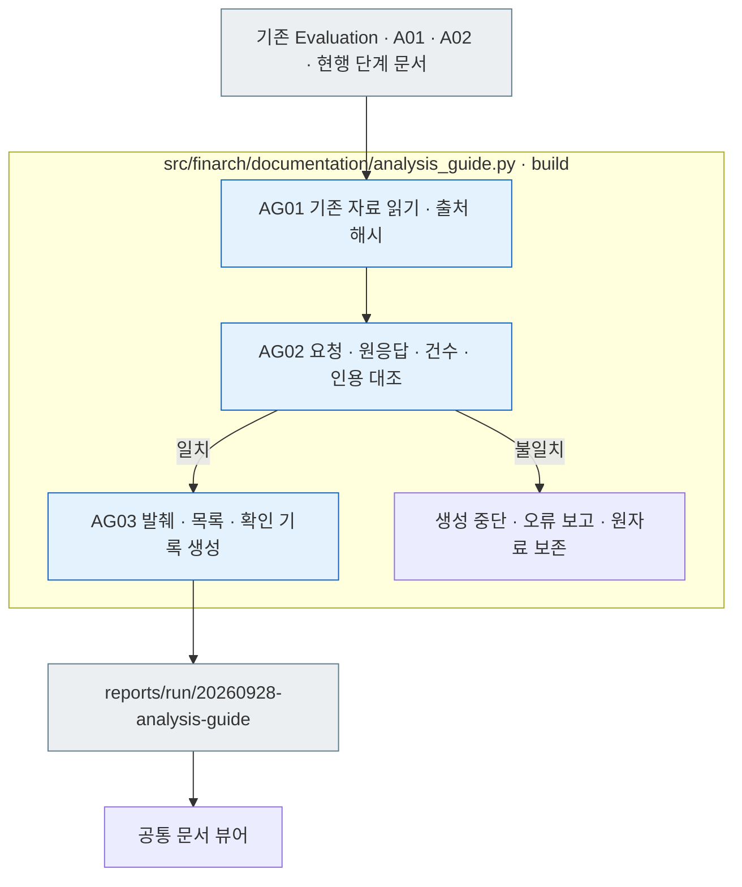

# Analysis 쉬운 안내 — 자료와 확인 기록

2026-09-28 · Evaluation에서 받은 자료가 A01 → A02 → A03으로 이어지는 과정을 설명합니다. 원본 문서는 소속 단계 아래 한 곳에서 관리합니다.

## 읽는 순서

1. [Analysis 쉽게 이해하기](../../../docs/02-experiments/02_analysis/00-overview.md): 전체 그림 → 실제 사례 → 모으기 → 비교하기 → 연구 해석.
2. [실제 사례 원문](example-evidence.json): `20260927-exp-007-luna`의 `test-0381`, Criteria-Guided Solving, 원본/충돌 변형 × Reasoning OFF/ON 네 응답과 기존 관찰입니다.
3. [A01 상세](../../../docs/02-experiments/02_analysis/01_results/README.md), [A02 상세](../../../docs/02-experiments/02_analysis/02_comparison/README.md), [A03 상세](../../../docs/02-experiments/02_analysis/03_research/README.md): 구현·실패 경로와 담당 소스를 확인합니다.

[안내 자료 뷰어](http://127.0.0.1:8893/?run=20260928-analysis-guide&doc=docs%2F02-experiments%2F02_analysis%2F00-overview.md)는 viewer/dataset의 공통 문서 화면에서 현재 Markdown과 흐름도를 읽습니다. 실행 선택에서 `20260928-analysis-guide`를 선택해도 같은 자료가 열립니다. 별도의 결과 HTML은 만들지 않습니다.

## 파일 역할

|파일|역할|
|---|---|
|[example-evidence.json](example-evidence.json)|실제 원응답 네 건, 공개 문항, 관련 제작 정보, 기존 A02 관찰, 전체 상태 수를 확인용으로 발췌한 자료입니다. 제작·실험 입력으로 사용하지 않습니다.|
|[sources.json](sources.json)|실제로 읽은 기준 문서·소스·원자료의 경로와 SHA-256입니다.|
|[documentation.json](documentation.json)|공통 뷰어가 읽을 현행 문서 목록입니다.|
|[migration.json](migration.json)|공통 문서 뷰어용 빈 이관 목록입니다. 이번 작업에는 문서 이관이 없습니다.|
|[events.jsonl](events.jsonl)|작성·원자료 대조·문서·화면 확인 기록입니다.|
|[validation.json](validation.json)|건수·발췌·출처·문서·화면 확인의 실제 범위입니다.|

## 생성과 확인

README는 [템플릿](../../../src/finarch/documentation/templates/analysis-guide-run.md)에서 생성합니다. 자료 확인 도구는 [analysis_guide.py](../../../src/finarch/documentation/analysis_guide.py)입니다.



회색은 파일, 파랑은 Python 처리입니다. 불일치 시 자동 재시도나 모델 호출은 없으며 자료를 확인한 뒤 수동으로 다시 생성합니다.

```text
python3 src/finarch/documentation/manage.py refresh
python3 src/finarch/documentation/analysis_guide.py
python3 src/finarch/documentation/manage.py validate
```

문서 설명·출처 대조·화면 확인을 위한 로컬 처리입니다. 별도 모델 호출, 신규 실험, 과거 재채점, 원응답 수정은 없습니다. 예시의 한국어 문장은 안내용 요약이며, 영어 원문과 분리합니다. 화면 확인과 사용자의 검토·연구 주장 채택도 별개로 기록합니다.
