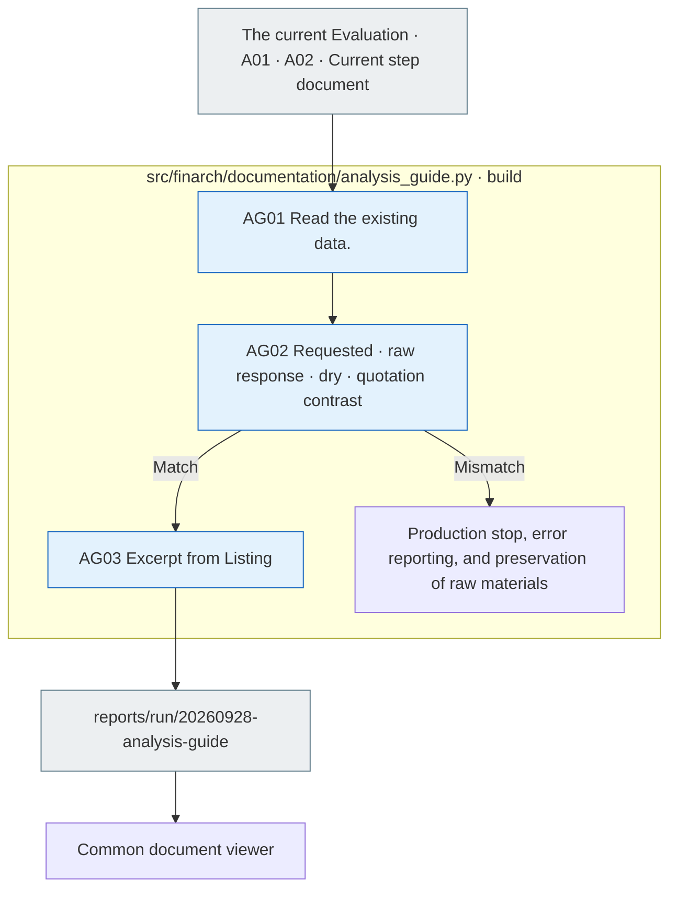

# Analysis easy guide to the data and verification records

2026-09-28 • The data from the evaluation is A01 → A02 → A03It describes the process that leads to the original document being managed in one place below the subordinate level.

## Reading order

1. [Analysis is easy to understand.](../../../docs/02-experiments/02_analysis/00-overview.md): Full picture → real case → collecting → comparing → studying interpretation.
2. [Real case study](example-evidence.json): `20260927-exp-007-luna` `test-0381`Criteria-Guided Solving, original/contradictory variation × Reasoning OFF/ON are four responses and the existing observations.
3. [A01 Details](../../../docs/02-experiments/02_analysis/01_results/README.md), [A02 Details](../../../docs/02-experiments/02_analysis/02_comparison/README.md), [A03 Details](../../../docs/02-experiments/02_analysis/03_research/README.md)Implementation: Check the path and the source responsible.

[Inner data viewer](http://127.0.0.1:8893/?run=20260928-analysis-guide&doc=docs%2F02-experiments%2F02_analysis%2F00-overview.md)Read the current Markdown and flow rate on the common document screen of the viewer/dataset. `20260928-analysis-guide`You can select the same data, and you can't create separate HTML results.

## File responsibilities

|File|Role|
|---|---|
|[example-evidence.json](example-evidence.json)|The real raw response is four, public statements, relevant production information, existing A0.2 It's a little bit of data for observation, for the whole statistics, not for production and experimental input.|
|[sources.json](sources.json)|The path of the reference documents that you actually read, the source material, and the SHA-256.|
|[documentation.json](documentation.json)|It's a list of current documents that the common viewer can read.|
|[migration.json](migration.json)|This is a blank list of links for the Common Document Viewer.|
|[events.jsonl](events.jsonl)|It's a written, resource-based contrast, a documentary, a screen-based verification.|
|[validation.json](validation.json)|It's the real range of sewer, excavator, source, document, and screen checks.|

## The existence and identification

ReadME is a template for](../../../src/finarch/documentation/templates/analysis-guide-run.md)The data verification tool is at [analysis_guide.py](../../../src/finarch/documentation/analysis_guide.py).



The gray is the file, the blue is the Python process, and there's no automatic reset or model call when there's a discrepancy, and then you verify the data and then you manually generate it again.

```text
python3 src/finarch/documentation/manage.py refresh
python3 src/finarch/documentation/analysis_guide.py
python3 src/finarch/documentation/manage.py validate
```

It's a local process for document description, source contrast, and screen verification. No separate model calls, new experiments, past reviews, or raw response adjustments. For example, Korean phrases are a guide summary, separated from English originals. Screen verification and user review and research claims adoption are recorded separately.
