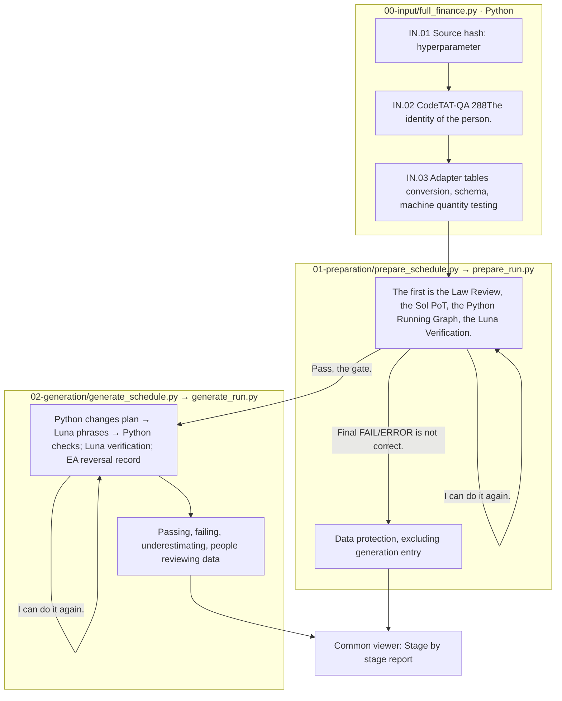

# 1003-001-CodeTAT-QA(0917-002)

CodeTAT-QA **All 288Case**(easy 189·medium 99Now, I've created the adapter prompt. 0917-002The test ID and question-and-answer accuracy are preserved. 10The building is [Existence folder](restart-history/000-pilot/README.md)is the location.

## The final result 2026-10-03

Existing 00 → 01 → 02 The whole process is over. 288In a case. **279 PASS·9 FAIL**Generation is the generation that passed through. 279This is the first case. 7Type is = **1,953Of the type 1,891 PASS·62 FAIL**and, 3We've reached the car limit. **260The case is 7All types are PASS.**It's not a personal approval.

|Segment|1Car accumulated pass / failure|2Car accumulated pass / failure|3Car accumulated pass / failure|
|---|---|---|---|
|Preparation · cases|269 / 19|279 / 9|279 / 9|
|Generation · case × variant|1,840 / 113|1,883 / 70|1,891 / 62|

The actual measurement time is Preparation **11minutes 24Seconds.**, Generation **33minutes 55Seconds.**The time between the two steps is the star, and the time is the [source preparation timing].](timing.json)And the [Generation timing](02-generation/timing.json)Check it out.

[Results from the synopsis README](results/README.md)Read from here. `results/00-input.json`and 01~07Each type of JSON is **288rows**Preparation failure. 9The case is type-wise. `NOT_RUN`The default default is the default default default, which is the default error, and the default default is default.](results/manifest.json)Do not interpret the existence of all these files as experimental PASS.

[Preparation Excel](phase-reports/preparation/preparation-report.xlsx), [Generation Excel](phase-reports/generation/generation-report.xlsx)[JSON is updated](regeneration-check.json)[Confirmation log](regeneration-check.log)[Terminal code](terminal.log)[Copy creation log](03-export.log)[Blocker checks the screen](viewer-completed.png)They're giving it together.

The stored unique request is **5,208entries**And the Sol medium 290That's Luna Max. 4,918That's the same call reuse usage 8The total estimated cost of the recorded call is the total of the total number of calls that the token uses. **$27.45**And then there's the extra **2entries (test-0122·test-1120The EA-02 The reverse review) is a drug. 300Over time for the second API connection. `CALL_FAILED`**And the token cost is uncertain. `false`The reverse review is a separate record that doesn't change EA's quality assessment.34~68And it's a difference between the actual storage usage.

The final verification is the mechanical examination of the file quantity, ID, hash, model response scheme. 62The automated failure of the type was not determined to be meaningfully resolved. `prepare_schedule`This step corrected to deliver the specified runtime-config and then ran again. 10entries `restart-history`I've preserved it.

## Start program and run order

|In order.|The actual start program|Processing|
|---|---|---|
|00|`finarch.dataset.00-input.full_finance`|Select the source code of the hyperparameter, select the source code, select the JSON tab, select the input. 288entries|
|01|`finarch.dataset.01-preparation.prepare_schedule`|Select list 288The original, the PoT, the graph, the verification, the failure, the maximum. 3round|
|02|`finarch.dataset.02-generation.generate_schedule`|Preparation passing the entry criteria → generate_run → 7Type creation verification, EA recording and maximum 3round|

The terminal calls in the order of these existing startup programs, and it doesn't use any Python connection programs. 01When this summit ends, 02If the process is interrupted by a technical error, the phrase FAIL does not change to a discard or forced passage, but preserves the basis and the case judgment of that step.

## Reading order

1. [Terminal progress is underway](sequence-status.txt)[Terminal output](terminal.log).
2. [List of answers](input-selection.json)[Source response](cohort.json)[Introducing force](../../../data/prepared/finance-reasoning/CodeTAT-QA-20261003/README.md).
3. [hyperparameter](hyperparameter.json)[Model definition](codex-profiles.toml)[Real model schema preview](model-preflight.json)[Action plan](preflight-plan.json)[prompting](prompt-snapshot.json).
4. [00 Log, please.](00-input.log), [01 Log, please.](01-preparation.log), [02 Log, please.](02-generation.log)The real result is `01-preparation/summary.json`, `02-generation/summary.json`, `phase-reports`, `completion-report.json`I'll check it out.
5. Common [Blower](http://127.0.0.1:8893/?run=20261003-001-CodeTAT-QA-0917-002)Check the actual output from the.

The PoT is `gpt-5.6-sol / medium`The rest of the review, the review, and the audit, the audit, and the feedback. `gpt-5.6-luna / max`It only uses the profile ID specified in the version. 200Total token budget, and 500,000So, the output of each model is solved. 128,000 / Luna 32,768It's a simultaneous call method, and it doesn't change to a batch API.

[Winning and cost estimates](authorization.json)The existing: 288entries 4,889If you convert the call usage recorded to the same model price, approximately $1.34.25That's the expected $34~68It's an estimate, and it's not an expense estimate or actual invoice amount. The actual token-time-calculation cost of a new run is verified by the stored usage and timing report, which distinguishes between an automatic verification pass and a person reviewed and approved results.

README generates from documentation/templates. It verifies whether the step is in progress and whether it's completed by the actual sequence-status and step result files.
