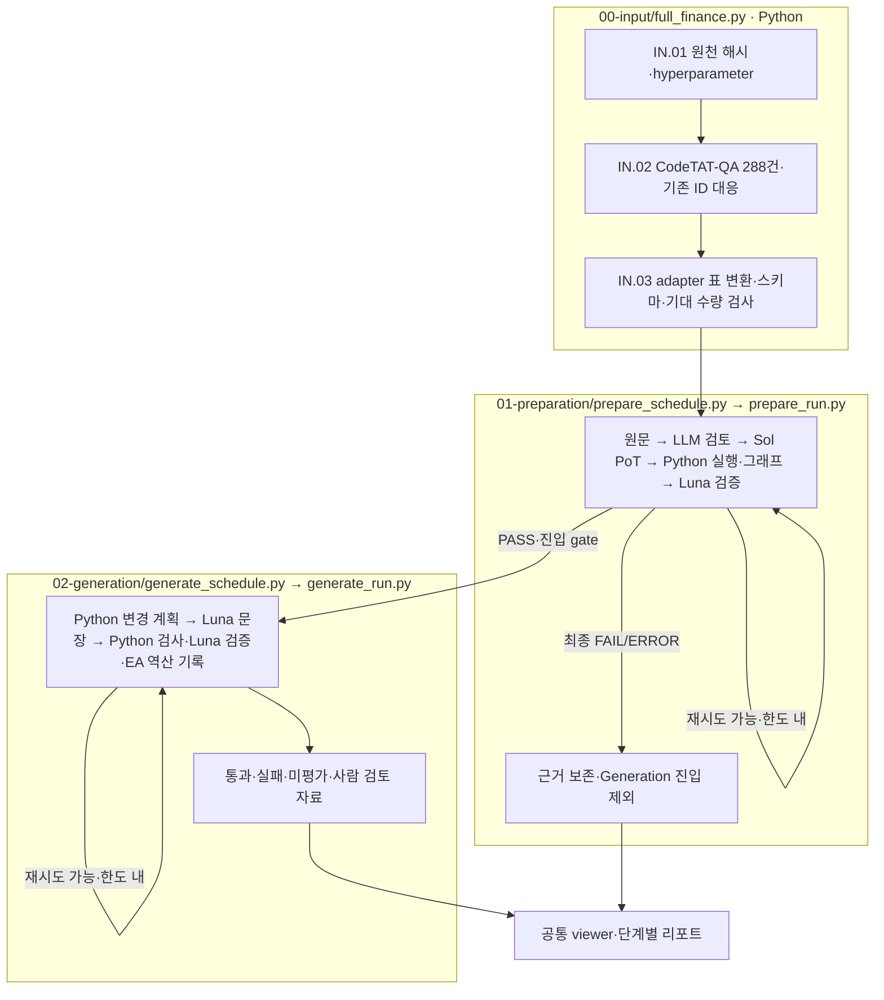

# 1003-001-CodeTAT-QA(0917-002)

CodeTAT-QA **전체 288문항**(easy 189·medium 99)을 현재 adapter·prompt로 새로 생성했습니다. 0917-002의 test ID와 질문·정답·정밀도를 보존합니다. 이전 모델 응답은 사용하지 않습니다. 앞선 10건은 [보존 폴더](restart-history/000-pilot/README.md)에 있습니다.

## 최종 결과 · 2026-10-03

기존 00 → 01 → 02 프로세스가 모두 정상 종료했습니다. Preparation은 288문항 중 **279 PASS·9 FAIL**입니다. Generation은 통과한 279문항 × 7유형 = **1,953유형 중 1,891 PASS·62 FAIL**이며, 3차 한도에 도달했습니다. **260문항은 7유형 모두 PASS**입니다. 사람의 개별 승인은 수행하지 않았습니다.

|구간|1차 누적 통과 / 실패|2차 누적 통과 / 실패|3차 누적 통과 / 실패|
|---|---|---|---|
|Preparation · 문항|269 / 19|279 / 9|279 / 9|
|Generation · 문항×유형|1,840 / 113|1,883 / 70|1,891 / 62|

실제 측정 시간은 Preparation **11분 24초**, Generation **33분 55초**입니다. 두 단계 사이의 리포트 저장 시간 등은 별도이며 시간은 [원본 Preparation timing](timing.json)과 [Generation timing](02-generation/timing.json)에서 확인합니다.

[결과 합본 README](results/README.md)부터 읽으십시오. `results/00-input.json`과 01~07의 유형별 JSON은 각각 **288행**입니다. Preparation 실패 9문항은 유형별 `NOT_RUN`으로 남으며, 자동 FAIL과 명시적 사람 Reject는 구별합니다. 사람 Reject 제외 정책은 [manifest](results/manifest.json)에 기록했습니다. 이 파일들의 존재를 모두 실험 사용 가능한 PASS로 해석하지 마십시오.

[Preparation Excel](phase-reports/preparation/preparation-report.xlsx), [Generation Excel](phase-reports/generation/generation-report.xlsx), [최종 확인 JSON](regeneration-check.json), [확인 로그](regeneration-check.log), [터미널 원문](terminal.log), [합본 생성 로그](03-export.log), [뷰어 확인 화면](viewer-completed.png)을 함께 제공합니다.

저장된 고유 요청은 **5,208건**이며 Sol medium 290건, Luna max 4,918건입니다. 동일 호출의 재사용 usage 8개를 중복 합산하지 않았습니다. 토큰 사용량이 기록된 호출의 추정 비용 합계는 **$27.45**이며, 추가 **2건(test-0122·test-1120의 EA-02 역산 검토)은 약 300초 API 연결 시간 초과로 `CALL_FAILED`**이며 토큰·비용이 미확인입니다. 역산 판정은 미평가로 남기며 `false`로 바꾸지 않았습니다. 역산 검토는 EA 품질 판정을 바꾸지 않는 별도 기록입니다. 이 합계는 전체 청구액이 아닙니다. 기존 예상 $34~68과 실제 저장 사용량은 구별합니다.

최종 확인은 파일 수량·ID·해시·모델·응답 스키마의 기계적 검사입니다. 62유형의 자동 실패를 의미상 해결되었다고 판정하지 않았습니다. 초기 모델 선택 단계 전달 오류는 실제 API 시작 전 발생했으며, `prepare_schedule`이 단계가 명시된 runtime-config를 전달하도록 수정한 뒤 다시 실행했습니다. 초기 실패와 이전 10건은 `restart-history`에 보존했습니다.

## 시작 프로그램과 실행 순서

|순서|실제 시작 프로그램|처리|
|---|---|---|
|00|`finarch.dataset.00-input.full_finance`|hyperparameter의 CodeTAT-QA 출처 선택 → JSON 표 변환·원천 해시·입력 검사 → 288건|
|01|`finarch.dataset.01-preparation.prepare_schedule`|선택 목록 288건 → prepare_run → 원문·PoT·그래프·검증·실패 피드백·최대 3차|
|02|`finarch.dataset.02-generation.generate_schedule`|Preparation 진입 기준 통과 → generate_run → 7유형 생성·검증·EA 역산 기록·최대 3차|

터미널은 이 기존 시작 프로그램을 순서대로 호출합니다. 별도 Python 연결 프로그램을 사용하지 않습니다. 01이 정상 종료되면 02를 호출하며 기술 오류로 프로세스가 중단되면 다음 단계로 넘어가지 않습니다. 문항 FAIL은 폐기나 강제 통과로 바꾸지 않고 해당 단계의 근거·재시도 판단을 보존합니다.

## 읽는 순서

1. [터미널 진행 상태](sequence-status.txt), [터미널 출력](terminal.log).
2. [대상 목록](input-selection.json), [원천 대응](cohort.json), [입력](../../../data/prepared/finance-reasoning/CodeTAT-QA-20261003/README.md).
3. [hyperparameter](hyperparameter.json), [모델 정의](codex-profiles.toml), [실제 모델·schema 사전 검사](model-preflight.json), [실행 계획](preflight-plan.json), [prompt 해시](prompt-snapshot.json).
4. [00 로그](00-input.log), [01 로그](01-preparation.log), [02 로그](02-generation.log). 실제 결과는 `01-preparation/summary.json`, `02-generation/summary.json`, `phase-reports`, `completion-report.json`을 확인합니다.
5. 공통 [뷰어](http://127.0.0.1:8893/?run=20261003-001-CodeTAT-QA-0917-002)에서 실제 산출물을 확인합니다.

PoT는 `gpt-5.6-sol / medium`, 나머지 검토·문장·검증·역산·피드백은 `gpt-5.6-luna / max`입니다. 버전이 명시된 profile ID만 사용합니다. API 동시 상한 200, 총 토큰 예산 500,000, 모델별 출력 한도 Sol 128,000 / Luna 32,768입니다. API 동시 호출 방식이며 Batch API로 바꾸지 않습니다.

[승인·비용 추정](authorization.json): 기존 288건의 4,889회 기록된 호출 사용량을 같은 모델 가격으로 환산하면 약 $34.25입니다. 예상 $34~68은 추정이며 지출 상한이나 실제 청구액이 아닙니다. 새 실행의 실제 토큰·시간·추정 비용은 저장된 usage와 timing 보고서로 확인합니다. 자동 검증 통과와 사람이 검토하여 승인한 결과는 구별합니다.

README는 documentation/templates에서 생성합니다. 단계 진행 중의 상태·최종 완료 여부는 실제 sequence-status와 단계 결과 파일을 기준으로 확인합니다.
