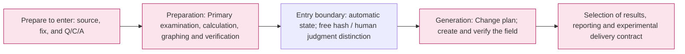

# The pipeline to build the data set

[Top: Full article](../README.md)

We take the financial principles and we check the basis and the basis, and we make cases that reflect the conflict of values, the source conditions, the relationship contradictions, the elimination of the neighborhood. **The current task is to organize this production flow and the user needs step by step.**The experimental plan is to organize the sequence in the star space.

## The whole picture.

The pink is the area with the linked detailed document, and not the implementation finish mark. The actual Python/LLM segmentation/failure flow for each step is identified in the document below. The resulting delivery distinguishes the required agreement from the current implementation boundary.

|Reading order|The realm|What you get → what you make|
|---|---|---|
|1|[Created Common Requirements](00-requirements.md)|Purpose of research, entry limits, protection, exit and judgment principles|
|2|[Prepare for entry](00-input/README.md)|Source distribution → Select Q/C/A source response and foreign log|
|3|[Preparation](01-preparation/README.md)|Q/C/A → Reviewed articles, POT graphs, checks and inspections|
|4|[Generation](02-generation/README.md)|The first line of the graph 7Type of sentence, test, test data|
|5|[Results selected and transmitted](03-release/README.md)|Production results → Selection criteria and public/private delivery boundaries|
|When you need it.|[Public operation](90-operations/README.md)|The lawsuit was filed against the company.|
|Problem reviews|[Step by step verification](99-open-issues.md)|The demand for the difference, uncertainty, and the range of the difference|

## The current reading standards

2026-09-23The key step module is the runner gate, which is a static contrast to the runnergate, which is the code readability criterion in the document, and does not mean a new run verification.

Especially P07The human judgment and the current Generation entry code, EA's restricted inversion and total impossibility of response distinguish.](99-open-issues.md)And we've connected it to the next step.

Previously, the serial number document was [archived](../../archive/20260923-documentation-reorganization/README.md)The readings of the daily paper start with this document.](../../src/finarch/documentation/templates/dataset.md)And then we're going to generate.

## The standard for filing folders and files

Customization parameters are stored in the run. **The order of the moves.**. `01-preparation/01-source`, `02-review`, `03-calculation`And the name of the detail step is real. `reports/run/20260917-003/01-preparation/test-0001/01-round`Generation is the same run. `02-generation/01-round/test-0001/01-ic-value-before`And I'm going to do that.

- `01-dataset`, `02-experiments`is the reading order of the document area.
- `00-input`Prepare to run before entry, `01-preparation`and `02-generation`It's the phase name of the run.
- The step folder matches the actual run name. The detailed step in README is the actual folder name.
- `03-release`This is not the document order of the subsequent delivery contract and does not mean that the run steps of the same name have been implemented.
- `90-operations`, `99-open-issues.md`It's not a run-through step, it's a common reference area.
- README is the input of each folder, and it doesn't have any work numbers attached. The rest of the description files are numbered within the associated folder.
