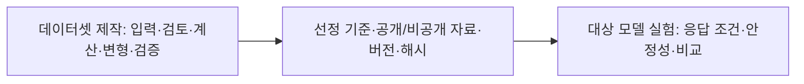

# fin-arch 문서

이 프로젝트는 금융 원문의 근거를 바꾸어 데이터셋을 만들고, 그 데이터로 모델의 답변을 살펴봅니다. 문서는 작업 날짜가 아니라 **전체 흐름 → 단계 → 세부 스텝** 순서로 읽습니다.

|영역|입구|내용과 현재 작업|
|---|---|---|
|데이터셋 제작|[제작 파이프라인](01-dataset/README.md)|원천 입력 → Preparation → Generation → 결과 선정·전달. 먼저 취합·재정리한 영역|
|대상 모델 실험|[실험 문서](02-experiments/README.md)|Input → Evaluation → Analysis|

이 그림은 영역의 연결입니다. 제작 중 검증용 LLM 호출은 대상 모델 실험과 구별합니다. 분홍 상세 확장 표시는 이 최상위 개념도에 사용하지 않습니다.

## 문서를 고치는 방법

- 사용자 요구는 해당 단계 문서에, 여러 단계 공통 요구는 해당 영역의 requirements에 둡니다.
- 코드가 바뀌면 같은 단계의 흐름·책임·확인 범위를 갱신합니다.
- 특정 실행의 설정·결과는 reports에, 대체된 문서·설계 이력은 archive에 둡니다.
- 새 요청마다 새 번호 파일을 만들지 않습니다. 새 문서는 실제로 독립된 단계·책임이 생겼을 때만 추가합니다.

## 이번 재정리 확인

[읽는 순서·이관 기록](../reports/run/20260923-dataset-documentation/README.md) · [기존 문서 대응표](../archive/20260923-documentation-reorganization/MIGRATION.md) · [원본 보관 안내](../archive/20260923-documentation-reorganization/README.md).

이 README는 [템플릿](../src/finarch/documentation/templates/docs.md)에서 생성합니다. 현재 구현의 확인 기준은 각 단계의 실제 코드 링크와 명시한 정적 확인 범위입니다. 과거 테스트 수치를 현재 구현의 검증 결과로 재사용하지 않습니다.

## 코드·서버 구조

[대시보드](03-dashboard/README.md)에서 단계별 소스 위치와 서버 실행 방법을 확인합니다.
