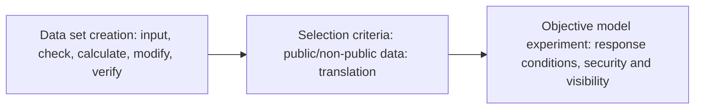

# Fin-arch document

This project is about changing the basics of financial sources, creating a dataset, and looking at the model's answers using that data. **Full flow → step → detail step** in this order.

|The realm|Get in there.|Content and current work|
|---|---|---|
|Creating a data set|[Created pipeline](01-dataset/README.md)|Source input → Preparation → Generation → Results selection; transmission. First the setup; the decentralized area|
|The target model experiment.|[Experimental document](02-experiments/README.md)|Input → Evaluation → Analysis|

This is a linkage of the region. The call for a validated LLM in production differentiates it from the subject model experiment. The pink detail extension does not apply to this top-level concept.

## How to Fix a Document

- The user requirements are in the document of the respective step, and the multi-step common requirements are in those requirements of the respective area.
- If the code changes, it updates the flow, responsibility, and validation range of the same level.
- The settings and results of certain executions are in reports, and the replacement document and structure moves to the archive.
- They don't create a new number file with each new request, they only add new documents when they actually have independent steps and responsibilities.

## Check this re-entry.

[Reading order and accompanying record](../reports/run/20260923-dataset-documentation/README.md) · [Existence document correspondence chart](../archive/20260923-documentation-reorganization/MIGRATION.md) · [Copyrighted to the Editor](../archive/20260923-documentation-reorganization/README.md).

This README is a template for](../src/finarch/documentation/templates/docs.md)The validation criteria for the current implementation are the static validation range specified by the actual code link at each step. Past test figures are not reused as validation results for the current implementations.

## Code-server architecture

[Dashboard](03-dashboard/README.md)From step-by-step, check the source location and how the server runs.
