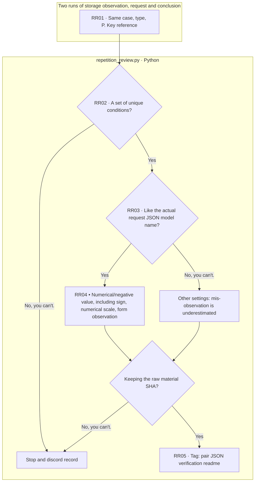

# {{first_run}} → {{second_run}} · The same condition repeating guide

[analysis.md](analysis.md)The two-fold comparison of → [summary.json](summary.json)The denominator of the conditional number → [pairs.jsonl](pairs.jsonl)Changes in the phrases → [verification.json](verification.json)The raw material is the hash and the [events.jsonl](events.jsonl)I read it in the order of the analytical log.

`repetition_review.py`The results of the two previously stored run observations, provider request JSON, raw response. There are no new model calls or original score changes. The same input, JSI, JSON model settings do not match the number/bins, numbers, and scale of the two responses, and compare whether the format is valid and accurate. Without one response, it remains undervalued.

The input box is a file and the rest is Python processing. There is no LLM step-by-step recursion. The fact that the provider model name is the same does not guarantee the identity of the internal overhead. The two-time unit does not scale to normal stability or meaningful correctness. The actual screen verification follows the common viewer verification record of the above work and distinguishes it from user open completion. README generates from this template.
