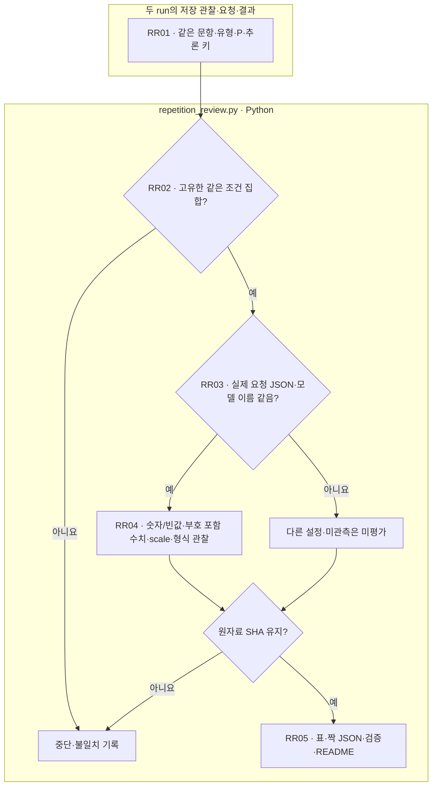

# {{first_run}} → {{second_run}} · 동일 조건 반복 안내

[analysis.md](analysis.md)의 두 회 비교 → [summary.json](summary.json)의 분모·조건별 수치 → [pairs.jsonl](pairs.jsonl)의 문항별 변화 → [verification.json](verification.json)의 원자료 해시와 [events.jsonl](events.jsonl)의 분석 로그 순서로 읽습니다.

`repetition_review.py`는 기존에 저장한 두 run의 관찰 행, provider 요청 JSON, 원응답 결과를 읽습니다. 새 모델 호출이나 원래 점수 변경은 없습니다. 같은 입력·지시·JSON·모델 설정에서 두 응답의 숫자/빈값, 숫자와 scale, 형식 유효 여부를 비교하며 정확도와 합치지 않습니다. 한쪽 응답이 없으면 미평가로 유지합니다.

입력 박스는 파일이고 나머지는 Python 처리입니다. LLM 단계·재시도는 없습니다. provider 모델 이름이 같다는 사실은 내부 가중치의 동일성을 보장하지 않습니다. 두 회 일치를 일반적 안정성이나 의미 정답으로 확대하지 않습니다. 실제 화면 확인은 상위 작업의 공통 뷰어 검증 기록을 따르며 사용자 열람 완료와 구별합니다. README는 이 템플릿에서 생성합니다.
