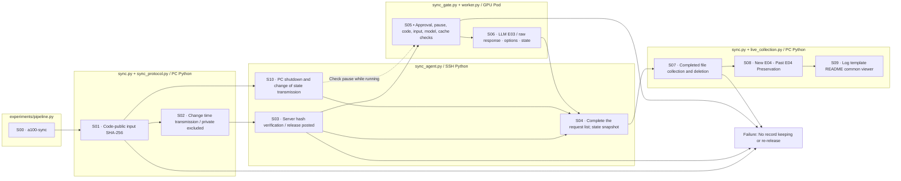
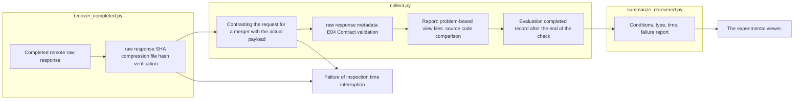
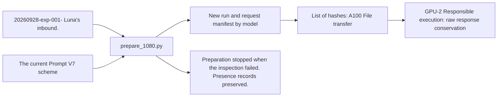
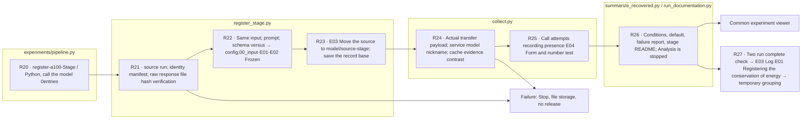
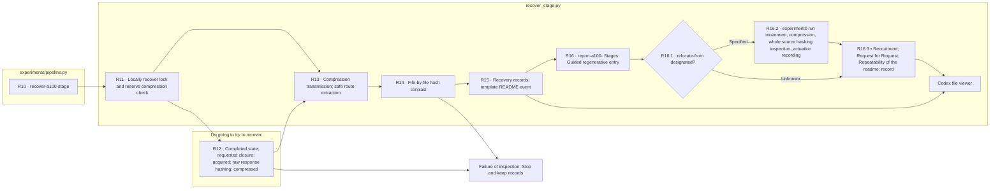

# A100 Run connection

It takes the results of the GPU server in the existing Evaluation output format and runs the existing Analysis on the PC.

## The current PC is A1.00 Common pipeline.

PC `src/finarch`So, go to the code standard and A1.00 The common path. `/home/clink-wooix/workspace/fexperiment/fin-arch`. `releases/<code SHA-256>/`If the same code, setup, experiment document viewer is stored and the actual hash matches, `current`The execution uses a fixed release. `finarch_financereasoning`It's a recapture of past results and distinguishes it from the new worker path.

The entrance points are on both sides. `python -B -m finarch.experiments.pipeline`So this is the SSH host Python. 3.8It runs only file scanning agents and the actual pipeline is the GPU Pod Python. 3.11 I use the ideal. `config/experiments/a100-sync.toml`The server is based on the list of runs `reports/experiments-run/<run_id>/00_input`, `01_evaluation`, `02_analysis` We use structure.

|The command of pipeline.py|Role|
|---|---|
|`a100-sync --sync-action check`|PC/A100 Code: open input: PC shutdown state hash contrast|
|`a100-sync --sync-action push`|Code release. Public input change time transmission. Server verification|
|`a100-sync --sync-action pull`|Complete: request and state collection; raw response hashing|
|`a100-sync --sync-action cycle`|Confirm → need change to transmit → collect results|
|`a100-sync --sync-action watch`|After completing the cycle, the default 60Repeat second waiting; no model call|
|`a100-verify --run <run>`|Check the pre-distributed code; public input; no model call|
|`a100-evaluation --run <run> --endpoint <local-url> --model-path <revision-snapshot> --authorization`|Common E03 worker; in this order, it doesn't run|

PC Yes: `PYTHONPATH=src .venv/bin/python -B -m finarch.experiments.pipeline a100-sync --sync-action cycle`.
The GPU Pod is a `PYTHONPATH=<Recent release>/src`The worker is responsible for the session of the GPU server. The worker has already prepared the server's model path, configuration options, cache non-use, start/finish. 0 Check the hit. Pause. Unconfirmed transmission does not automatically retrieve.

Open input, prompt, schema, and E02 The manifest runtime is PC → A100So, the state-finished raw response is A1.00 → sync to PC. private. Correct. Analysis is left on PC. The input that has already been synchronized and the existing raw response are not overlaid with other hashes.3 `remote-state.json`The result of the new common worker is the existing PC E0.4 Linking to reporting·numeric_validation and E0 of the previous comparison stage4Analysis does not start automatically.

In order of reading: `log/experiments-a100-sync/README.md` → `status.json` → `events.jsonl` → Run by remote snapshot → experiment E03 `sync-status.json`Common viewer: http://127.0.0.1:8894/?tab=sync . 3The last record is not up to date. `STOP` It creates a file. The code-input system is separate from validity checks for reasoning content, which is not validated by a new real model execution, but checks the entire path without model calls.

The box is the input·Python processing·reset result and S06The synchronization command is S05–S06It doesn't run.

|File|Input → Role → Output|
|---|---|
|sync_protocol.py|Code: public input → SHA-256• Safe route and inconsistency|
|sync.py|TOML; PC state → Code; input power; center state change time push/pull; watch → status; events; template README|
|sync_agent.py|SSH commands → server hashes; release posts; PC shutdown reflects; complete request lists.|
|sync_gate.py|Distribution run → code public input disorder blocked|
|worker.py|Approved run; configured GPU endpoint → common payload·E03 Raw response · Status|
|live_collection.py|Common worker E03 → The existing PC E04• Portrait of the viewer|
|prepare.py|The latest copy 557Select the article Luna public input vs. independent model run|
|prepare_1080.py|20260928-exp-001- The lunar flux input and current prompt 1,080Article: Model by model 34,560The items request is generated, the hash is verified, the GPU is2 Delivery file. No model call|
|wire.py|Public requests and runtime → Qwen chat, schemes, promotional terms → server requests|
|token_preflight.py|The request for synchronization and the actual tokenizer → input length checking → token-preflight.json|
|install_worker_hook.py|The preserved worker original → gpu-2 Dedicated single run quarter → hash record|
|remote.py|Public request 8B·14B The first time I saw the data, I was able to see the data.|
|coordinate.py|Remote completed state → PC recovery; decryption check → collect and analyze run|
|collect.py|Recovery raw response → Form-processing testing → existing Evaluation output|
|import_completed.py|pipeline recover-a100 → Sealing package; local private hash connection; internal template connection → existing recovery; E04·View registration. No model calls|
|recover_completed.py|Complete remote run → raw response SHA; compress; local file hash check → original file; recover record. No model call|
|recover_stage.py|Completed comparison stage → Conclusion request; raw response · Copy hash contrast; Local recovery → Original data; Recovery README. No model call|
|register_stage.py|Recovered completed stage → source input; request hash counterparts; presence run equals; E03 Recorded E04 Check → date-model independent experiment run with viewer.|
|summarize_recovered.py|Local E04and receiving time; cache indicator → condition; pattern; failure; time estimate → report comparison with RESULTS.md.|
|analyze.py|Verified results and private classification → set Codex analysis → A01·A02·A03|

The detailed flow is `src/finarch/experiments/templates/a100-readme-template.md`It's generated by model to README.
The target execution is `reports/experiments-run/20260928-a100-qwen3-8b`, `20260928-a100-qwen3-14b`.
The error-response inaccuracy is not automatically returned. The completed state is recorded after verifying the actual COMPLETE of the analysis.

The public evaluation input does not include the correct answer and the EXTERNAL_RULE classification. The classification is based on the original manufacturing verification and is not a verified attribute of the modification itself.
To preserve the current input length of the run, we need to change the context. 10,240in 12,288The internal settings are in the preparation-revisions and events of each run.

## 2026-09-28 Recovery is coming.

GPU response is both models. 17,824It's done, but the coordinator is off with the change in the entire directory compression, compressing only the files specified in the recovery-manifest and transfer-manifest, and then retrieving them after the existing hash check, and then sequentially analyzing the two models after the retrieval and verification, and no remote evaluation re-entry.

Reads in order: recovery-repair.json → coordinator.log → Each run README and Evaluation/Analysis state. Viewer: http://127.0.0.1:8894/ Run from model to model.

## 2026-09-29 1,080case delivery

`prepare_1080.py`The current FinancialAnswerV7 prompt and public input are aligned on the new run of both models. `src/finarch/experiments/templates/a100-1080-handoff-readme.md`The private right-to-external classification is stored on the local run and the A100 And that's not included in the transfer list.2 The session verifies and executes the request that was sent. `remote.py`The execution path does not apply to this request exactly. `collect.py`The actual number of requests for the synchronization manifest is contrasted with the remote completion state.

## 2026-09-30 Results are recovered

`recover_completed.py`Go raw response, transfer payload, status of service, recover server settings and file-by-file SHA-256Check the changed guidance document and the status of the remote. `remote-evidence/`Put it in. `collect.py`is the actual transfer payload and the input of the incoming current compared to the E04 I run the test. `summarize_recovered.py`The model-by-model RESULTS.md and `reports/run/20260930-a100-recovery/README.md`It generates from the template. It calculates remote JSON schematic passing and local additional field contract passing. LLM Analysis doesn't start.

`collect.py`It reads the usage·finish_reason of the actual raw response. If the remote receiving metadata is missing, it keeps the original and records the inconsistency. `--repair-delivery-metadata`The previous local resolution is saved to a separate file and then only the resolution that corresponds to this missing point is fixed.4 Report: Problem-based review file: Figure comparison and synthesis only after the verification is complete.

The box is the input → Python processing → storage result sequence, and the recovery processing has no model call. README contained in the syntax manifest keeps the result guide in EVALUATION.md and RESULTS.md. The response text of vLLM Chat Completions read in call_layout.response_text() also displays the response cut in the viewer.

The box is the input → Python file preparation → output → remote run subject sequence. The last GPU execution is not the operation of this file preparation code.

## Register the completed run prepared by the server

`experiments/pipeline.py recover-a100` `import_completed.py`The server registers the completed server packages through the server sealing compression and forwarding file hash, verifying the local source public/private hash and not reproducing the existing request. Private data is connected to the local source run of the same hash. Running ID, including the model version point, is stored remotely as a noun.

The local guide template that's missing from the public GPU package is `ensure_report_templates()`The source and description of the linked file is recorded in imported-report-templates.json and the event. The original syntax manifest; prompt; schema; raw response is not corrected. The registration results are read in RESULTS.md → recovered-summary.json → recovery-receipt.json order, and the Analysis is left in standby mode.

## Completed data recovery

The only way to do this is to recover the folder and the run is not finished by the experiment viewer. `pipeline.py register-a100-stage --run reports/experiments-run/YYYYMMDD-fin-o1-8b --source-stage <accept stage> --source run <synchronous input of the synchronoun run>`And we're moving on. 14BAnd it makes an independent run in the same way. The dates use the actual remote run dates.

E0 of two runs.4And once the state of completion is confirmed, `pipeline.py report-a100-stages --run < existence recovery group>`This log is E03 It connects to the model-by-model pipeline.log, and then it stores the recovery log to the source-stage/recovery.log. 8B E01The history README is a100It's created in the -stage-registration-history.md template.

The run you've registered is the same as the original run. `00_input`, `01_evaluation/01_preparation`, `02_request`, `03_execution`, `04_validation`, `02_analysis`The remote source is E0.3 By model. `source-stage/`Save the existing calls and E04 The results are generated by the JSON server schematic test and the local total response contract test. 0The first telemetry sample cache setup. 0 The provider does not separate the processing time inside the hit and the shutdown snapshot.

The storage location of the test results and the recovered original `reports/experiments-run`. `recover_stage.py`refuses new recruits outside this route. `reports/run`The wrongly stored recovery folder is `pipeline.py report-a100-stages --run <experiments-run My own. The neck.The enemy.> --relocate-from the Presence Retrieval folder`It moves the folder from the same file system, then it compares the entire compression and source file map, and it updates the template README-color-relocation-receipt.json, which preserves the existing remote path and past logs as the original log.

`pipeline.py report-a100-stages --run `The check is done by reading the recovery record of the stage `a100-stage-recovery-index.md` It creates an upper README from the template, which is the guiding color of the saved recovery records, and there's no additional file transfer or model call.

`pipeline.py recover-a100-stage --run <local recovery folder> --remote-root <identical stage absolute path>` `recover_stage.py`Call it. `prepared.json`Check the full range of the manifest source hash, the completed state, the trial ID of the request and the copy, the delivery hash of all raw responses. `a100-stage-recovery.md`The remote top-level run record and control record are the same as the remote top-down run record. `remote-evidence/`This command is for the original recovery and the new experiment run register.4 ReadME is a Codex file viewer.

The box is the Python file and the processing order. 0It doesn't re-transmit remote model requests when they fail, and if you have a complete recovery record, you don't revalidate the compression and file hash and override the remote compression.
