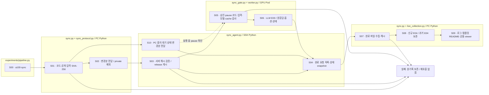
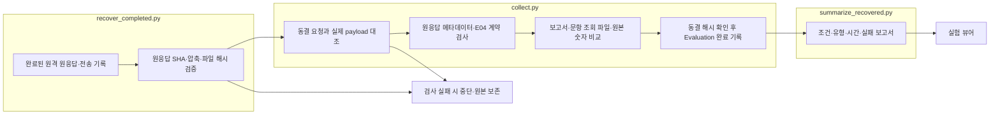
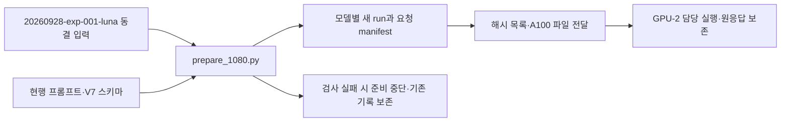
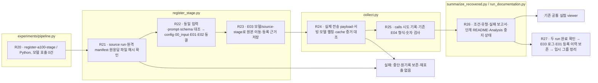
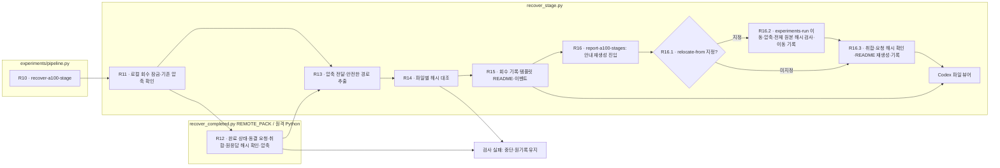

# A100 실행 연결

기존 Evaluation 산출물 형식으로 GPU 서버 결과를 회수하고, 기존 Analysis를 PC에서 실행합니다.

## 현행 PC ↔ A100 공통 파이프라인

PC `src/finarch`가 코드 기준이며 A100 공통 경로는 `/home/clink-wooix/workspace/fexperiment/fin-arch`입니다. `releases/<코드 SHA-256>/`에 동일 코드·설정·실험 문서·뷰어를 저장하고 실제 해시가 일치하면 `current`를 연결합니다. 실행은 고정 release를 사용합니다. 기존 `finarch_financereasoning`은 과거 결과 회수용이며 새 worker 경로와 구별합니다.

진입점은 양쪽 모두 `python -B -m finarch.experiments.pipeline`입니다. SSH 호스트 Python 3.8은 파일 검사 agent만 실행하며 실제 pipeline은 GPU Pod Python 3.11 이상을 사용합니다. `config/experiments/a100-sync.toml`의 runs 목록을 기준으로 서버도 `reports/experiments-run/<run_id>/00_input`, `01_evaluation`, `02_analysis` 구조를 사용합니다.

|pipeline.py 명령|역할|
|---|---|
|`a100-sync --sync-action check`|PC/A100 코드·공개 입력·PC 중지 상태 해시 대조|
|`a100-sync --sync-action push`|코드 release·공개 입력 변경분 전달·서버 검증|
|`a100-sync --sync-action pull`|완료·오류 요청과 상태 수집·원응답 해시 검사|
|`a100-sync --sync-action cycle`|확인 → 필요 변경분 전달 → 결과 수집|
|`a100-sync --sync-action watch`|cycle 완료 후 기본 60초 대기하여 반복; 모델 호출 없음|
|`a100-verify --run <run>`|실행 전 배포 코드·공개 입력 확인; 모델 호출 없음|
|`a100-evaluation --run <run> --endpoint <local-url> --model-path <revision-snapshot> --authorization <승인 기록>`|공통 E03 worker; 이번 정리에서는 실행하지 않음|

PC 예: `PYTHONPATH=src .venv/bin/python -B -m finarch.experiments.pipeline a100-sync --sync-action cycle`.
GPU Pod는 `PYTHONPATH=<고정 release>/src`와 해당 release 작업 폴더를 사용합니다. GPU 서버 시작·소유권은 GPU 담당 세션 책임입니다. worker는 이미 준비된 서버의 모델 경로·별칭, 동결 옵션, cache 비사용·초기/종료 0 hit를 확인합니다. pause·미확인 전송은 자동 재요청하지 않습니다.

공개 입력·프롬프트·스키마·E02 manifest·runtime은 PC → A100으로, 상태·완료 원응답은 A100 → PC로 동기화합니다. private·정답·Analysis는 PC에 남깁니다. 이미 동결한 입력과 기존 원응답은 다른 해시로 덮어쓰지 않습니다. 변경된 입력은 새 run을 사용합니다. 서버 E03 `remote-state.json`은 원자적으로 갱신됩니다. 신규 공통 worker 결과는 기존 PC E04 reporting·numeric_validation으로 연결하며 과거 비교 stage의 E04는 보존합니다. Analysis는 자동 시작하지 않습니다.

읽는 순서: `log/experiments-a100-sync/README.md` → `status.json` → `events.jsonl` → 실행별 remote snapshot → 실험 E03 `sync-status.json`. 공통 viewer: http://127.0.0.1:8894/?tab=sync . 3분 이상 지난 기록은 최신 상태로 표시하지 않습니다. 중지는 로그 폴더에 `STOP` 파일을 만듭니다. 코드·입력 일치는 reasoning 내용의 유효성 검증과 별개입니다. 새 실제 모델 실행으로 이 경로 전체를 검증한 것은 아니며 모델 호출 없이 검사합니다.

상자는 입력·Python 처리·저장 결과이며 S06만 LLM 호출입니다. 동기화 명령은 S05–S06을 실행하지 않습니다.

|파일|입력 → 역할 → 출력|
|---|---|
|sync_protocol.py|코드·공개 입력 → SHA-256·안전한 경로·불일치 구분|
|sync.py|TOML·PC 상태 → 코드·입력·중지 상태 변경분 push/pull·watch → status·events·템플릿 README|
|sync_agent.py|SSH 명령 → 서버 해시·release 게시·PC 중지 상태 반영·완료 요청 목록. 모델 호출 없음|
|sync_gate.py|배포·run → 코드·공개 입력 불일치 차단|
|worker.py|승인된 run·준비된 GPU endpoint → 공통 payload·E03 원응답·상태|
|live_collection.py|공통 worker E03 → 기존 PC E04·문항 조회·viewer 갱신|
|prepare.py|최신 취합본 → 557문항 선정·Luna 공개 입력 대조 → 독립 모델별 run|
|prepare_1080.py|20260928-exp-001-luna의 동결 입력과 현행 프롬프트 → 1,080문항·모델별 34,560개 요청 생성·해시 확인 → GPU-2 전달 파일. 모델 호출 없음|
|wire.py|공개 요청과 런타임 → Qwen 채팅·스키마·추론 조건 → 서버 요청|
|token_preflight.py|동결 요청과 실제 토크나이저 → 입력 길이 검사 → token-preflight.json|
|install_worker_hook.py|보존한 worker 원본 → gpu-2 전용 단일 실행 분기 → 해시 기록|
|remote.py|공개 요청 → 8B·14B 순차 평가 → 원응답·전송상태·캐시·시간·회수 해시|
|coordinate.py|원격 완료 상태 → PC 회수·해시 검사 → collect와 analyze 실행|
|collect.py|회수 원응답 → 형식·수치 검사 → 기존 Evaluation 산출물|
|import_completed.py|pipeline recover-a100 → 봉인 패키지·로컬 private 해시 연결·안내 템플릿 연결 → 기존 회수·E04·뷰어 등록. 모델 호출 없음|
|recover_completed.py|완료된 원격 run → 원응답 SHA·압축·로컬 파일 해시 확인 → 원본 파일·회수 기록. 모델 호출 없음|
|recover_stage.py|완료된 비교 stage → 동결 요청·원응답·취합본 해시 대조·로컬 회수 → 원본 자료·회수 README. 모델 호출 없음|
|register_stage.py|회수한 완료 stage → 원본 입력·요청 해시 대조·기존 run 동결·E03 기록·E04 검사 → 날짜-모델 독립 실험 run과 viewer. 모델 호출 없음|
|summarize_recovered.py|로컬 E04와 수신 시간·cache 지표 → 조건·유형·실패·시간 집계 → RESULTS.md와 비교 보고서. 모델 호출 없음|
|analyze.py|검증된 결과와 private 분류 → 설정된 Codex 분석 → A01·A02·A03|

상세 흐름은 `src/finarch/experiments/templates/a100-readme-template.md`에서 모델별 README로 생성합니다.
대상 실행은 `reports/experiments-run/20260928-a100-qwen3-8b`, `20260928-a100-qwen3-14b`입니다.
오류·응답 미확인은 자동으로 다시 보내지 않습니다. 완료 상태는 분석의 실제 COMPLETE를 확인한 뒤 기록합니다.

공개 평가 입력에는 정답과 EXTERNAL_RULE 분류를 포함하지 않습니다. 분류는 원본 제작 검증 기준이며 변형 자체의 확인된 속성이 아닙니다.
현재 실행의 입력 길이를 보존하려고 컨텍스트를 10,240에서 12,288로 조정한 내역은 각 run의 preparation-revisions와 events에 있습니다.

## 2026-09-28 회수 복구

GPU 응답은 두 모델 모두 17,824건 완료됐으나 전체 디렉터리 압축 중 변경 감지로 coordinator가 종료됐습니다. recovery-manifest와 transfer-manifest에 명시된 파일만 압축하고 기존 해시 검사 후 회수합니다. 두 모델 회수·검증 후 순차 분석합니다. 원격 평가 재호출은 없습니다.

읽는 순서: recovery-repair.json → coordinator.log → 각 run README와 Evaluation/Analysis 상태. 뷰어: http://127.0.0.1:8894/ 에서 모델별 run 선택.

## 2026-09-29 1,080문항 전달

`prepare_1080.py`는 두 모델의 새 run에 현행 FinancialAnswerV7 프롬프트와 공개 입력을 동결합니다. 각 run의 README는 `src/finarch/experiments/templates/a100-1080-handoff-readme.md`에서 생성됩니다. private 정답·외부지식 분류는 로컬 run에 보존하며 A100 전달 목록에서 제외합니다. GPU-2 세션이 전송된 요청을 검증하고 실행합니다. 이전 `remote.py`의 실행 경로는 이번 요청에 그대로 적용하지 않습니다. `collect.py`는 동결 manifest의 실제 요청 수와 원격 완료 상태를 대조합니다.

## 2026-09-30 결과 회수

`recover_completed.py`가 원응답·전송 payload·수신 상태·서버 설정을 회수하고 파일별 SHA-256을 확인합니다. 원격의 변경된 안내 문서와 상태는 `remote-evidence/`에 둡니다. `collect.py`는 실제 전송 payload와 동결 입력을 대조한 뒤 E04 검사를 실행합니다. `summarize_recovered.py`는 모델별 RESULTS.md와 `reports/run/20260930-a100-recovery/README.md`를 템플릿에서 생성합니다. 원격 JSON 스키마 통과와 로컬 추가 필드 계약 통과를 별도 집계합니다. LLM Analysis는 시작하지 않습니다.

`collect.py`는 실제 원응답의 usage·finish_reason을 읽습니다. 원격 수신 메타데이터가 누락된 경우 원본을 유지하며 불일치를 기록합니다. `--repair-delivery-metadata`는 이전 로컬 판정을 별도 파일에 보존한 뒤 이 누락에 해당하는 판정만 정정합니다. 다른 결과 변경은 중단합니다. E04 보고서·문항별 조회 파일·숫자 비교 생성과 동결 해시 확인이 끝난 뒤에만 Evaluation 완료를 기록합니다.

상자는 입력 → Python 처리 → 저장 결과 순서이며, 회수 처리에는 모델 호출이 없습니다. 동결 manifest에 포함된 README는 유지하고 결과 안내를 EVALUATION.md와 RESULTS.md에 저장합니다. vLLM Chat Completions의 응답 본문은 call_layout.response_text()에서 읽어 잘린 응답도 뷰어에서 표시합니다.

상자는 입력 → Python 파일 준비 → 산출물 → 원격 실행 주체 순서입니다. 마지막 GPU 실행은 이 파일 준비 코드의 동작이 아닙니다.

## 서버에서 준비된 완료 run 등록

`experiments/pipeline.py recover-a100`는 `import_completed.py`를 거쳐 완료된 서버 패키지를 등록합니다. 서버 봉인 압축과 전달 파일 해시, 로컬 원본 public/private 해시를 확인하며 기존 요청을 재생성하지 않습니다. private 자료는 같은 해시의 로컬 source run에서 연결합니다. 모델 버전의 점을 포함한 실행 ID는 원격 이름 그대로 보존합니다.

GPU 공개 패키지에 빠진 로컬 안내 템플릿은 `ensure_report_templates()`가 ordered-model/ordered-run 템플릿에서 연결합니다. 연결한 파일의 출처·해시는 imported-report-templates.json과 이벤트에 기록합니다. 원래 동결 manifest·프롬프트·스키마·원응답은 수정하지 않습니다. 등록 결과는 RESULTS.md → recovered-summary.json → recovery-receipt.json 순서로 읽으며 Analysis는 중지 상태로 남깁니다.

## 비교 stage 완료 자료 회수

회수 폴더만으로는 실험 viewer가 읽는 run이 완성되지 않습니다. 최종 등록은 `pipeline.py register-a100-stage --run reports/experiments-run/YYYYMMDD-fin-o1-8b --source-stage <회수 stage> --source-run <동일 입력의 동결 run>`으로 진행합니다. 14B도 같은 방식으로 독립 run을 만듭니다. 날짜는 실제 원격 실행 날짜를 사용합니다.

두 run의 E04와 완료 상태가 확인되면 `pipeline.py report-a100-stages --run <기존 회수 그룹>`이 등록 로그를 E03 모델별 pipeline.log로 연결하고, 회수 로그를 source-stage/recovery.log에 보존합니다. 임시 그룹의 공유 해시·위치 이력은 8B E01의 registration-history로 옮기며, 기존 그룹은 남기지 않습니다. history README는 a100-stage-registration-history.md 템플릿에서 생성합니다.

등록한 run은 기존과 동일한 `00_input`, `01_evaluation/01_preparation`, `02_request`, `03_execution`, `04_validation`, `02_analysis`를 사용합니다. 원격 원본은 E03 모델별 `source-stage/`에 보존하고 기존 calls와 E04 결과를 생성합니다. 서버 JSON 스키마 검사와 로컬 전체 응답 계약 검사는 별도 집계합니다. 캐시 사용량 누락은 0으로 채우지 않습니다. 최초 telemetry 표본의 cache 설정·명시적 0 hit 및 종료 snapshot을 사용하며 제공자 내부 처리 시간은 분리하지 않습니다.

실험 결과와 회수 원본의 저장 위치는 `reports/experiments-run`입니다. `recover_stage.py`는 이 경로 밖의 새 회수를 거부합니다. `reports/run`에 잘못 저장된 회수 폴더는 `pipeline.py report-a100-stages --run <experiments-run 내 목적지> --relocate-from <기존 회수 폴더>`로 옮깁니다. 동일 파일시스템에서 폴더를 이동한 뒤 압축·원본 파일 전체 해시를 대조하고 템플릿 README·색인·relocation-receipt.json을 갱신합니다. 기존 원격 경로와 과거 로그는 원기록으로 보존합니다.

`pipeline.py report-a100-stages --run <회수 상위 폴더>`는 검증이 끝난 stage의 회수 기록을 읽고 `a100-stage-recovery-index.md` 템플릿에서 상위 README를 생성합니다. 이는 저장된 회수 기록의 안내 색인이며 추가 파일 전송이나 모델 호출이 없습니다.

`pipeline.py recover-a100-stage --run <로컬 회수 폴더> --remote-root <원격 stage 절대 경로>`는 `recover_stage.py`를 호출합니다. `prepared.json`의 manifest·원본 해시, 완료 상태, 요청과 취합본의 trial ID 전체 범위, 모든 원응답의 delivery 해시를 확인합니다. 압축 회수 후 파일별 해시를 다시 확인하고 템플릿 `a100-stage-recovery.md`에서 README를 생성합니다. 원격 최상위 실행 기록과 control 기록은 `remote-evidence/`에 보존합니다. 이 명령은 원본 회수 전용이며 새 실험 run 등록·E04 재판정·Analysis를 실행하지 않습니다. README는 Codex 파일 뷰어로 확인합니다.

상자는 담당 Python 파일과 처리 순서입니다. 이 회수 흐름의 모델 호출은 0건입니다. 실패 시 원격 모델 요청을 재전송하지 않습니다. 기존 완료 회수 기록이 있으면 압축과 파일 해시를 재확인하며 원격 압축을 중복하지 않습니다.
