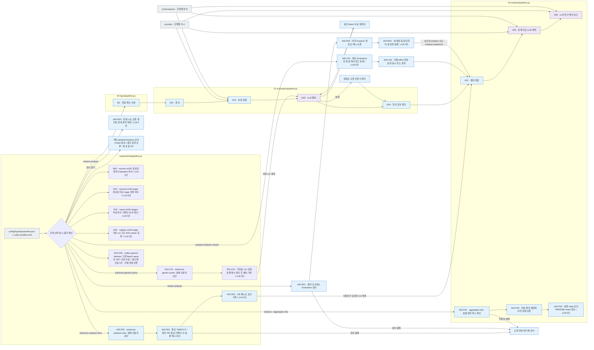
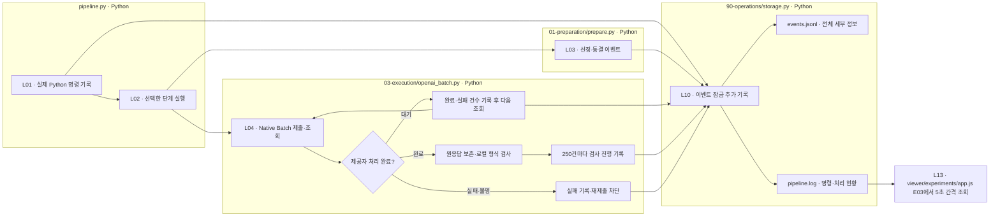
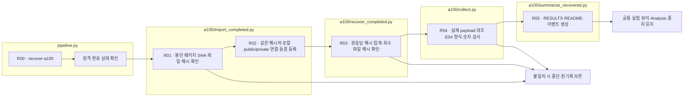

# Experiments — Input → Evaluation → Analysis

PC와 A100 공통 배포·동기화는 [a100/README.md](a100/README.md)의 S00–S09 흐름을 따릅니다. `pipeline.py a100-sync`가 코드·공개 입력 해시, 변경분 전달, 완료 원응답 수집을 담당합니다. 새 GPU 실행은 `pipeline.py a100-evaluation`이 동결 입력과 배포 버전을 확인한 뒤 수행합니다. 과거 전용 worker 결과와 공통 worker 실행을 구별합니다.

[실험 문서](../../../docs/02-experiments/README.md) · [실험 설정](../../../config/experiments/README.md) · [이관·검사 기록](../../../reports/run/20260927-experiment-source-layout/README.md)

소스 폴더는 실행 순서대로 배치했습니다. 소스의 `00-input`, `01-evaluation`, `02-analysis`는 run의 `00_input`, `01_evaluation`, `02_analysis`와 대응합니다. 내부 단계도 번호와 역할이 같습니다.

```text
src/finarch/experiments/
├── pipeline.py                     전체 단계 선택·실행·재개
├── assets.py                       단계명으로 현행 prompt/schema 찾기
├── 00-input/
│   ├── pipeline.py                 전달 자료 선정·입력 연결 확인
│   ├── dataset.py                  generated 합본 읽기·public/private 구성
│   └── edit_provenance.py          원본/변형 편집 근거 연결
├── 01-evaluation/
│   ├── pipeline.py                 E01 → E02 → E03 → E04
│   ├── 01-preparation/prepare.py   설정·실행 폴더·동결 관리
│   ├── 02-request/                 prompt/schema·manifest·캐시 정책
│   ├── 03-execution/               API·Batch·Codex·원응답 보존
│   └── 04-validation/              형식 검사·숫자 비교·집계
├── 02-analysis/
│   ├── pipeline.py                 A01 → A02 → A03 → A04
│   ├── configuration.py            TOML 분석 설정 동결·읽기
│   ├── 01-results/results.py       저장 Evaluation·제작 메타 취합
│   ├── 02-comparison/comparison.py 관계 집계·대응 비교
│   ├── 03-research/research.py      근거 확인·연구 해석·보고
│   ├── 04-quadrant/pipeline.py      F 전용 의미 그룹·조건 요약·D01 사분면
│   ├── llm_backend.py              Codex/API 선택·재개·시도 기록
│   ├── recovery.py                 A02/A03 실패 분류·승인된 최대 3회 재시도
│   ├── backends/codex.py           현재 Analysis 전용 Codex 호출
│   ├── contracts.py                응답·정확 인용 연결 검사
│   └── legacy/                     과거 분석·개선 실행 호환 코드
├── 90-operations/                  설정·경로·저장·로그·README
├── prompts/                        E02·A02·A03·A04 영어 모델 지시
├── schemas/json/                   E02·A02·A03·A04 응답·기록 JSON 형식
├── templates/                      run 안내 문서 양식
├── checks/                         모델 호출 없는 회귀 검사
└── viewer/                         공통 실험 결과 조회 서버
```

## 대상 모델 실험 사용법

프로젝트 루트에서 다음 순서로 진행합니다. 데이터 생성은 dataset pipeline, 대상 모델 Evaluation·Analysis는 experiments pipeline이 담당합니다.

1. TAT-QA Evaluation 예시 설정인 `config/experiments/config.toml`의 `evaluation.schedule.dataset.generated_path`에 `data/generated/<제작 run-id>`를 지정하고 모델·추론 설정을 확인합니다.
2. `config`로 설정을 확인하고 `prepare`로 실험 입력·요청을 동결합니다. 둘 다 모델 호출 0건이며 `prepare`가 새 run 경로를 출력합니다.
3. 출력한 run 경로로 `run --evaluation-only`를 실행합니다. Native Batch 제출·조회·수집·E04 검사까지 진행하고 Analysis 전에 끝납니다.
4. 실험 뷰어에서 해당 run을 선택하고 E03 비용·실행의 Python 로그 또는 진행 대시보드를 봅니다.
5. 분석용 메타가 준비되고 Analysis 실행을 정한 경우, `config/hyperparameter.json`에서 Analysis 설정을 확인·동결한 뒤 같은 run으로 `analysis`를 실행합니다. 아래 Evaluation TOML 예시는 명시적 선택이며 기본 설정은 아닙니다.

```sh
PYTHONPATH=src .venv/bin/python -u -B -m finarch.experiments.pipeline config --config config/experiments/config.toml
PYTHONPATH=src .venv/bin/python -u -B -m finarch.experiments.pipeline prepare --config config/experiments/config.toml
RUN_PATH=reports/experiments-run/20261003-exp-004-tatqa-luna
PYTHONPATH=src .venv/bin/python -u -B -m finarch.experiments.pipeline run --evaluation-only --run "$RUN_PATH"
```

위 `RUN_PATH`는 실제 TAT-QA 실행 예시이며 새 `prepare`에서는 새로 출력된 경로로 바꿉니다. 실제 선정은 291원본 + 2,037변형이며 네 조건을 적용해 9,312요청을 만들었습니다. 이 수를 다른 데이터셋의 고정 요청 수로 사용하지 않습니다.

```sh
tail -f "$RUN_PATH/pipeline.log"
```

`pipeline.log`는 실제 Python 명령·단계·Batch 처리 건수를, `events.jsonl`은 상세 이력을 기록합니다. 같은 pipeline이 실행 중이면 중복으로 시작하지 않습니다. 기존 실험을 재개할 때 `prepare`를 다시 실행하면 다른 실험 폴더가 생깁니다.

승인된 Codex A02 실패 복구는 `configure-analysis-retries --run "$RUN_PATH" --authorization '<실제 지시>'`로 정책을 기록한 뒤 `analysis-sequence --run "$RUN_PATH"`로 실행합니다. 기존 호출 종료 후 서버 혼잡·종료 확인 TIMEOUT만 60/120/240초 간격, 최대 3회 재시도하며 성공 응답은 보존합니다. A02 검사·취합 완료 후 A03로 이어갑니다. 설정 모델·effort는 바꾸지 않고 Evaluation도 재호출하지 않습니다. [Analysis 사용법](02-analysis/README.md)에 실패 분류·횟수 보존·중단 조건을 정리했습니다.

응답 검사 실패까지 복구하고 A03에도 적용하도록 정한 run은 설정 명령에 `--retry-validation-failures --retry-research`를 추가합니다. 단계마다 최대 3회이며 이미 사용한 회차는 유지합니다. A03의 복구를 포함한 최종 실행은 같은 `analysis-sequence`가 담당합니다.

[00 Input 사용법](00-input/README.md) · [단계별 설명](../../../docs/02-experiments/README.md) · [설정 안내](../../../config/experiments/README.md) · [실험 뷰어](http://127.0.0.1:8894/)

## 읽는 순서와 책임

|순서|소스 입구|입력 → 작업 → 산출물|
|---|---|---|
|전체|[pipeline.py](pipeline.py)|설정/run → 단계 선택·일시 중지 확인·승인된 TIMEOUT 재시도 및 해당 Gemini 암묵 캐시 예외 기록·기존 Gemini Batch만 수집·재개·저장 결과 재집계 → 상태|
|별도 분석|[90-operations/analysis_variant.py](90-operations/analysis_variant.py)|완료 Evaluation·태그·새 설정 → 원응답 동일 복사·원본 해시 확인 → 기존 분석 없는 별도 run; 준비는 LLM 0건|
|시작 출력|[90-operations/execution_start.py](90-operations/execution_start.py)|실제 동결 설정·단계 → 모델·effort·작업·요청 수·동시 한도 출력 → TASK_START 로그|
|분석 모델 변경|[90-operations/analysis_restart.py](90-operations/analysis_restart.py)|중지된 run·새 설정·사용자 지시 → 프로세스 종료·Evaluation 완료 확인 → 이전 Analysis 전체 보존·새 모델 요청 동결; 모델 호출 0건|
|분석 순서 실행|[90-operations/analysis_sequence.py](90-operations/analysis_sequence.py)|승인된 run 목록 → Analysis만 순서대로 실행 → 실제 진행·완료·오류 상태와 로그; Evaluation 재호출 없음|
|중지|[90-operations/execution_control.py](90-operations/execution_control.py)|선택 run → 해당 pipeline 또는 Analysis 순서 실행과 연결된 Codex만 종료·중간 출력 보존 → PAUSED_BY_USER; 미확인 요청 자동 재실행 금지|
|00|[00-input](00-input/README.md)|data/generated 합본 → 전달 무결성·선정·ID 확인 → public/private|
|01|[01-evaluation](01-evaluation/README.md)|공개 입력·조건 → 요청 동결·대상 모델 풀이·평가 → manifest/raw/results|
|02|[02-analysis](02-analysis/README.md)|응답·평가 → 취합·관계 비교·연구 해석 → responses/comparisons/findings|
|정의|[prompts](prompts/README.md) · [schemas/json](schemas/json/README.md)|단계명으로 지시·형식 선택 → 새 요청에 사용·run에 동결|
|공통|[90-operations](90-operations/README.md)|설정·run → 경로·잠금·해시·문서 생성 → 실행 기록|
|화면|[viewer](viewer/README.md)|선택 run → 공통 화면 → 입력·응답·분석 근거|
|회수|[a100/import_completed.py](a100/import_completed.py)|완료된 원격 동결 패키지·응답 → 해시 확인·로컬 private 연결·E04 검사 → Evaluation 뷰어; 모델 호출 없음|
|자료 회수|[a100/recover_stage.py](a100/recover_stage.py)|완료된 원격 비교 stage → 요청·취합·원응답 해시 확인 → reports/experiments-run의 원본 자료와 README·회수 색인; 모델 호출 없음|
|완료 stage 등록|[a100/register_stage.py](a100/register_stage.py)|회수 완료 vLLM stage → 동결 입력 대조·기존 E03/E04·단계 안내 생성 → 독립 날짜-모델 run과 기존 viewer; 모델 호출 없음|



회색은 파일, 파랑은 Python 처리, 보라는 LLM 호출 단계입니다. 각 단계 README의 상세도는 실제 담당 파일을 기준으로 읽습니다.

## 별도 태그의 분석을 처음부터 시작

`prepare-analysis-variant`는 완료된 Evaluation 파일만 바이트 동일하게 복사합니다. 기존 A01·A02·A03 결과는 가져오지 않습니다. 새 run은 `ANALYSIS_ONLY`이므로 Evaluation 호출이 차단됩니다. 원본/복사본의 파일 해시를 실행 전후 확인하며 실패·미평가 응답도 전체 분모에 남깁니다.

```sh
PYTHONPATH=src .venv/bin/python -u -B -m finarch.experiments.pipeline prepare-analysis-variant --source-run reports/experiments-run/20261003-exp-004-tatqa-luna --run reports/experiments-run/20261003-exp-004-tatqa-luna-sol-low --analysis-tag sol-low --config config/hyperparameter.json --authorization '<사용자의 실제 지시>'
PYTHONPATH=src .venv/bin/python -u -B -m finarch.experiments.pipeline analysis --run reports/experiments-run/20261003-exp-004-tatqa-luna-sol-low
```

첫 명령은 모델 호출 0건이며 A01부터 새로 취합합니다. 시작 로그의 `TASK_START`는 tag·모델·effort·작업·Python/LLM 구분·요청 수·동시 한도를 실행 전에 출력합니다. `restore-analysis --run <기존 run> --analysis-history <보존 시각 폴더명> --authorization '<실제 지시>'`는 중지된 기존 분석을 복원하고 현재 중지 시도도 별도로 보존합니다. 모델 호출은 없습니다.

## 설정과 진입점

다른 Analysis 완료 후 순차 실행하려면 `analysis-sequence --run <첫 run> --analysis-run <두 번째 run> --after-analysis-run <선행 run>`을 사용합니다. 선행 run의 analysis·full_pipeline이 모두 COMPLETE여야 첫 run을 시작하고, 첫 run이 정상 완료되어야 두 번째 run을 시작합니다. 대기 중 모델 호출은 0건입니다. 대기는 각 run의 `queued_execution`, 순서는 첫 run의 `02_analysis/sequence-state.json`에서 확인합니다. 선행 실패·미확인·중지는 완료로 간주하지 않습니다.

Codex Analysis는 첫 1건의 응답 대기 없이 설정 한도로 병렬 시작합니다. 스키마·근거 검사는 각 응답에 계속 적용합니다. 중지 후 아직 보내지 않은 요청을 재개할 때는 `resume-analysis --run <run> --authorization '<실제 지시>'`로 Analysis 대기만 해제한 뒤 `analysis-sequence --run <run>`을 실행합니다. 재개 명령 자체는 모델 호출 0건이며, 중지된 시도의 부분 출력·응답 미확인을 보존하고 자동 재전송하지 않습니다.

기본 설정은 [hyperparameter.json](../../../config/hyperparameter.json)입니다. `analysis.run.backend`가 `codex`이면 Codex CLI, `api`이면 OpenAI Batch를 선택합니다. 프로필 이름은 JSON에서 선택하며 모델·추론의 실제 정의는 [codex-profiles.toml](../../../config/codex-profiles.toml) 한 곳에서 읽습니다. 현재 Analysis는 Sol 6.1/low·동시 100건 고정입니다. 명시적으로 `--config`에 지정한 과거 TOML은 호환용으로 읽습니다. Python이 읽는 프로젝트 설정이며 Codex 앱의 개인 설정 파일을 덮어쓰지 않습니다.

```sh
PYTHONPATH=src .venv/bin/python -m finarch.experiments.pipeline config
PYTHONPATH=src .venv/bin/python -m finarch.experiments.pipeline prepare
PYTHONPATH=src .venv/bin/python -m finarch.experiments.pipeline evaluation --run <run>
PYTHONPATH=src .venv/bin/python -m finarch.experiments.pipeline configure-analysis --run <run> --config config/hyperparameter.json
PYTHONPATH=src .venv/bin/python -m finarch.experiments.pipeline analysis --run <run>
PYTHONPATH=src .venv/bin/python -m finarch.experiments.pipeline analysis --aggregate-only --run <run>
PYTHONPATH=src .venv/bin/python -m finarch.experiments.pipeline authorize-analysis-retry --run <run> --stage 02_comparison --trial-id <trial-id> --authorization '<사용자의 실제 승인>'
```

`config`와 `configure-analysis`는 모델을 호출하지 않습니다. `prepare`는 새 실행 자료를 만듭니다. `evaluation`·`analysis`·`run`은 실행 명령이며 일시 중지 기록이 있는 run은 시작하지 않습니다. 이미 제출한 원격 Batch 처리는 제공자에서 계속될 수 있습니다.

`analysis --aggregate-only`는 저장된 A01 원천 해시를 확인하고 A02 숫자 집계만 다시 생성합니다. 기존 `comparisons.json`은 해시를 포함한 이름으로 보존하며 A02 호출 state·원응답·manifest·전체 실행 상태를 완료로 바꾸지 않습니다. 새 모델 호출은 0건이며 A03은 시작하지 않습니다. 표시 오류를 보정할 때도 이 진입점을 사용하고 run 산출물을 직접 편집하지 않습니다.

`authorize-analysis-retry`는 사용자가 승인한 종료된 TIMEOUT 또는 중지 기록과 PID 종료가 확인된 INTERRUPTED 요청에 한 번의 추가 시도를 기록합니다. 현재 미확인 ID·종료 기록·동결 Analysis 해시를 검사하며 모델을 호출하지 않습니다. 이어서 `run`을 실행하면 파이프라인이 승인된 요청과 미전송 요청을 처리합니다. 기존 원응답과 실패 시도는 보존합니다. 운영 시간 제한 변경은 `configure-schedule --run <run> --config config/hyperparameter.json`로 반영하며 이미 동결된 요청을 바꾸지 않습니다.

`authorize-gemini-cache --run <run> --model-key <key> --authorization '<실제 승인>'`은 Native Gemini Batch의 미전송 run에만 암묵 캐시 예외를 기록합니다. 이어서 `run --evaluation-only`를 사용합니다. 원래 동결 정책은 유지하며 `cache-exceptions.json`과 실제 캐시 감사에 승인·누락 사용량을 남깁니다. 모델이 접근 제한으로 제출을 거절하면 `BATCH_REJECTED`와 제공자 오류를 보존하고 다른 모델로 자동 전환하지 않습니다.

일부 Gemini 배치가 접수된 뒤 나머지가 한도 초과로 거절되면 `collect-gemini-batches --run <run> --model-key <key>`로 접수된 ID만 수집합니다. 미제출·거절 배치는 다시 보내지 않습니다. 수집 결과와 원응답은 저장하며 원래 거절 상태와 전체 실행 실패는 유지합니다. 일부 수집 완료를 전체 Evaluation 완료로 표시하지 않습니다.

`restart-analysis --run <run> --config config/hyperparameter.json --authorization '<실제 사용자 지시>'`는 중지된 분석의 모델 변경을 준비합니다. 실행 중인 coordinator·Codex를 거절하고, 이전 `02_analysis` 전체를 `02_analysis-history/<시각>`에 보존합니다. Evaluation은 유지하며 동일 입력·prompt·schema로 새 모델의 요청 ID를 만듭니다. 기존 LLM 판정은 재사용하지 않습니다. 이 명령은 모델 호출 0건입니다. 이어서 `analysis` 또는 `analysis-sequence --run <첫 run> --analysis-run <다음 run>`으로 승인된 분석만 실행합니다.

Analysis 설정은 첫 요청 전에 `02_analysis/config.json`으로 따로 동결할 수 있습니다. 이미 시작한 분석의 설정 교체는 차단합니다. Evaluation의 동결 설정·원응답·정답 기준은 유지합니다. 기존 JSON 설정도 읽습니다.

현재 소스는 이 구조를 사용합니다. 실제 실험 완료는 각 run의 상태와 원응답으로 확인합니다. 과거 코드의 독립 문항 재검증은 신규 A01→A02→A03에 포함되지 않습니다.

이 README는 `src/finarch/documentation/templates/experiments-code.md`에서 생성합니다.

## 실행 명령과 처리 현황 로그

실험 루트의 `pipeline.log`는 실제 Python 명령, 단계 변경, Batch ID와 제공자 완료/실패 건수, 로컬 응답 검사 진행을 시간순으로 표시합니다. `events.jsonl`에는 같은 이벤트의 전체 세부 정보를 보존합니다. API 키나 전체 환경변수는 기록하지 않습니다. 제공자 완료 건수와 로컬 형식 검사 완료 건수는 별도 이벤트입니다.

공통 실험 뷰어의 E03 비용·실행 화면은 실행 README의 로그 링크를 따라 실제 `pipeline.log` 최근 60행과 마지막 Python 명령을 표시합니다. 화면이 열려 있는 동안 5초마다 읽고, 화면을 떠나면 조회를 중단합니다. 이 조회는 모델 호출을 만들지 않습니다.

|실행 파일|로그 책임|
|---|---|
|`pipeline.py`|실행 대상 run의 실제 CLI 명령 기록|
|`01-evaluation/01-preparation/prepare.py`|새 run을 만든 뒤 준비 명령·선정·동결 이벤트 기록|
|`01-evaluation/03-execution/openai_batch.py`|Batch 제출·주기 조회와 250건 단위 로컬 검사 현황 기록|
|`90-operations/storage.py`|상세 이벤트와 사람이 읽을 진행 로그에 잠금으로 추가 기록|



상자는 실제 Python 파일별 처리입니다. 제공자 내부의 대기·추론 시간은 이 로그로 분리 측정하지 않습니다. 완료를 기다리는 동안 미실행 요청과 미수집 응답을 완료로 표시하지 않습니다.

## 완료된 A100 Evaluation 회수

`pipeline.py recover-a100 --run <run> --remote-root <원격 프로젝트> --recovery-output <회수 기록 폴더>`는 `a100/import_completed.py`를 호출합니다. 새 모델 요청은 보내지 않습니다.



상자는 Python 처리 파일별 역할입니다. 완료 조건은 요청별 원응답 회수와 E04 검사·숫자 비교·동결 해시 확인을 모두 마친 상태입니다. 기존 원응답은 그대로 보존하며 Analysis는 시작하지 않습니다. 원격에서 이미 사용한 모델 버전의 점을 포함한 실행 ID도 뷰어에서 그대로 조회합니다. `..`·경로 구분자·심볼릭 링크는 허용하지 않습니다.

A03 수집 다음에는 A04가 연구 발견 F만 의미별로 묶고 네 풀이 조건을 비교합니다. 코드·프롬프트·검사 흐름은 [04-quadrant/README.md](02-analysis/04-quadrant/README.md)를 따릅니다. 완료된 A03에 이 단계만 추가할 때는 `analysis-postprocess --run <run>`을 사용하며 A02/A03 성공 호출을 다시 실행하지 않습니다.
