# The experimental pipeline is  Input → Evaluation → Analysis

[Full article in German](../README.md) [Data set transfer results](../01-dataset/03-release/README.md) · [Source configuration](../../src/finarch/experiments/README.md) · [Record of verification](../../reports/run/20260927-experiment-documentation/README.md)

## The use of entrance

The order in which the actual commands and results are read.](../../src/finarch/experiments/README.md)And then we're going to use the target model experimentation, and then we'll put the input, input, output, and re-open method in each of the steps below, and then the start of the production data. `data/generated/<run-id>`And the new Evaluation doesn't directly integrate the build run snippet file.

**Evaluation defines conditions and collects the results of the evaluation of the target model, and Analysis analyzes the relationships between the results.** The verification of the answering probability of the case itself is a step in the data set, not a repeated verification procedure to start the analysis.

This is the agreed upon structure. **006It now preserves the Codex dialogue analysis. 007From the new executable Analysis pipeline and API/Codex selection, E04 We implemented a numerical evaluation link to see if the actual mass analysis was complete in run condition. `00-input → 01-evaluation → 02-analysis`And then the internal steps correspond to the run.** The current implementation separates the table below from the step-by-step README, which does not change the storage location or the judgment of the existing run once the document is updated.

## Big picture → step → detail step

```text
docs/02-experiments/
├── README.md
├── 00_input/README.md
├── 01_evaluation/
│   ├── README.md
│   ├── 01_preparation/README.md    E01 • Objective: conditions: public/private preparation
│   ├── 02_request/README.md        E02 · prompt·schema·actual input configuration
│   ├── 03_execution/README.md      E03 · LLM Full; raw response conservation
│   └── 04_validation/README.md     E04 • Statistical evaluation of the form and existence of the correct answer criteria
└── 02_analysis/
    ├── README.md
    ├── 01_results/README.md        A01 • Accumulation of experimental results
    ├── 02_comparison/README.md     A02 • Relationship comparison; response based interpretation
    ├── 03_research/README.md       A03 • Research interpretation and development consultation
    └── 04_quadrant/README.md       A04 · Research findings group-condition comparison
```

Each step is a README that collects target, input, three-step, output, employee source, failure/missing process. `E02.01 prompt_and_schema`It's the work number in the README and not the new folder. `LLM`attach

|Stage|Input → work → output|Implementation state|
|---|---|---|
|[00 Input](00_input/README.md)|Data/generated copy → transmitted integrity; corrected verification → experimental input candidate|Implementation. Or the step of re-verifying the dataset.|
|[E01 Preparation](01_evaluation/01_preparation/README.md)|Entry candidate/user requirements → selection, public/evaluation separation, condition recording → public/private·config|Implementation|
|[E02 Request](01_evaluation/02_request/README.md)|public Q/C·precision + prompt/schema → model-by-model fixed request → manifest|Implementation. Not using private to complement the input of the array|
|[E03 Run](01_evaluation/03_execution/README.md)|Fixed request → subject LLM pool → raw response ·operating status·use volume|Implementation|
|[E04 Evaluation](01_evaluation/04_validation/README.md)|raw response ·Reported schema·reported evaluation → Formatting; source number comparison → results|format validation ·E04 Implementing the numerical comparison. Preserving the existing storage standards|
|[A01 Result collection](02_analysis/01_results/README.md)|Full request, response, presence assessment, output metadata → linked response line → responses|006 E0 of reuse results and new execution4 Implement the resulting setup|
|[A02 Relationship comparison](02_analysis/02_comparison/README.md)|Answer line → Original/Variable·Conditions·Type comparison + Answer basis of LLM|006The current dialog analysis. The new execution is the set up Codex/API analysis implementation|
|[A03 Research interpretation](02_analysis/03_research/README.md)|Comparative figures, statistical cases, half-cases, research, interpretation, change, and findings of the study|006 The new run is A0.2 And the basics are being integrated and the improvements are being made to the user feedback atmosphere.|

```mermaid
flowchart LR
 I["00 Input"] --> E1["E01 Preparation"] --> E2["E02 Request"] --> E3["E03 LLM is a"] --> E4["E04 The results of the evaluation"]
 E4 --> A1["A01 Result collection"] --> A2["A02 Relationship comparison"] --> A3["A03 Research interpretation"]
 classDef detail fill:#fce4ec,stroke:#ad1457;
 class I,E1,E2,E3,E4,A1,A2,A3 detail;
 click I "00_input/README.md" "Enter details"
 click E1 "01_evaluation/01_preparation/README.md" "Ready for the details."
 click E2 "01_evaluation/02_request/README.md" "Request details"
 click E3 "01_evaluation/03_execution/README.md" "Detailed execution"
 click E4 "01_evaluation/04_validation/README.md" "The evaluation details"
 click A1 "02_analysis/01_results/README.md" "Details of the summary"
 click A2 "02_analysis/02_comparison/README.md" "Comparison details"
 click A3 "02_analysis/03_research/README.md" "Detailed research"
```



Pink is the step that extends to the actual detailed document, and not the completion mark. The gray detail of each file is the file, the blue is the local processing, the Borah LLM, the dot line is the connection that is to be implemented.

## The structure applied to the sauce and run.

The Input and Evaluation default folder below is current `layout_version=2`It's also used in the US. **New Analysis output and E04We implemented the numerical evaluation integration of**Check whether the run is complete and the state of each run.](../../reports/run/20260927-experiment-documentation/run-layout-reference.json)Check it out.

```text
The first is the "experimental ID".
├── README.md, config.json, manifest.json, state.json, events.jsonl
├── 00_input/
│   └── public.jsonl, private.jsonl
├── 01_evaluation/
│   ├── 01_preparation/README.md
│   ├── 02_request/
│   │   ├── common.md, prompt-unguided.md, prompt-guided.md
│   │   ├── response.schema.json, plan.json, README.md
│   │   └── <model>/manifest.jsonl
│   ├── 03_execution/<model>/batches/, calls/
│   └── 04_validation/
│       ├── REPORT.md, summary.json, README.md
│       ├── numeric-comparisons.jsonl
│       └── <model>/results.jsonl, summary.json, README.md
└── 02_analysis/
    ├── README.md
    ├── 01_results/responses.jsonl, README.md
    ├── 02_comparison/comparisons.json, interpretations.jsonl, README.md
    └── 03_research/findings.json, findings.md, README.md
```

The analysis of LLM records is a common rule of analysis.](02_analysis/README.md)The prompt/schema·manifest·calls in the interpretation step are saved when you run the interpretation. `findings.json`This is interpretation data, and MD and Viewer are the markers, and no HTML or transcription input-selection results.

|Common files.|Purpose|
|---|---|
|public.jsonl|The completed Q/C·precision required in the LLM foil. item_id is for connecting and the foil is excluded from the text|
|private.jsonl|Reference to the assessment; source/variant link; production meta. Subject pool not transferred to LLM|
|The model manifest.jsonl|Actual request-condition-problem connection. Not creating a list of requests for the same connection.|
|config.json·manifest.json|The synchronization of the execution settings and input/determination. Models vary in the manifest and role of the request|
|state.json·events.jsonl|Run/detect status and change, fail, and incident|
|README.md|The role of the target, read order, file, created in the template|

## Comparing conditions and analysis boundaries

And the original. 7All the variations. **Unguided Solving / Criteria-Guided Solving × Reasoning OFF / ON** 4The new identifier is the `unguided`, `guided`And we use a common response schema, not just to select and call the cases that match the original, but to analyze the original chronological relationships after the collection. 10· variants 70· models 1items · repetitions 1If you're going to do a round, the plan-through request is 320items.

- We analyze the value of the model, or null/classification/explanation/evidence together.
- The way we interpret form passages, the matching of the original numbers, the classification of models, the way we interpret the response are different axes, and we don't change the original number of variations into the variation of the correct answer.
- The analysis of the 7topics **Total response patterns → origin/variable relationships → condition/model effects → type-by-type patterns → response four elements relationship → semiconductor → study interpretation**[The comparison of each subject.](02_analysis/02_comparison/README.md)And then we follow.
- Input verification, independent case completion, and replication are not the prerequisite for Analysis.
- Failure, failure, and failure are not hidden in the denominator. Hidden reasoning or implicit biases are not confirmed by the explanatory text and a single experiment.

[config/experiments/config.toml](../../config/experiments/README.md) `evaluation`and `analysis`Separate and separate the existing `schedule / run / models` The codex/API selection of the target pool model and analysis is separate. This structure setup is not a task that changes the setup, settings prompt, or existence raw response or executes a model call.

## Document, source and viewer connection

[Source is README](../../src/finarch/experiments/README.md)The current file → corresponding run path → input output → responsible responsibility is connected to the entire and phase pipeline connecting the actual run code.](../../reports/run/20260927-experiment-source-layout/README.md)The document step, the actual function, the plan file is [source-map.json](../../reports/run/20260927-experiment-documentation/source-map.json)It's different from.

[Screaming](http://127.0.0.1:8893/?run=20260927-experiment-documentation&doc=docs%2F02-experiments%2FREADME.md) · [Experimental results viewer](http://127.0.0.1:8894/) · [schema·prompt contrasted with](http://127.0.0.1:8893/contract?source=current)

The goal menu for the experiment viewer is Input/Evaluation/Analysis, and A0 under Analysis.1 The result is a 02 Relation to A03 The current status of the menu and data reading is [View README](../../viewer/experiments/README.md)It doesn't create HTML for each new result folder.

[Compare the comparison](http://127.0.0.1:8894/?tab=quadrants)is an additional check-in menu next to these three steps.2 Collect the storage statistics by the data set and synchronize the input 7It compares the four parts of the condition to the checked model, which is not a pipeline step or LLM analysis, but it shows the source, the problem, the denominator of the current storage.](../../log/viewer-experiments-quadrants-20261003/README.md).

Previously, the documents were](../../archive/20260927-experiment-pipeline-reorganization/README.md)Just before this analysis changes the document [Additional archived copy](../../archive/20260927-experiment-pipeline-reorganization/analysis-before-results-focus/README.md)Every step of the README is `src/finarch/documentation/templates`is generated in `manage.py refresh` → `validate`Check the link guardian map for the step-source reference.

[A04 So, we're going to do this.](02_analysis/04_quadrant/README.md)is A03 After the study is completed, we find that F is bound by meaning and linked to the four grass conditions, not grouping the polling stations and observations.
