# 실험 파이프라인 — Input → Evaluation → Analysis

[전체 문서](../README.md) · [데이터셋 전달 결과](../01-dataset/03-release/README.md) · [소스 구성](../../src/finarch/experiments/README.md) · [정리·확인 기록](../../reports/run/20260927-experiment-documentation/README.md)

## 사용법 입구

실제 명령과 결과 읽는 순서는 [실험 소스 README](../../src/finarch/experiments/README.md)의 대상 모델 실험 사용법을 따릅니다. 아래 각 단계 README에도 해당 단계의 진입점·입력·산출물·재개 방법을 넣었습니다. 제작 데이터의 시작점은 `data/generated/<run-id>`이며 새 Evaluation은 제작 run 조각 파일을 직접 취합하지 않습니다.

**Evaluation은 조건을 정해 대상 모델의 풀이와 평가 결과를 수집하고, Analysis는 그 결과 사이의 관계를 분석합니다.** 문항 자체의 답변 가능성 검증은 데이터셋 단계의 역할입니다. Analysis를 시작하기 위한 재검증 절차로 반복하지 않습니다.

이 문서는 합의한 전체 구조입니다. **006은 현재 Codex 대화 분석을 보존합니다. 007부터 새 실행용 Analysis pipeline과 API/Codex 선택, E04 숫자 평가 연결을 구현했습니다. 실제 대량 분석 완료 여부는 run 상태로 확인합니다. 소스는 `00-input → 01-evaluation → 02-analysis`로 재배치했고, 내부 단계도 run과 대응합니다.** 현재 구현은 아래 표와 단계별 README에서 구분합니다. 문서를 갱신했다고 기존 run의 저장 위치나 판정이 바뀌지는 않습니다.

## 큰 그림 → 단계 → 세부 스텝

```text
docs/02-experiments/
├── README.md
├── 00_input/README.md
├── 01_evaluation/
│   ├── README.md
│   ├── 01_preparation/README.md    E01 · 대상·조건·public/private 준비
│   ├── 02_request/README.md        E02 · prompt·schema·실제 입력 구성
│   ├── 03_execution/README.md      E03 · LLM 풀이·원응답 보존
│   └── 04_validation/README.md     E04 · 형식·기존 정답 기준의 수치 평가
└── 02_analysis/
    ├── README.md
    ├── 01_results/README.md        A01 · 실험 결과 취합
    ├── 02_comparison/README.md     A02 · 관계 비교·응답 근거 해석
    ├── 03_research/README.md       A03 · 연구 해석·개선안 토의
    └── 04_quadrant/README.md       A04 · 연구 발견 그룹·조건 비교
```

단계마다 README 하나에 목표·입력·세부 스텝·출력·담당 소스·실패/미기록 처리를 모읍니다. `E02.01 prompt_and_schema`는 README 안의 작업 번호이며 새 폴더가 아닙니다. LLM을 사용하는 세부 스텝 이름에만 `LLM`을 붙입니다.

|단계|입력 → 작업 → 출력|구현 상태|
|---|---|---|
|[00 Input](00_input/README.md)|data/generated 합본 → 전달 무결성·선정 확인 → 실험 입력 후보|구현. 데이터셋을 다시 검증하는 단계가 아님|
|[E01 준비](01_evaluation/01_preparation/README.md)|입력 후보·사용자 요건 → 선정·공개/평가용 분리·조건 기록 → public/private·config|구현|
|[E02 요청](01_evaluation/02_request/README.md)|public Q/C·precision + prompt/schema → 모델별 고정 요청 → manifest|구현. private를 풀이 입력 보충에 사용하지 않음|
|[E03 실행](01_evaluation/03_execution/README.md)|고정 요청 → 대상 LLM 풀이 → 원응답·실행 상태·사용량|구현|
|[E04 평가](01_evaluation/04_validation/README.md)|원응답·고정 schema·평가 참조 → 형식·원본 숫자 비교 → results|형식 검사·E04 숫자 비교 구현. 기존 저장 기준 보존|
|[A01 결과 취합](02_analysis/01_results/README.md)|전체 요청·응답·기존 평가·제작 메타 → 연결된 응답 행 → responses|006 재사용 결과와 신규 실행의 E04 결과 취합 구현|
|[A02 관계 비교](02_analysis/02_comparison/README.md)|응답 행 → 원본/변형·조건·유형 비교 + LLM의 응답 근거 해석 → 비교·해석 자료|006은 현재 대화 분석. 신규 실행은 설정된 Codex/API 분석 구현|
|[A03 연구 해석](02_analysis/03_research/README.md)|비교 수치·대표 사례·반례 → 연구 해석·대안·한계·토의 → findings|006 해석 저장. 신규 실행은 A02 근거를 종합하며 개선안은 사용자 토의 대기|

```mermaid
flowchart LR
 I["00 Input"] --> E1["E01 준비"] --> E2["E02 요청"] --> E3["E03 LLM 풀이"] --> E4["E04 평가 결과"]
 E4 --> A1["A01 결과 취합"] --> A2["A02 관계 비교"] --> A3["A03 연구 해석"]
 classDef detail fill:#fce4ec,stroke:#ad1457;
 class I,E1,E2,E3,E4,A1,A2,A3 detail;
 click I "00_input/README.md" "입력 상세"
 click E1 "01_evaluation/01_preparation/README.md" "준비 상세"
 click E2 "01_evaluation/02_request/README.md" "요청 상세"
 click E3 "01_evaluation/03_execution/README.md" "실행 상세"
 click E4 "01_evaluation/04_validation/README.md" "평가 상세"
 click A1 "02_analysis/01_results/README.md" "취합 상세"
 click A2 "02_analysis/02_comparison/README.md" "비교 상세"
 click A3 "02_analysis/03_research/README.md" "연구 상세"
```



분홍색은 실제 상세 문서로 확장되는 단계이며 구현 완료 표시가 아닙니다. 파일별 상세도의 회색은 파일, 파랑은 로컬 처리, 보라는 LLM, 점선은 구현 예정 연결입니다.

## 소스와 run에 적용한 구조

아래에서 Input과 Evaluation 기본 폴더는 현재 `layout_version=2`에서도 사용합니다. **새 Analysis 산출물과 E04의 숫자 평가 통합을 구현했습니다**. 실행 완료 여부는 각 run의 상태로 확인합니다. 현재 run은 [실제 경로 표본](../../reports/run/20260927-experiment-documentation/run-layout-reference.json)에서 확인합니다.

```text
reports/experiments-run/<실험ID>/
├── README.md, config.json, manifest.json, state.json, events.jsonl
├── 00_input/
│   └── public.jsonl, private.jsonl
├── 01_evaluation/
│   ├── 01_preparation/README.md
│   ├── 02_request/
│   │   ├── common.md, prompt-unguided.md, prompt-guided.md
│   │   ├── response.schema.json, plan.json, README.md
│   │   └── <model>/manifest.jsonl
│   ├── 03_execution/<model>/batches/, calls/
│   └── 04_validation/
│       ├── REPORT.md, summary.json, README.md
│       ├── numeric-comparisons.jsonl
│       └── <model>/results.jsonl, summary.json, README.md
└── 02_analysis/
    ├── README.md
    ├── 01_results/responses.jsonl, README.md
    ├── 02_comparison/comparisons.json, interpretations.jsonl, README.md
    └── 03_research/findings.json, findings.md, README.md
```

분석 LLM 기록은 [Analysis 공통 규칙](02_analysis/README.md)을 따릅니다. 해석 단계의 prompt/schema·manifest·calls는 해당 해석을 실행할 때 저장합니다. `findings.json`이 해석 데이터이고 MD와 뷰어는 그 표시입니다. 별도 결과 HTML이나 중복 input-selection은 만들지 않습니다.

|공통 파일|용도|
|---|---|
|public.jsonl|LLM 풀이에 필요한 Q/C·precision을 완성한 입력. item_id는 연결용이며 풀이 본문에서 제외|
|private.jsonl|평가 참조·원본/변형 연결·제작 메타. 대상 풀이 LLM에 전송하지 않음|
|모델별 manifest.jsonl|실제 요청·조건·문항 연결. 같은 연결의 별도 요청 목록을 만들지 않음|
|config.json·manifest.json|동결 실행 설정과 입력/정의의 해시. 모델별 요청 manifest와 역할이 다름|
|state.json·events.jsonl|실행/분석 상태와 변경·실패·재시도 이력|
|README.md|템플릿에서 생성한 목표·읽는 순서·파일 역할|

## 비교 조건과 분석 경계

원본과 7변형 모두 **Unguided Solving / Criteria-Guided Solving × Reasoning OFF / ON**의 4조건입니다. 새 식별자는 `unguided`, `guided`이며 공통 응답 schema를 사용합니다. 원본을 맞힌 문항만 선별해 호출하지 않고, 수집 후 원본 정오별 관계를 분석합니다. 예를 들어 원본 10개·변형 70개·모델 1개·반복 1회라면 계획 풀이 요청은 320개입니다.

- 모델의 값 또는 null / classification / explanation / evidence를 함께 분석합니다. Unguided의 classification null은 분류 미제공입니다.
- 형식 통과, 원본 숫자 일치, 모델의 분류, 응답에서 해석한 풀이 방식은 서로 다른 축입니다. 변형의 원본 숫자 일치를 변형 정답률로 바꾸지 않습니다.
- Analysis의 7개 주제는 **전체 응답 양상 → 원본/변형 관계 → 조건/모델 효과 → 유형별 패턴 → 응답 네 요소 관계 → 반례 → 연구 해석**입니다. [각 주제의 비교 기준](02_analysis/02_comparison/README.md)을 따릅니다.
- 입력 검증·독립 문항 풀이·정답 기준 재작성은 Analysis의 선행 절차가 아닙니다. 응답 설명은 관계 분석의 근거로 읽습니다.
- 실패·미실행·미평가·짝 없는 응답을 분모에서 감추지 않습니다. 숨은 추론이나 인과적 편향은 설명 텍스트와 단일 실험만으로 확정하지 않습니다.

[config/experiments/config.toml](../../config/experiments/README.md)의 `evaluation`과 `analysis`를 분리하고 기존 `schedule / run / models` 체계를 유지합니다. 대상 풀이 모델과 분석의 Codex/API 선택은 별개입니다. 이번 구조 정리는 설정·동결 prompt·기존 원응답을 변경하거나 모델 호출을 실행한 작업이 아닙니다.

## 문서·소스·뷰어 연결

[소스 README](../../src/finarch/experiments/README.md)에 현재 파일 → 대응 run 경로 → 입출력 → 담당 책임을 연결했습니다. 전체 및 단계 pipeline은 실제 실행 코드를 연결합니다. [이동 전후 경로와 검사 기록](../../reports/run/20260927-experiment-source-layout/README.md)을 함께 제공합니다. 문서 단계·실제 함수·계획 파일은 [source-map.json](../../reports/run/20260927-experiment-documentation/source-map.json)에서 구분합니다.

[문서 뷰어](http://127.0.0.1:8893/?run=20260927-experiment-documentation&doc=docs%2F02-experiments%2FREADME.md) · [실험 결과 뷰어](http://127.0.0.1:8894/) · [schema·prompt 대조](http://127.0.0.1:8893/contract?source=current)

실험 뷰어의 목표 메뉴는 Input / Evaluation / Analysis이며, Analysis 아래 A01 결과 취합 / A02 관계 비교 / A03 연구 해석을 둡니다. 현재 메뉴와 데이터 읽기의 이관 상태는 [뷰어 README](../../viewer/experiments/README.md)에서 구분합니다. 새 결과 폴더마다 HTML을 만들지 않습니다.

[사분면 비교](http://127.0.0.1:8894/?tab=quadrants)는 이 세 단계 옆의 추가 조회 메뉴입니다. 여러 회차의 실제 A02 저장 집계를 데이터셋·동일 입력별로 모아 7조건과 체크한 모델의 사분면을 비교합니다. 별도 파이프라인 단계나 LLM 분석이 아니며, 현재 저장 자료의 출처·문항·분모를 확인한 뒤 표시합니다. [파일별 책임·조회 흐름·검사 기록](../../log/viewer-experiments-quadrants-20261003/README.md).

이전 문서들은 [보관본](../../archive/20260927-experiment-pipeline-reorganization/README.md), 이번 Analysis 변경 직전 문서는 [추가 보관본](../../archive/20260927-experiment-pipeline-reorganization/analysis-before-results-focus/README.md)에 있습니다. 모든 단계 README는 `src/finarch/documentation/templates`에서 생성하며 `manage.py refresh` → `validate`로 단계·소스 참조·링크·보관 해시를 확인합니다.

[A04 사분면 정리](02_analysis/04_quadrant/README.md)는 A03 완료 후 연구 발견 F만 의미별로 묶어 네 풀이 조건에 연결합니다. 토의 안건과 관찰을 그룹 대상으로 넣지 않습니다.
