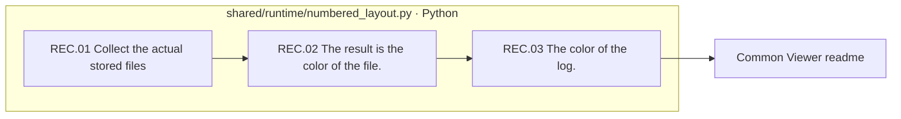

# 08-records are the result of processing and the color of the file log

[Top: Generation](../README.md) · [Guide to public outputs](../../90-operations/03-artifacts.md)

The actual run is stored in the 08It's not a new step in determining the meaning of the production, but a field of gathering the location of the resulting logs that have already been recorded.

|In order.|Save the folder|Role|
|---|---|---|
|08.01|01-run-summary|Reference to existing results like run.json|
|08.02|02-file-index|The actual list of files and the step-by-step sorting|
|08.03|03-log-index|Location of the log of the case|



The file box has no real responsibility, no pink extension nodes, no LLM call, no person approval, no process to perform the new verification.

Now numbered_layout.py has a default STAGES and a default Stag. `06-human-review` And the reference remains. **08-records exist and the color that classifies the current steps exactly.** You have to check the actual file of the active variable with the run.json.](../../99-open-issues.md)In this document work, the creation of the index generated the logic was not changed.

Implementation basis: [numbered_layout.py](../../../../src/finarch/dataset/90-operations/numbered_layout.py).

## The order of the real run is the lower folder.

The path used in the gravel counterpart: `reports/run/20260917-003/02-generation/01-round/test-0001/01-ic-value-before/08-records`The following is the actual verified folder in the execution, but that doesn't mean that all of them are in the wrong quarter.

```text
08-records/
  01-run-summary/
  02-file-index/
  03-log-index/
```
