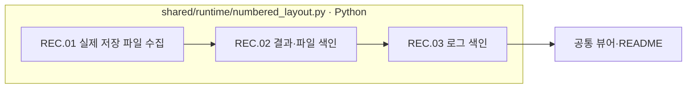

# 08-records — 처리 결과와 파일·로그 색인

[상위: Generation](../README.md) · [공통 산출물 안내](../../90-operations/03-artifacts.md)

실제 run에 저장된 08-records 구조를 따릅니다. 제작의 의미를 판단하는 새 단계가 아니라, 이미 기록된 결과·파일·로그의 위치를 모으는 영역입니다.

|순서|저장 폴더|역할|
|---|---|---|
|08.01|01-run-summary|run.json 등 기존 결과로 가는 참조|
|08.02|02-file-index|실제 파일 목록과 단계별 분류|
|08.03|03-log-index|문항·차수의 로그 위치|



파일 상자는 실제 책임, 분홍 확장 노드는 없습니다. LLM 호출·사람 승인·새 검증을 수행하는 과정이 아닙니다.

현재 numbered_layout.py에는 구형 STAGES와 `06-human-review` 참조가 남아 있습니다. **08-records가 존재한다는 사실과 그 색인이 현재 단계들을 정확히 분류한다는 사실은 다릅니다.** 활성 차수의 실제 파일과 run.json을 함께 확인해야 합니다. 이 차이는 [확인 사항](../../99-open-issues.md)에 기록했습니다. 이번 문서 작업에서 제작 인덱스 생성 로직을 변경하지 않았습니다.

구현 근거: [numbered_layout.py](../../../../src/finarch/dataset/90-operations/numbered_layout.py).

## 실제 run의 하위 폴더 순서

채번 대조에 사용한 경로: `reports/run/20260917-003/02-generation/01-round/test-0001/01-ic-value-before/08-records`. 아래는 해당 실행에서 실제 확인한 폴더이며, 미실행 분기까지 모두 존재한다는 뜻은 아닙니다.

```text
08-records/
  01-run-summary/
  02-file-index/
  03-log-index/
```
