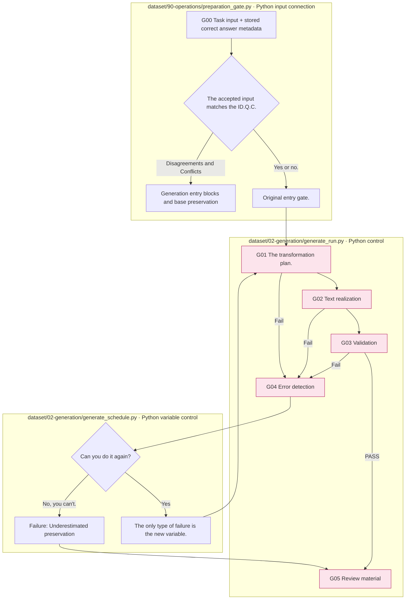
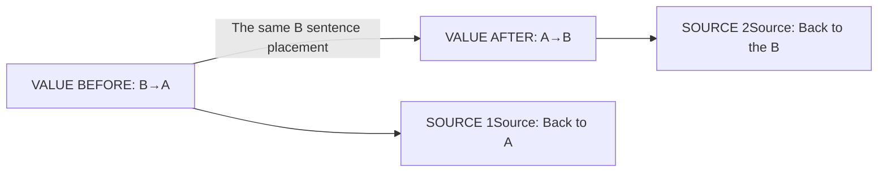

# Generation — 7The type of perturbed item

## Start the program.

The Dagan Generation's initial program is `src/finarch/dataset/02-generation/generate_schedule.py`Read the entries that passed the Preparation entry criteria in the existing run. 7It manages the type and the variable reproduction.

Run it from the storage root. `PATH_TO_EXISTING_RUN`It's a placeholder that needs to be changed to the actual run path.

```sh
PYTHONPATH=src .venv/bin/python -B -m finarch.dataset.02-generation.generate_schedule --run PATH_TO_EXISTING_RUN
```

The basic maximum dimension is the hyperparameter. `generation.schedule.max_rounds`If the existing generation is down, the same command is sent to the next generation. `--resume`The restart of the completed generation is rejected. `--cases`You can't use the phrase-type option, and it's a separate path that you use with the step-by-step option.

The real Dagenham route: `generate_schedule.run` → `generate_run.process` → Each step of the `stage.py`The normal order. 01-perturbation → 02-generate-text → 03-validation → 05- human-review, and when it fails, 04The next dimension is the re-expected type of failure, and it deals with the VALUE/SOURCE dependency.

Run setting is run `config.json`The model-effort is read in the selected profile definition. Simultaneous processing, maximum parameters, target model selection is connected to the hyperparameter setting. `02-generation`The production interval from the review data to the creation and the actual judgement of the person and the evaluation-analysis does not run.

The Generation enters. `90-operations/preparation_gate.py` `data.json`Check the correct answer value, type, accuracy gap. If there is a gap, the same case ID, question, text `accepted-input.json`The only memory that is replenished is the storage of the query-text inconsistency or partial correct answer conflict before entering. `generate_run.py`All the Dagan stage selection paths use this loader. `reference-metadata-handoff.json`This is a complementary rule. `03-release/export_run_results.py`The correct answer is for Python calculation comparison and it doesn't add to the phrase generation request.

[Top: The whole production.](../README.md) · Previous: [Preparation](../01-preparation/README.md) · Next: [Results are conveyed](../03-release/README.md)

We make a change plan on the original text, calculation graph, and then we check it in the cases, and then it records the failures and the repeats in the case times the model unit.4is the error fraction and G05It's a collection of data reviewed.



The file box is the actual control responsibility, and the flood is the step where the details are. Planning failure and lack of data about existence are not all solved by the same LLM diagnosis. The details are verified in each step document.

|Stage|What to read|
|---|---|
|[G01 The transformation plan.](01-perturbation/README.md)|Change-reserve range and calculation connection|
|[specific requirements for each type](01-perturbation/01-variant-rules.md)|VALUE forward/back, source 1/2RELATION, EA forward and back.|
|[G02 Text realization](02-generate-text/README.md)|Real LLM patch. Sharing back and forth.|
|[G03 Validation](03-validation/README.md)|The meaning of the audit: EA limitation inverse: SOURCE Accurate comparison|
|[G04 Error handling](04-exception-handler/README.md)|Feedback by article: Jaisido: Rehabilitation of the Miyu Prefecture boundary|
|[G05 Review material](05-human-review/README.md)|The separation of automatic results and human judgment|

## Inter-types dependence



The above figure is a data-dependent relationship. 7The creation of an independent LLM 7It doesn't count circuits. Audit calls and reset are stars.

[08 All records](08-records/README.md)Check the result log reference in the type.
