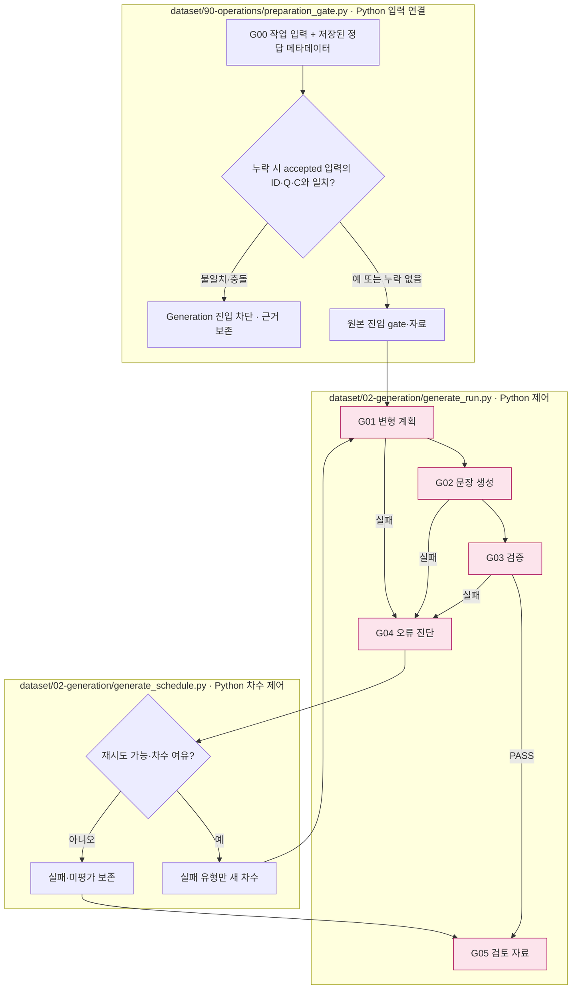
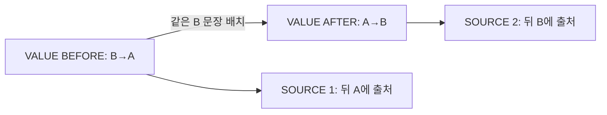

# Generation — 7유형의 변형 문항 제작

## 시작 프로그램

다건 Generation의 시작 프로그램은 `src/finarch/dataset/02-generation/generate_schedule.py`입니다. 기존 run에서 Preparation 진입 기준을 통과한 입력을 읽어 7유형 생성과 차수별 재시도를 관리합니다.

저장소 루트에서 실행합니다. 아래 `PATH_TO_EXISTING_RUN`은 실제 run 경로로 바꿔야 하는 자리표시자입니다.

```sh
PYTHONPATH=src .venv/bin/python -B -m finarch.dataset.02-generation.generate_schedule --run PATH_TO_EXISTING_RUN
```

기본 최대 차수는 hyperparameter의 `generation.schedule.max_rounds`를 읽습니다. 기존 Generation이 중단된 경우 같은 명령에 `--resume`을 추가합니다. 완료된 Generation의 재시작은 거절됩니다. 일반 전체 실행에는 `--cases`를 사용할 수 없으며, 문항·유형 선택은 단계 선택 옵션과 함께 사용하는 별도 경로입니다.

실제 다건 경로: `generate_schedule.run` → `generate_run.process` → 각 단계의 `stage.py`. 정상 순서는 01-perturbation → 02-generate-text → 03-validation → 05-human-review이며, 실패 시 04-exception-handler로 분기합니다. 다음 차수는 재시도 가능한 실패 유형을 대상으로 하며 VALUE/SOURCE 의존성도 처리합니다.

실행 설정은 run의 `config.json`, 모델·effort는 선택된 프로필 정의에서 읽습니다. 동시 처리·최대 차수·목적별 모델 선택은 hyperparameter 설정에 연결됩니다. 결과는 같은 run의 `02-generation`에 저장합니다. 검토 자료 생성까지의 제작 구간이며 사람의 실제 판정과 Evaluation·Analysis는 실행하지 않습니다.

Generation 진입 시 `90-operations/preparation_gate.py`가 `data.json`의 정답 값·타입·정밀도 누락을 확인합니다. 누락이 있으면 같은 문항 ID·질문·본문인 `accepted-input.json`의 저장값만 메모리에서 보완합니다. 질문·본문 불일치나 부분 정답 충돌은 진입 전에 막습니다. 이전 파일과 정답은 변경하지 않으며 `generate_run.py`의 다건·단계 선택 경로 모두 이 로더를 사용하고 `reference-metadata-handoff.json`에 근거 경로·해시를 기록합니다. 이 보완 규칙은 `03-release/export_run_results.py`의 기존 결과 취합 규칙과 공유합니다. 정답은 Python 계산 비교용이며 문장 생성 요청에 추가하지 않습니다.

[상위: 제작 전체](../README.md) · 이전: [Preparation](../01-preparation/README.md) · 다음: [결과 전달](../03-release/README.md)

원문·계산·그래프에서 변경 계획을 만들고 문장에 반영한 뒤 검증합니다. 문항×유형 단위로 실패와 재시도를 기록합니다. G04는 오류 분기이고 G05는 검토 자료 수집입니다.



파일 상자는 실제 제어 책임이며 분홍은 상세도가 있는 단계입니다. 계획 실패·의존 자료 부재는 같은 LLM 진단으로 모두 해결되는 것이 아닙니다. 세부 분기는 각 단계 문서에서 확인합니다.

|단계|읽을 내용|
|---|---|
|[G01 변형 계획](01-perturbation/README.md)|변경·보존 범위와 계산 연결|
|↳ [유형별 세부 조건](01-perturbation/01-variant-rules.md)|VALUE 앞/뒤, SOURCE 1/2, RELATION, EA 앞/뒤|
|[G02 문장 생성](02-generate-text/README.md)|실제 LLM patch·앞뒤 공유·최종 본문|
|[G03 검증](03-validation/README.md)|의미 감사·EA 제한 역산·SOURCE 정확 비교|
|[G04 오류 처리](04-exception-handler/README.md)|문항별 피드백·재시도·재선정 미구현 경계|
|[G05 검토 자료](05-human-review/README.md)|자동 결과와 사람 판정의 분리|

## 유형 간 의존성



위 그림은 데이터 의존 관계입니다. 원본의 RELATION/EA는 각자의 계획을 사용합니다. 생성 7건을 독립 LLM 생성 7회로 계산하지 않습니다. 감사 호출과 재시도는 별도입니다.

[08 전체 기록](08-records/README.md)에서 유형의 결과·파일·로그 참조를 확인합니다.
