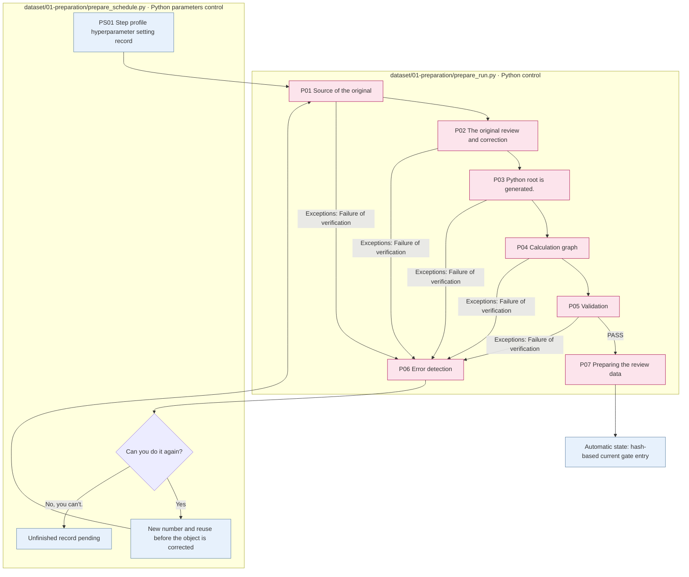

# Preparation  Step to verify the root of the equation

## Start the program.

The Dagan Preparation launch program is `src/finarch/dataset/01-preparation/prepare_schedule.py`It's ready. `input.json`And then you can run the execution settings and manage the cases, the numbers, and the repeats.

Run it from the storage root. `PATH_TO_...`It's a placeholder that needs to be changed to the real path.

```sh
PYTHONPATH=src .venv/bin/python -B -m finarch.dataset.01-preparation.prepare_schedule --input PATH_TO_INPUT_JSON --config PATH_TO_RUN_CONFIG --cases-file PATH_TO_CASE_IDS_JSON
```

`--cases-file` `["test-0001", "test-0002"]` It's a list of the form's target ID. `--cases`You can also specify the object and not write it together. If you omit the object, you process the entire input. `--plan-only`Add the number of the number of times.

When restarting the stop phrase of an existing run, the following path is used: the completed phrase is excluded from the automatic restart object, and the unfinished phrase starts again from the original.

```sh
PYTHONPATH=src .venv/bin/python -B -m finarch.dataset.01-preparation.prepare_schedule --run PATH_TO_EXISTING_RUN --resume
```

The real Dagenham route: `prepare_schedule.main` → `run_selected` → `run_case_rounds` → `prepare_run.run` → Each step of the `stage.py`The normal order. 01-source → 02-review → 03-calculation → 04-graph → 05-verification → 07- human-review, and when it fails, 06-exception-handler is broken down. `preparation_pipeline.py`is a separate `prepare_batch/run_case` It's an internal module with a path, and it's not the start of the Dagan CLI program.

`--config`The run-profile path is set, and the simultaneous processing, processing, and targeted model selection is read in the hyperparameter setting. `model`and `effort`Check it out. `reports/run/<run>/01-preparation`is saved in 02The person's review data is separate from the person's actual judgement.


Scheduler is a valid execution setting `01-preparation/runtime-config.json`It's stored in a file and then passed to the worker. `run_phase=preparation`, never `profiles_path`And then the run. `hyperparameter_path`It's a setup record that prevents the worker from re-setting the model selection step or the model version, and the individual worker in the run does not update this file.

[Top: The whole production.](../README.md) · Previous: [Prepare for entry](../00-input/README.md) · The following: [Generation](../02-generation/README.md)

So we take a Q/C/A of a case and we do a review, a calculation, a graph check.1→P02→P03→P04→P05→P07. **P06The error handling step that enters when it fails**.



The subgraph is responsible for the actual execution file, the blue is the Python control document, and the pink is the step with the detailed flow rate below. The LLM call for each step is distinguished from the detailed document. The selection execution stops at the end of the specified step with PAUSED and differs from the entire execution diagram.

|Stage|Input → output|LLM or not?|
|---|---|---|
|[00 Enter the variable](00-round-input/README.md)|case, cross, reuse, feedback connection|None|
|[P01 Source text](01-source/README.md)|Prepare input → Select case source source source directory contrast|None|
|[P02 Review](02-review/README.md)|Q/C/A → Restricted correctional copy|Reviewing and adjusting 1The trajectory.|
|[P03 Calculation](03-calculation/README.md)|Q/C form → POT source code, value of action, gold comparison|POT generated|
|[P04 Graph](04-graph/README.md)|Same code, action value → graph, value contrast, source|None|
|[P05 Validation](05-verification/README.md)|Exercise: Graph: Circular → Python testing and meaning judgement|Meaning review|
|[P06 Error handling](06-exception-handler/README.md)|Failure basis → Fixed object feedback|General diagnostic calls, infrastructure breakdowns and misunderstandings|
|[P07 Review material](07-human-review/README.md)|Automatic results → review grouping and separation of people judgement|There is no public collection.|

[08 All records](08-records/README.md)Silver is the result of the log file color, which distinguishes it from the meaning verification step.

The difference between the current entrance gate and the past person approval requirements is P07And [Confirmation](../99-open-issues.md)The document theory did not modify the gate.
