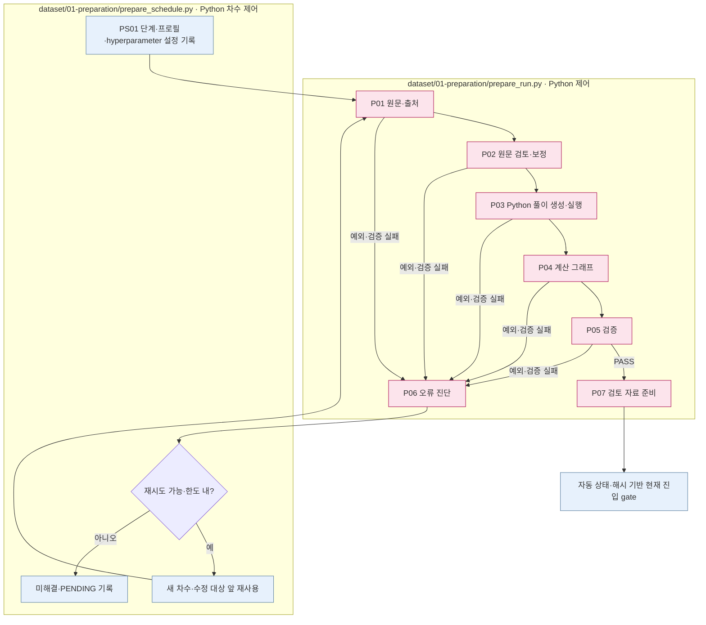

# Preparation — 원문 풀이를 확인하는 단계

## 시작 프로그램

다건 Preparation의 시작 프로그램은 `src/finarch/dataset/01-preparation/prepare_schedule.py`입니다. 준비된 `input.json`과 실행 설정을 받아 대상 문항·차수·재시도를 관리합니다.

저장소 루트에서 실행합니다. 아래 `PATH_TO_...`는 실제 경로로 바꿔야 하는 자리표시자입니다.

```sh
PYTHONPATH=src .venv/bin/python -B -m finarch.dataset.01-preparation.prepare_schedule --input PATH_TO_INPUT_JSON --config PATH_TO_RUN_CONFIG --cases-file PATH_TO_CASE_IDS_JSON
```

`--cases-file`은 `["test-0001", "test-0002"]` 형태의 대상 ID 목록입니다. `--cases`로도 지정할 수 있으며 두 옵션을 함께 쓰지 않습니다. 대상을 생략하면 입력 전체를 처리합니다. 실행 없이 대상·설정을 확인하려면 같은 명령에 `--plan-only`를 추가합니다.

기존 run의 중단 문항을 재개할 때는 다음 경로를 사용합니다. 완료 문항은 자동 재개 대상에서 제외되며, 미완료 문항은 원문 단계부터 다시 시작합니다.

```sh
PYTHONPATH=src .venv/bin/python -B -m finarch.dataset.01-preparation.prepare_schedule --run PATH_TO_EXISTING_RUN --resume
```

실제 다건 경로: `prepare_schedule.main` → `run_selected` → `run_case_rounds` → `prepare_run.run` → 각 단계의 `stage.py`. 정상 순서는 01-source → 02-review → 03-calculation → 04-graph → 05-verification → 07-human-review이며, 실패 시 06-exception-handler로 분기합니다. `preparation_pipeline.py`는 별도 `prepare_batch/run_case` 경로를 가진 내부 모듈이며, 현재 다건 CLI의 시작 프로그램이 아닙니다.

`--config`는 실행·프로필 경로 설정이고, 동시 처리·재시도·목적별 모델 선택은 hyperparameter 설정에서 읽습니다. 실행 전 선택된 프로필의 실제 `model`과 `effort`를 확인합니다. 결과는 `reports/run/<run>/01-preparation`에 저장하며 02는 해당 run을 입력으로 받습니다. 사람 검토 자료 생성과 사람의 실제 판정은 별개입니다.


스케줄러는 유효 실행 설정을 `01-preparation/runtime-config.json`으로 저장하여 worker에 전달합니다. 이 파일에는 `run_phase=preparation`, 절대 `profiles_path`, 해당 run의 `hyperparameter_path`가 포함됩니다. worker가 모델 선택 단계나 모델 버전을 다시 추측하지 않도록 하는 설정 기록이며, 실행 중 개별 worker가 이 파일을 갱신하지 않습니다.

[상위: 제작 전체](../README.md) · 이전: [입력 준비](../00-input/README.md) · 다음: [Generation](../02-generation/README.md)

한 문항의 Q/C/A를 받아 검토·계산·그래프·검증을 수행합니다. 정상 경로는 P01→P02→P03→P04→P05→P07입니다. **P06은 실패할 때 진입하는 오류 처리 단계**입니다.



subgraph는 실제 실행 파일의 책임, 파랑은 Python 제어·기록, 분홍은 아래 상세 흐름도가 있는 단계입니다. 각 단계의 LLM 호출은 상세 문서에서 구별합니다. 선택 실행은 지정 단계 끝에서 PAUSED로 멈추며 전체 실행 그림과 다릅니다.

|단계|입력 → 출력|LLM 여부|
|---|---|---|
|[00 차수 입력](00-round-input/README.md)|문항·차수·재사용·피드백 연결|없음|
|[P01 원문](01-source/README.md)|준비 입력 → 선택 문항·출처·원문 대조|없음|
|[P02 검토](02-review/README.md)|Q/C/A → 제한 보정본·변경 이유·판정|차수당 검토·보정 1회 경로|
|[P03 계산](03-calculation/README.md)|Q/C·형식 → POT·원코드·실행값·gold 비교|POT 생성|
|[P04 그래프](04-graph/README.md)|같은 코드·실행값 → 그래프·값 대조·출처|없음|
|[P05 검증](05-verification/README.md)|실행·그래프·근거 → Python 검사와 의미 판단|의미 검토|
|[P06 오류 처리](06-exception-handler/README.md)|실패 근거 → 수정 대상·피드백|일반 진단 호출, 기반시설 분기는 미호출|
|[P07 검토 자료](07-human-review/README.md)|자동 결과 → 검토 묶음·별도 사람 판정|일반 수집에는 없음|

[08 전체 기록](08-records/README.md)은 결과·파일·로그 색인입니다. 의미 검증 단계와 구별합니다.

현재 진입 gate와 과거 사람 승인 요구의 차이는 P07과 [확인 사항](../99-open-issues.md)에 명시했습니다. 문서 정리로 gate를 수정하지 않았습니다.
