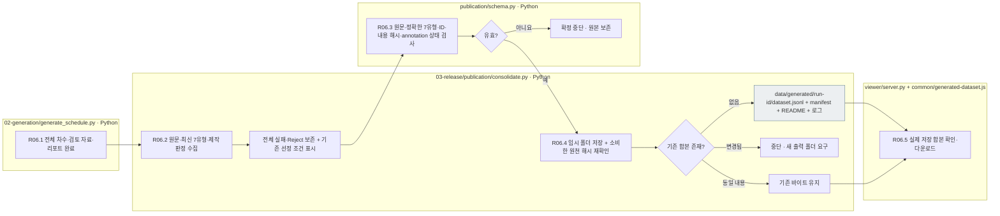
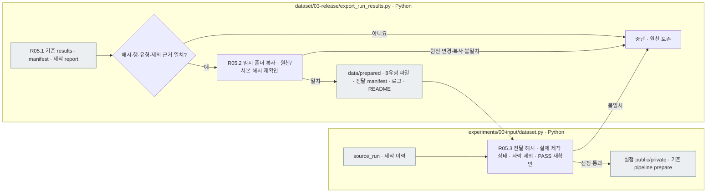
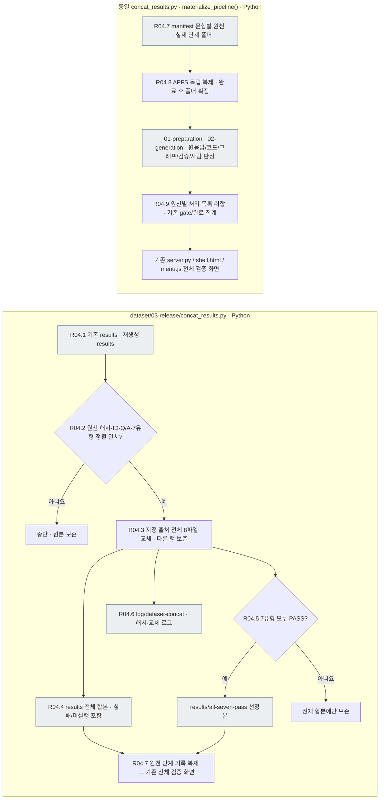
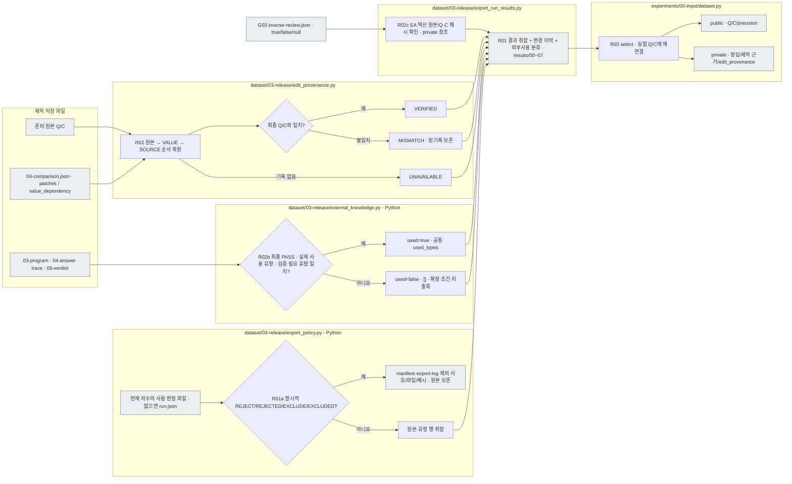

# 제작 결과 선정·고정·실험 전달

[상위: 제작 전체](../README.md) · 이전: [Generation](../02-generation/README.md) · 다음 영역: [실험](../../02-experiments/README.md)

이 영역은 제작의 끝과 실험의 시작 사이의 계약을 설명합니다. 실행별 `results/` 취합기는 원본 입력과 7유형의 최종 저장 결과를 모읍니다. 자동 PASS와 사람 승인은 구별하며, 선정·배포를 모두 완료하는 공통 release 실행기는 아직 별도입니다.

[선정·공개/비공개·버전·해시 계약](01-contract.md)을 읽으세요. 자동 검사 PASS, 사람 판정, 실험에 사용할 집단의 선정 조건을 구별합니다. 실제 실험 입력 준비 경로는 실험 계획을 다시 정리할 때 대조합니다.

## Generation 종료 후 data/generated 단일 취합본

[publication/consolidate.py](../../../src/finarch/dataset/03-release/publication/consolidate.py)는 전체 Generation 종료 후 `data/generated/<run-id>/dataset.jsonl`을 만듭니다. 한 줄에 준비 원천, 최종 Preparation 원문, 7유형의 실제 Q/C와 상태·정답 메타정보·내용 해시를 저장합니다. 실패·Reject를 보존하는 전체 취합본이며, `production_selection.eligible`은 기존 Preparation PASS·7유형 전부 PASS·명시적 Reject 없음 기준입니다. 기존 `results/`와 평가자 HTML의 선정 기준은 변경하지 않습니다.

`annotation.status=UNREVIEWED`는 평가자 annotation을 아직 연결하지 않았다는 뜻입니다. 자동 검사와 제작 판정을 별도 필드로 보존합니다. 이후 `item_id`와 `content_sha256`이 맞는 실제 ratings만 새 합본에 연결하며 평가자 간 이견을 임의로 합치지 않습니다. 원문 gold를 변형의 정답으로 간주하지 않습니다.

최종 human annotation 통과 목록에 포함된 변형은 사용자 요청에 따라 `annotation={"ratings": [], "status": "PASS"}`로 기록할 수 있습니다. 평가자별 상세 기록은 데이터셋에 넣지 않으며, 변경 전 합본을 백업합니다. 목록 밖 문항과 원문의 annotation은 유지합니다. 이 형식의 PASS는 기존 자동 취합의 UNREVIEWED 기본값이나 export 선정 기준을 변경하지 않습니다.

|단계·담당 파일|입력 → 처리 → 출력|
|---|---|
|R06.1 `generate_schedule.py`|전체 차수·검토 자료·리포트 완료 → `consolidate.publish()` 호출. 부분 단계·실패 해석·재검토 경로는 제외|
|R06.2 `publication/consolidate.py`|선정 원천·활성 Preparation·최신 유형별 run.json·관찰 → 상태·ID·원천 해시 대조 → 원문+7유형|
|R06.3 `publication/schema.py`|문항·Q/C·ID·annotation 상태·ratings → 스키마와 내용 해시 검사. PASS는 빈 ratings만 허용 → 유효 문항 또는 중단|
|R06.4 `publication/consolidate.py`|검사된 문항 → 임시 폴더 저장·원천 재확인·폴더 확정 → dataset.jsonl·manifest·스키마·로그·템플릿 README|
|R06.5 `viewer/server.py` / `common/generated-dataset.js`|선택 run의 합본 → 해시 확인·문항별 실제 Q/C 읽기 → 기존 공통 화면의 생성 데이터 합본 버튼|



회색은 파일이며 다른 상자는 Python 검사·분기입니다. 추가 LLM 호출이나 새 상세도 확장 노드는 없으므로 분홍색을 사용하지 않습니다. Generator 실행 성공과 합본 확정은 구별합니다. 취합 실패 시 오류를 반환하고 기존 합본을 덮어쓰지 않습니다. 대상 모델에 전달할 public Q/C 선택은 별도 경계입니다.

```shell
# 완료된 과거 실행을 같은 취합기로 배포. API 호출 없음.
PYTHONPATH=src .venv/bin/python -B -m finarch.dataset.03-release.publication.consolidate \
  --run reports/run/20261003-003
```

현재 배포 대상은 [20261003-003](../../../data/generated/20261003-003/README.md)과 [20261003-concat-002](../../../data/generated/20261003-concat-002/README.md)입니다.

## 실험용 결과를 data/prepared에 전달

아래는 기존 `prepare_copy()` 기능의 호출 예이며, 현재 `data/generated` 배포와 별도입니다. 원천 [20261003-003 제작 run](../../../reports/run/20261003-003/README.md)의 기록·원응답·판정은 원래 위치에 보존합니다. prepared 전달 폴더가 실제로 존재하는지는 사용 전에 확인합니다. 이번 배포에서 prepared 사본을 재생성하거나 실험 코드를 수정하지 않습니다.

[export_run_results.py](../../../src/finarch/dataset/03-release/export_run_results.py)의 `prepare_copy()`는 이미 취합된 `results/`의 해시·행 수·유형·명시적 제외 근거를 확인하고, 새 `data/prepared` 폴더에 바이트 동일 사본·원천 README·전달 manifest·로그·템플릿 README를 저장합니다. 기존 전달 폴더는 덮어쓰지 않으며 복사 중 원천 변경을 발견하면 확정하지 않습니다. 다시 Export하거나 모델을 호출하지 않습니다.

```shell
PYTHONPATH=src .venv/bin/python -B -m finarch.dataset.03-release.export_run_results \
  reports/run/20261003-003 --prepared-output data/prepared/tatqa/20261003-003
```

|단계·담당 파일|입력 → 처리 → 출력|
|---|---|
|R05.1 export_run_results.py `prepare_copy()`|기존 results·제작 report → 해시·ID·유형·제외 검사 → 복사 가능 여부|
|R05.2 같은 함수|원천 파일 → 임시 폴더 복사·전후 해시 검사 → 새 prepared 폴더·prepared-results.json·events.jsonl·README|
|R05.3 experiments/00-input/dataset.py `collected_results()/select()`|source_run·results_path → 전달 manifest·원천 상태·검사 결과 재확인 → 선정 public/private 입력|



회색은 파일·폴더이며 나머지는 로컬 검사·처리입니다. 이번 전달에 LLM 호출은 없습니다. 437원본의 결과·실패를 보존하고, 원본과 7변형 모두 자동 PASS인 291문항군을 Evaluation 입력으로 선정합니다. 이 수는 자동 검사 기준이며 사람 승인이나 의미 판정 완료를 뜻하지 않습니다. 신규 실험의 `results_path`는 전달본, `source_run`은 제작 이력입니다. 같은 이름의 `results/`를 data 폴더 안에 다시 만들지 않습니다.

[20260917-002 취합 결과](../../../reports/run/20260917-002/results/README.md)에는 `00-input.json`과 번호를 붙인 7유형 JSON, 출처·해시 manifest가 있습니다. 실험 입력 선택기는 이 폴더가 있으면 파일 무결성을 확인하고 PASS Q/C를 읽습니다.

## 출처별 재생성 결과 교체

[concat_results.py](../../../src/finarch/dataset/03-release/concat_results.py)는 기존 합본에서 한 출처의 모든 문항을 재생성 합본으로 교체하는 Python 처리입니다. 지정 출처의 ID 집합과 원천 raw_id·질문·정답·정밀도가 정확히 일치해야 합니다. Preparation 후 질문 표현의 차이는 `question-revisions.json`에 보존하고 새 결과를 채택하며, 정답·정밀도 차이는 중단합니다. 해시·정렬·유형을 검사한 뒤 원문과 7유형을 함께 교체하며, 다른 출처 행은 보존합니다. 새 실패도 그대로 반영하고 이전 성공으로 대신 채우지 않습니다. 검사가 실패하거나 출력 폴더가 이미 있으면 중단합니다. LLM 호출과 pipeline 재실행·재시도는 없습니다.

산출물은 새 run 폴더의 `results/` 전체 합본, `results/all-seven-pass/`의 7유형 전체 자동 PASS 선정본, 원천별 해시 manifest입니다. `case-map.json`, `concat-summary.json`, `concat-log.json`은 `log/dataset-concat/<run>/`에 따로 저장합니다. README는 documentation/templates의 concat 템플릿으로 생성합니다. `materialize_pipeline()`은 manifest의 문항별 원천 선택과 동일하게 Preparation·Generation 단계 기록을 복제합니다. APFS clone을 사용하므로 이후 판정 저장·파일 변경은 원천 파일에 전파되지 않습니다. 기존 공통 viewer가 코드·그래프·LLM 원응답·검증·사람 판정 화면을 그대로 제공합니다. 데이터셋 목록은 보고서 폴더를 제외하고 run 이름의 역순으로 정렬합니다. 합본은 새 pipeline 실행이 아니며 행의 private 근거 경로는 manifest의 `row_source_runs[id]` 원천 run을 기준으로 해석합니다.



회색은 파일입니다. 기존 두 원천을 읽는 로컬 취합 흐름이며 LLM·새 모델 실험·사람 승인 판정은 포함하지 않습니다. [20261003-concat-001 실행 안내](../../../reports/run/20261003-concat-001/README.md)에서 실제 교체 결과를 확인합니다.

## 최종 파일과 변경 이력 전달

|순서|실행 파일·함수|입력 → 처리 → 출력|
|---|---|---|
|R01a 제외 판정|[export_policy.py](../../../src/finarch/dataset/03-release/export_policy.py) `review()/exclusion()`|현재 차수의 canonical 사람 판정 → 명시적 Reject·Exclude만 제외 → manifest·로그의 근거 파일·해시|
|R01 취합|[export_run_results.py](../../../src/finarch/dataset/03-release/export_run_results.py) `export()`|제외되지 않은 원본·유형별 최종 관찰·상태 → 원본 순서의 부분집합으로 취합 → `results/00~07.json`|
|R02 편집 확인|[edit_provenance.py](../../../src/finarch/dataset/03-release/edit_provenance.py) `from_file()/build()`|제작 `04-comparison.json`의 원본·최종 Q/C·patches·value_dependency → 단계별 복원과 일치 검사 → 각 행의 `edit_provenance`|
|R02b 외부사용 확인|[external_knowledge.py](../../../src/finarch/dataset/03-release/external_knowledge.py) `classify()`|활성 차수의 계산·정답 경로·검증 판정과 최종 Preparation 상태 → 사용·필요·PASS가 모두 맞는 외부 유형만 `external_knowledge.used=true`로 기록|
|R02c EA 역산 참조|[export_run_results.py](../../../src/finarch/dataset/03-release/export_run_results.py) `export()`|현재 Q/C·역산 원본 해시 확인 → EA 행에 `inverse_review_ref` 경로·해시만 연결. true/false로 선정 조건을 바꾸지 않음|
|R03 실험 전달|[dataset.py](../../../src/finarch/experiments/00-input/dataset.py) `select()`|결과 파일·manifest → 선정·재확인 → public Q/C·precision, private 정답·변경 이력|



회색은 파일, 그 외는 로컬 처리입니다. LLM 호출·자동 재시도·추가 상세 문서 노드는 없습니다. 편집 확인은 의미 정답 판정을 대신하지 않습니다. IC-source는 부모 IC-value의 초록색과 출처 A의 분홍/출처 B의 빨강을 함께 표시할 근거를 보존합니다. 삭제는 변경 기록으로 설명하며 입력 C에 복원하지 않습니다.

2026-10-01부터 새 `export()`는 현재 차수의 명시적 사람 Reject/Exclude를 제외합니다. Preparation의 `07-human-review/03-record-decision/decision.json`이 거절이면 원본과 7유형 전체를 제외합니다. Generation의 `05-human-review/02-record-decision/decision.json`이 거절이면 해당 유형만 제외합니다. 판정 파일이 있으면 오래된 `run.json.human_decision`보다 우선하며, 이전 차수의 판정은 읽지 않습니다. Accept·Pending·미판정·자동 FAIL은 이 규칙으로 제외하지 않습니다. FAIL·NOT_EVALUATED는 PASS가 아니며 실험 선정 조건은 별도입니다.

유형별 행 수가 다를 수 있으므로 `id`로 연결합니다. `manifest.json`의 `selection_policy=EXCLUDE_EXPLICIT_HUMAN_REJECTIONS`, `source_input_count`, `selected_count`, `files.*.count`, `exclusions`와 `export-log.json`에 제외 대상·유형·판정·이유·원천 해시를 기록합니다. 실험 입력 선택기는 순서·중복·파일 해시와 누락된 유형의 제외 근거를 검사하고, 7유형 모두 PASS를 요구하는 집단에서는 일부 유형이 제외된 문항을 선정하지 않습니다. 구형 취합본은 기존 전체 정렬 계약을 유지합니다. 기존 실행의 원본·응답·판정은 변경하지 않으며, 이 설정 변경만으로 이미 저장된 취합본을 다시 쓰지 않습니다.

기존 취합 결과는 `export_run_results.py`의 `enrich_existing()`으로 Q/C·정답·상태를 보존한 채 같은 파일에 변경 이력만 보강할 수 있습니다. `export-log.json`에 전후 해시를 남기고 `manifest.json`의 해시를 갱신합니다. 기록이 없거나 복원이 맞지 않으면 그 상태를 저장하며 임의의 차이 표시를 만들지 않습니다.

`export()`는 다음 실행부터 두 필드의 외부사용 분류를 자동 저장합니다. 이미 취합한 실행은 `enrich_external_existing()` 또는 `--external-knowledge-only`로 같은 판정 함수를 적용합니다. 최종 Preparation PASS와 검증 PASS/EXTERNAL, 정답 경로의 사용 유형과 필요 유형이 모두 맞아야 `used=true`입니다. 다른 경우의 `false`는 비사용 확정이 아닙니다. 기존 Q/C·상태·7유형 파일을 보존하고 원래 취합본은 `results/revisions/`에 보관하며, 보완 시각·근거 파일 해시·전후 해시를 `export-log.json`에 남깁니다. 이 단계는 저장 기록을 읽는 Python 처리로 LLM을 호출하지 않습니다. 외부사용 분류는 제작 측 private 메타정보이며 public 질문·본문·정밀도에 섞지 않습니다.

EA 역산은 [G03 검증 단계](../02-generation/03-validation/README.md)에 별도로 저장합니다. 취합 시 원판정을 복제하지 않고 `inverse_review_ref`만 보존합니다. `COMPLETED`의 true/false와 호출 실패·미실행의 null은 구분하며, public Q/C·정밀도에는 어떤 역산 정보도 넣지 않습니다. 기존 실행의 판정과 원응답은 소급 변경하지 않습니다.
