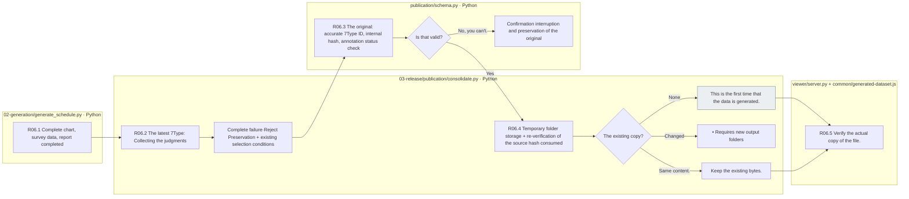
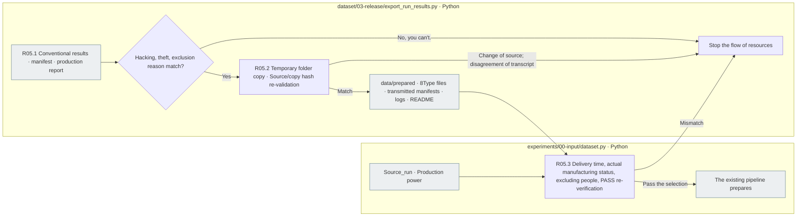
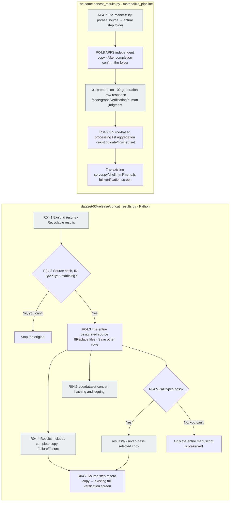
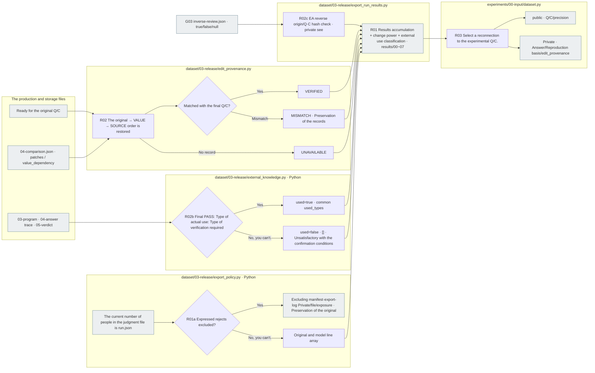

# Selection, recording and experimental delivery

[Top: The whole production.](../README.md) · Previous: [Generation](../02-generation/README.md) · The following areas: [Experimentation](../../02-experiments/README.md)

This area describes the contract between the end of production and the beginning of the experiment. `results/` The adapter is the original input and the 7Collects the final type of storage results. Automatic PASS and human approval are distinguished, and the common release executor that completes both selection and distribution is still a star.

[Repair, disclosure, disclosures, translations, disclosing agreements](01-contract.md)Read it. Automatic testing PASS, human judgement, selection criteria for the experiment, and the actual path of experiment input preparation contrasts when rearranging the experimental plan.

## After the end of generation data/generated single transcript

[publication/consolidate.py](../../../src/finarch/dataset/03-release/publication/consolidate.py)After the end of the whole generation `data/generated/<run-id>/dataset.jsonl`It's a line of ready-made sources, the final preparation code, 7It stores the actual Q/C and status, metadata, and input tables of the type, and it's a complete duplicate of the fail-reject, and it keeps the fail-reset, and it can be used to save the entire fail-rejet. `production_selection.eligible`The current Preparation PASS;7All types are PASS: no-reject criteria. `results/`And the selection criteria for the evaluator HTML don't change.

`annotation.status=UNREVIEWED`This means that the evaluator annotation has not yet been connected. `item_id`and `content_sha256`These are the only true ratings that are attached to the new copy, and they don't arbitrarily combine the bias between the evaluators. They don't consider the original gold as the correct answer to the variation.

The variations included in the final human annotation pass list are as requested by the user `annotation={"ratings": [], "status": "PASS"}`You can save the details of each evaluator in the database, but you don't add them to the dataset, and you back up the copy before you change it. You keep the annotation of the out-of-the-list clause and source. PASS in this format doesn't change the UNREVIEWED default value or export selection criteria of an existing automated merger.

|Step: The file is file.|Input → process → output|
|---|---|
|R06.1 `generate_schedule.py`|Full chart, survey data, report completed `consolidate.publish()` Excluding partial step, failure interpretation, re-examination path|
|R06.2 `publication/consolidate.py`|Select source; Activity Preparation; latest type by type run.json; review → status; ID; source hash contrast → source+7Type|
|R06.3 `publication/schema.py`|Article·Q/C·ID·annotation status·ratings → Schema and content hashing. PASS only allows empty ratings → Valid case or stop|
|R06.4 `publication/consolidate.py`|The check-in is done by the user. The check-out is done by a user.|
|R06.5 `viewer/server.py` / `common/generated-dataset.js`|Select the run copy → hash check → problem by problem actual Q/C reading → existing common screen generating data copy button|



The gray is the file, and the other box is the Python check-in. There are no additional LLM calls or new detailed extended nodes, so no pink is used. Generator execution success is distinguished from copy verification. Returns errors when the assembly fails and does not overwrite the existing copy. Public Q/C selection to pass to the target model is a separate boundary.

```shell
# Distributed to the same assembly as the completed past execution. No API calls.
PYTHONPATH=src .venv/bin/python -B -m finarch.dataset.03-release.publication.consolidate \
  --run reports/run/20261003-003
```

The current distribution is [20261003-003](../../../data/generated/20261003-003/README.md)and [20261003-concat-002](../../../data/generated/20261003-concat-002/README.md).

## The results of the experiment are transmitted to data/prepared

Below is the existing `prepare_copy()` It's a call example of a function, and it's current. `data/generated` So, the distribution and the star.20261003-003 Production run](../../../reports/run/20261003-003/README.md)The raw response of the file is preserved in its original location. The prepared delivery folder verifies that it actually exists before use.

[export_run_results.py](../../../src/finarch/dataset/03-release/export_run_results.py) `prepare_copy()`The first is the `results/`Check the hash, row count, and the temporary exclusion reason, and then `data/prepared` In the folder, bytes store the same copy source README; transmission manifest; log template README. The existing forwarding folder does not overwrite, and if a source change is found in the copy, it does not confirm, nor does it re-export or call the model.

```shell
PYTHONPATH=src .venv/bin/python -B -m finarch.dataset.03-release.export_run_results \
  reports/run/20261003-003 --prepared-output data/prepared/tatqa/20261003-003
```

|Step: The file is file.|Input → process → output|
|---|---|
|R05.1 export_run_results.py `prepare_copy()`|Existing results, product report, hash, ID, model, external testing, and whether or not it can be copied|
|R05.2 Same function.|Source file → Temporary folder copy; post-hash check → new prepared folder; prepared-results.json·events.jsonl·README|
|R05.3 experiments/00-input/dataset.py `collected_results()/select()`|source_run·results_path → transmit manifest; source status; verification of the search results → select public/private input|



The gray is the file folder, and the rest is the local inspection and processing. 437The original results, the failures, the preservation of the original and the original. 7All the transformations are automatic passes. 291The number is automatically checked, and it doesn't mean that you're completing a human approval or semantic assessment. `results_path`And the delivery, `source_run`It's the production power. `results/`I don't re-create the data in the folder.

[20260917-002 The result of the merger](../../../reports/run/20260917-002/results/README.md)In some cases `00-input.json`And the number is 7There's a type JSON, a source and a hash manifest, and the experimental input selector checks the integrity of the file and reads PASS Q/C if it has this folder.

## Replacement of the source-based regenerative results

[concat_results.py](../../../src/finarch/dataset/03-release/concat_results.py)It's a Python process that replaces every case from an existing source with a replicable source. It's about identifying the source's ID set exactly with the source raw_id, question, answer, accuracy. `question-revisions.json`It preserves the data and adopts new results, stops the difference between correctness and accuracy. 7It replaces the type together, preserves the different source rows, reflects the new failures, and doesn't fill them with the previous successes instead. The test fails, or the output folders stop if they're already there. There's no LLM call and no pipeline re-enactment.

The output is in the new run folder. `results/` The whole copy, `results/all-seven-pass/` 7The full type automatic PASS selection, source-specific hash manifest. `case-map.json`, `concat-summary.json`, `concat-log.json` `log/dataset-concat/<run>/`ReadME creates a concat template of documentation/templates. `materialize_pipeline()`The same as the phrase-by-case source selection of the manifest, the Preparation-Generation step record is copied. Since APFS clone is used, the judgment save and file changes are not propagated to the source file. The existing common viewer provides the code graph, LLM raw response, verification, and human judgment screen as it is. The dataset list is sorted by the inverse of the run name except for the report folder. `row_source_runs[id]` So we're going to interpret the source run as a base.



The gray is a file, a local merger stream that reads both existing sources, and does not include the LLM model experiment and the human approval judgment.20261003-concat-001 Running instructions](../../../reports/run/20261003-concat-001/README.md)Check the actual replacement results.

## Final file and change power transmission

|In order.|Run the file function|Input → process → output|
|---|---|---|
|R01a Excluded judgment|[export_policy.py](../../../src/finarch/dataset/03-release/export_policy.py) `review()/exclusion()`|The current number of canonical persons judgments → explicit Reject excludes only → manifest logs base file explanation|
|R01 Collection|[export_run_results.py](../../../src/finarch/dataset/03-release/export_run_results.py) `export()`|Original, type, final observation, condition, and assembly as a partial set of the original order `results/00~07.json`|
|R02 Edit the check|[edit_provenance.py](../../../src/finarch/dataset/03-release/edit_provenance.py) `from_file()/build()`|Production `04-comparison.json`The original; the latest Q/C; patches; value_dependency → step by step check for match with the return → of each row `edit_provenance`|
|R02b External use verification|[external_knowledge.py](../../../src/finarch/dataset/03-release/external_knowledge.py) `classify()`|The calculation of the active variable, the correct path, the verification judgment and the final preparation state, the use, the requirement, the PASS, all correspond to the external type. `external_knowledge.used=true`Recorded|
|R02c See EA as a reversal|[export_run_results.py](../../../src/finarch/dataset/03-release/export_run_results.py) `export()`|Current Q/C. Check the original hash of the asset → EA on the line `inverse_review_ref` Just connect path-to-path. Do not change the selection condition to true/false.|
|R03 The experimental delivery|[dataset.py](../../../src/finarch/experiments/00-input/dataset.py) `select()`|Results file·manifest → selection·revalidation → public Q/C·precision, private right answer·change ability|



Gray is the file, except for local processing. LLM calls, autocalls, and additional detailed document nodes are not available. Edit verification does not replace meaningful correctness judgement. IC-source preserves the basis for displaying the parent IC-value green and the source A's pink/source B's red together. Deletion is described as a change record and is not restored to input C.

2026-10-01From the new `export()`The current variable excludes the explicit person Reject/Exclude. `07-human-review/03-record-decision/decision.json`If you refuse, you'll have the original and the 7And that's all the way down to the generation. `05-human-review/02-record-decision/decision.json`If you reject this, you exclude the type. `run.json.human_decision`Priority is to not read the judgments of the previous variables. Accept, pending, misjudging, automatic FAIL are not excluded from this rule. FAIL, NOT_EVALUATED is not a PASS, nor is the test selection condition an anomaly.

So the row count can be different for each type. `id`It connects to the. `manifest.json` `selection_policy=EXCLUDE_EXPLICIT_HUMAN_REJECTIONS`, `source_input_count`, `selected_count`, `files.*.count`, `exclusions`and `export-log.json`The experiment input selector checks the order, duplicate, file hash and the missing type of exclusion reason, and then the test results are displayed in the following table: 7In groups where all types require PASS, they don't select cases excluding some types. The formatted duplicate maintains the existing complete sorting agreement. It doesn't change the original, response, or version of the existing execution, and it doesn't rewrite the duplicate that's already saved by changing this setting.

The result of the current merger is `export_run_results.py` `enrich_existing()`You can only increase the change power of the same file while maintaining the Q/C. Correct status. `export-log.json`Leave a post-war hash on the `manifest.json`If there's no record or if the recovery is not correct, it stores the status and doesn't create any arbitrary difference.

`export()`The next run automatically saves the external use classification of the two fields. `enrich_external_existing()` Or `--external-knowledge-only`The same determination function applies to the final preparation pass and verification pass/external, the type of use and the type of required path. `used=true`And in other cases, `false`It's not a non-use confirmation.7Save the type file and the original copy is `results/revisions/`Save in, and complement visual-detached file hash `export-log.json`This step doesn't call the LLM a Python procedure for reading the storage records. External use classification is private metadata on the manufacturer side and doesn't mix with public question, script, and accuracy.

The EA inverse is [G0].3 The verification stage.](../02-generation/03-validation/README.md)It's stored separately. `inverse_review_ref`It preserves the ocean. `COMPLETED`The null of the true/false and call failure/mis-action are distinguished, and the public Q/C. accuracy does not include any inverse information. The judgments of the existing execution and the raw response do not change the rate.
