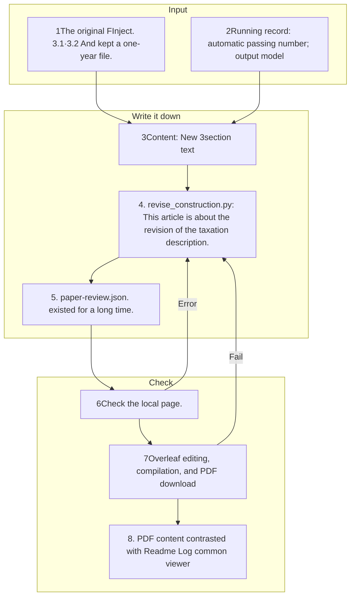

# Benchmark Construction Title and book reorganization

This README is generated from a document template.

## Reading order

1. [Conversion text and verification results](RESEARCH-DIRECTION.md)Hungarian: 3The whole pipeline.
2. [English text](content/construction-en.md)[English text](content/construction-ko.md): The standard text of the five paragraphs.
3. [English insert](content/appendix-en.md)[English added](content/appendix-ko.md): Full picture and four step detailed description.
4. [Overleaf PDF](evidence/overleaf-final.pdf): downloaded from the latest Overleaf sync 23The result. 3.3 So we're going to divide the taxonomy into two. 14,536It reflected the move of the case to the calculation.
5. [Clearly TeX](revised/revision-20261002-body.tex)[Repaired before TeX](backup/revision-20261002-body.tex)The original is preserved and modified. The revised is a local subtitle project copy.
6. [Further verification](SOURCE-MAP.md)[Checking records](verification.json)[Log](events.jsonl)[Sighs](manifest.json).

[Public research viewer](http://127.0.0.1:8896/viewer/research/)in **2026-10-03 · 3The reorganization of the plant; production; evaluation and detailed annexes**The existing Han-ing Revision Draft HTML has been updated to the same content.

## File-specific responsibilities and update flow

Python only performs document conversion and file checks and no model calls. 1,817items don't interpret human verification as a completed number. Human verification numbers preserve the uniformity as an uncertainty.
