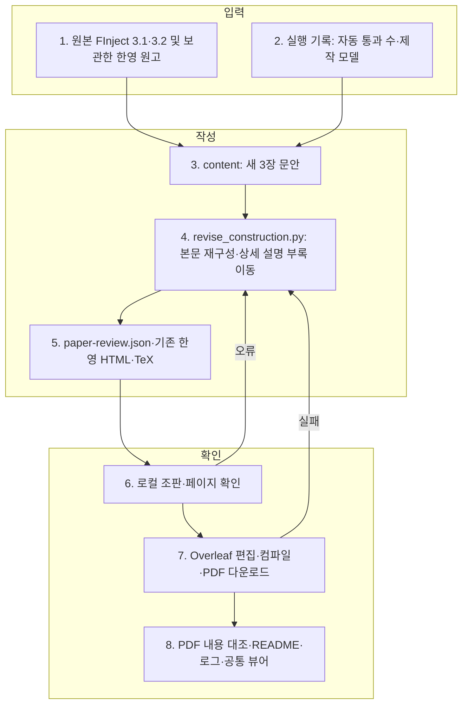

# Benchmark Construction 본문·부록 재구성

이 README는 문서 템플릿에서 생성합니다.

## 읽는 순서

1. [변경 본문과 확인 결과](RESEARCH-DIRECTION.md): 한글 3장과 전체 파이프라인.
2. [영문 본문](content/construction-en.md), [한글 본문](content/construction-ko.md): 다섯 소절의 기준 문안.
3. [영문 부록](content/appendix-en.md), [한글 부록](content/appendix-ko.md): 전체 그림 및 네 단계 상세 설명.
4. [Overleaf PDF](evidence/overleaf-final.pdf): 최신 Overleaf 동기화에서 내려받은 23쪽 결과. 3.3 Taxonomy 분리와 14,536개 문항 계산 이동까지 반영했습니다.
5. [수정 TeX](revised/revision-20261002-body.tex), [수정 전 TeX](backup/revision-20261002-body.tex): 원문 보존 및 변경 대조. revised는 로컬 조판 프로젝트 사본입니다.
6. [확인 근거](SOURCE-MAP.md), [검증 기록](verification.json), [로그](events.jsonl), [해시](manifest.json).

[공통 연구 뷰어](http://127.0.0.1:8896/viewer/research/)에서 **2026-10-03 · 3장 재구성 · 제작·평가와 상세 부록**을 선택합니다. 기존 한·영 Revision Draft HTML도 같은 내용으로 갱신했습니다.

## 파일별 책임과 갱신 흐름

Python은 문서 변환·파일 검사만 수행하며 모델 호출은 없습니다. 자동 통과 1,817개를 사람 검증 완료 수로 해석하지 않습니다. 사람 검증 수·일치도는 미확정으로 보존합니다.
