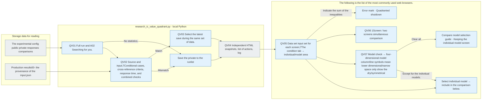

# Data sets by data set 7Condition quadratic · two screen comparisons

The location of the individual model quadrants above, as requested by the user, and the 9It's an independent HTML that maintains a step-by-step background. Below, we compare the checked model within the same four segments.7We're going to select the condition model. `1The screen.`And we can transition to a big, big, big. 2026-10-03From the experimental viewer, **[Compare the comparison](http://127.0.0.1:8894/?tab=quadrants)** The menu uses the same generator template, the viewer reads it and collects the current stored data, and this independent HTML keeps the data from the time it was created.

## Read order and file role

1. [ic-value-quadrant.html](ic-value-quadrant.html)Server: Node.js: This is a complete screen, with no external files.7The condition selection changes the upside down quadrant together, the top button selects the individual model, the bottom check box selects the model to compare together, and the choice of the two screens is independent.
2. [source-snapshot.json](source-snapshot.json): Dataset; synchronized input phrase bundle;7This is the sum of the conditions, the model, the set of the set of nine rows and the set of all the rows. 3 `features`So there's a condition definition, `Data sets[].cohorts[].models[].features[conditions].cells`There are conditionally numbered e.
3. [run-inventory.json](run-inventory.json)The entire run is included in the browsing: no setup and no unsearchable reason.
4. [Record of the verification](../../../log/research-ic-value-quadrant/20260930/README.md)Input, computation, authentication, resource storage and browser verification.

`src/finarch/documentation/templates/research/ic-value-quadrant.fragment.html`This is a template for creating. If you open this file directly, there's no data.

## 7Conditions and two screens.

The tab is **01 IC-value ahead → 02 After the IC-value → 03 IC-source A → 04 IC-source B → 05 IC-relation → 06 EA-01 → 07 EA-02** It's in order. 00This is 7The four quadrants in each tab are Unguided/Reasoning OFF·ON, Criteria-Guided/Reasoning OFF·On.

The first screen starts in front of the IC-value, the second starts behind the IC-values. You can change the arrow key to Home/End on the selected tab. The two screens are independently selected, stored, and reconfigured, and on the narrow screen, they're placed up and down, folded into one screen, and back to the two screens, and you have the second option.

IC conditions preserve the A/B/OTHER/null/failure. **Original answer and number match / Original answer and other number / null / Form-Action Failure**It's not just four rows of the IC. It's changing the EA to the candidate B of the IC or judging the numerical unit as the correct answer.

## Model check and top-down connection

The individual quadrants of the upper model maintain the existing arrangement, numerical, rate, and amplitude. The lower model comparisons use the same quadrants position and width, within each quadrants. **The response form row × the checked model column**It shows the touch and the evaporation in parallel, and even if the model is larger, it doesn't expand the width of the surface or scroll down the line.

The name of the line below is **A / B / ≠ / ∅ / !** So I'm just going to leave a symbol, which means that you add it up to the subset below the four sides and you're going to mark it down, and the name of the row can be 24pxSo, you can reduce the space to the model numbers. **= / ≠ / ∅ / !**And I don't use A/B, and I don' t show it, and I change the parameters together to the conditions that I've chosen, and I keep the line description of the individual quadrants above.

The default is to check the entire model with the storage statistics. When you uncheck the check, the columns of the model are dropped together in four dimensions. If you click the model button at the top, you include the model in the comparison below and highlight it as a theme. If you uncheck that model you saw at the top you display the first model at the top. If you remove all of them, you get the assurance that you'll select the comparison model, and the individual screen at the top is left.

Model one is the width of the can. **145px Below**The ratio of the sides to the sides of the sides of a triangle`The standard.` Hide the description and **Drying and thinning**The increase in comparison is the `–0`. **78px Below**The model arrow is also hidden, leaving the red ▲·faren ▼ and the augmented numbers. In the large space, the ratio and denominator are again visible. Whether or not the entire case denominator of the comparison includes the failure is always left below. The detailed numbers remain in the name of the space's accessibility.

The model you check is the tab:1/2The screen switches back and resets after the set is restored. When you change the data set, you compare only models with statistics from that input set, and the models without statistics are shown as inactive checkboxes.

## The sorting of the input like the dataset

A0 currently stored2 The statistics are TAT-QA. 557The Moon Haiku in the case 4.5·Qwen3 8B, FinanceReasoning 1,080The Moon Qwen3 14B·Qwen3 8BI'm not a financial reasoning expert. 10The Luna in the case. The numbers are read back from the storage when they're reproduced. 14Bis the same public input but A02is missing `No statistics.`It looks like. 0It doesn't mean you've done the experiment.

Model button checkbox within the space model heat **Luna → Haiku 4.5 → Qwen3 14B → Qwen3 8B** It's in order. Even models without statistics keep this order in the selection list, and only models with statistics are shown on the square.

The group criteria is **Source of the dataset + build run + public input file hash + 7The set of clauses by condition + 7The number of conditions**So if the exact input and output are different, the same number of cases are divided. `00-input.json` `input.provenance.dataset`Check out some of the FinanceReasoning experimental settings. `input_path`The tatqa path remains so that the path does not define the dataset as a string. The original layout does not modify.

If you run it multiple times with the same model, prompt, action setting, the most recent **The storage time of the statistics**The results are only displayed as representations and left the previous run in the data description. Select the run as performance or do not combine the duplicate response.

FinanceReasoning 1,080The Luna and Qwen in the case are different from the prompt files that are stored. `v1/v2`is a distinguishing mark for file hash and is not the official name of the prompt condition. It shows a difference in the top, model column, and resource description so it does not scale the fact that the same input is the same prompt-action setting.

## The numbers and the markings

The inference above is based on the unuided/reasoning OFF below left, the condition on the right is that the grass has changed direction. **10%, 20%, …, 90% 9Stage**And then the pressure increases. 0%p is the overlay10%And if p is less than p, then the concentration is less than P. 10%, 10%p is the overlay20%So if you have less than p, 20%and, 80%P is the concentration from the top. 90%It's limited to.

The model arrow color keeps changing the dataset, and the higher the incidence, the shorter it gets. Unguided/OFF is not the best interpretation assumption. Candidate number matches-null is not automatically determined by correct improvement. The increase in form-and-action failures is excluded from improvement.

The denominator of the two quadrants is the total number of phrases that are planned. The output cuts without the parsed response text are also included in the existing failure row. `collected`It doesn't drop because it's smaller than the planned number or subtract the failure from the denominator. If the planned pair doesn't exist or the case set-differentiation of the same condition is inconsistent, it leaves a gap except in comparison. The numbers are the difference in the total distribution, not the moving number of the individual cases.

The first line of model-by-model comparison is current dry, and the second line is augmentation. In a wide space, we attach the current ratio  % and the augmentation rate  % p. The dryness of the raw material does not decrease, and only hides explanations based on model numbers and the width of the space. 1/2The screen selection is saved and restored when it's opened again.

## Production responsibilities and order

| File | Responsibility |
| --- | --- |
| `src/finarch/documentation/research_ic_value_quadrant.py` | QV01–QV04: Running search, source and input;7Conditionally, cases; numerical comparison criteria; response hashes; numerical verification, and the same input together; HTML; list; snapshot; logs generated |
| `src/finarch/documentation/templates/research/ic-value-quadrant.fragment.html` | QV05–QV07Two independent screens and a 7Condition tab, data set, input bundle, separation/interface model connection, description reduction according to the square dimensions, symbol row and subdimensional size and width of the checked model;9The phase concentration |
| `src/finarch/documentation/checks/test_research_ic_value_quadrant.py` | Preventing mixing of condition results, prevention of candidate display not in EA, failure denominator, input-report-problem difference, overwriting run selection return check |
| `src/finarch/documentation/manage.py` | Create README and check the document connection in the template |

The gray is the file, the blue is the local processing. There are no detailed expansion nodes or pink nodes. There is no model call, recursion, or display point, and it stops when the raw material is changed during creation. The results of the new experiment must be retrieved with the following instructions, and static HTML does not automatically scan the server.

Renewable: `python3 src/finarch/documentation/research_ic_value_quadrant.py`- The return check: `PYTHONPATH=src .venv/bin/python -m unittest discover -s src/finarch/documentation/checks -p 'test_research_ic_value_quadrant.py'`This README is a `src/finarch/documentation/templates/research/ic-value-quadrant-readme.md`It's a distinction between screen checks and user-direct verification.
