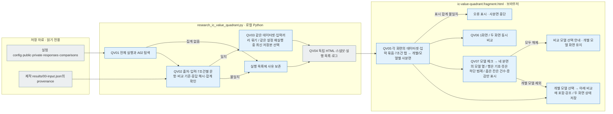

# 데이터셋별 7조건 사분면 · 두 화면 비교

사용자 요청에 따라 위쪽 개별 모델 사분면의 위치와 9단계 배경을 유지한 독립 HTML입니다. 아래쪽은 체크한 모델을 같은 네 분면 안에서 비교합니다. 기본은 두 화면 비교이며, 각 화면의 데이터셋·입력 묶음·7조건·모델을 따로 선택합니다. `1화면`으로 전환해 크게 볼 수도 있습니다. 2026-10-03부터 실험 뷰어의 **[사분면 비교](http://127.0.0.1:8894/?tab=quadrants)** 메뉴도 같은 생성기·템플릿을 사용합니다. 뷰어는 새로 읽기로 현재 저장 자료를 다시 모으고, 이 독립 HTML은 생성 시점의 자료를 유지합니다.

## 읽는 순서와 파일 역할

1. [ic-value-quadrant.html](ic-value-quadrant.html): 서버·Node.js·외부 파일 없이 여는 완성 화면입니다. 각 화면의 데이터셋·7조건 선택은 위아래 사분면을 함께 바꿉니다. 위쪽 버튼은 개별 모델을, 아래쪽 체크박스는 함께 비교할 모델을 선택합니다. 두 화면의 선택은 각각 독립적입니다.
2. [source-snapshot.json](source-snapshot.json): 데이터셋·동일 입력 문항 묶음·7조건·모델·네 풀이/추론 조합의 집계와 출처 해시입니다. 스키마 버전 3의 `features`에 조건 정의가 있고, `datasets[].cohorts[].models[].features[조건].cells`에 조건별 숫자가 있습니다.
3. [run-inventory.json](run-inventory.json): 탐색한 실행 전체의 포함 여부와 집계 없음·비교 불가 사유입니다. 설정에 모델이 있다는 것만으로 실행 완료라고 하지 않습니다.
4. [검증 기록](../../../log/research-ic-value-quadrant/20260930/README.md): 입력·합계·증감·원자료 보존과 브라우저 확인 상태입니다.

`src/finarch/documentation/templates/research/ic-value-quadrant.fragment.html`은 생성용 템플릿입니다. 이 파일을 직접 열면 자료가 없습니다. 위 완성 HTML을 여십시오.

## 7조건과 두 화면

탭은 **01 IC-value 앞 → 02 IC-value 뒤 → 03 IC-source A → 04 IC-source B → 05 IC-relation → 06 EA-01 → 07 EA-02** 순서입니다. 원본 00은 이 7조건에 포함하지 않습니다. 각 탭 안의 네 사분면은 Unguided/Reasoning OFF·ON, Criteria-Guided/Reasoning OFF·ON입니다.

첫 화면은 IC-value 앞, 두 번째는 IC-value 뒤로 시작합니다. 선택한 탭에서 화살표 키와 Home/End로 조건을 바꿀 수 있습니다. 두 화면은 독립적으로 선택·저장·복원되며, 좁은 화면에서는 위아래로 배치합니다. 한 화면으로 접었다가 두 화면으로 돌아와도 두 번째 선택은 남습니다.

IC 조건은 A/B/OTHER/null/실패를 보존합니다. EA에는 추가 숫자 후보 B가 없으므로 **원본 답과 숫자 일치 / 원본 답과 다른 숫자 / null / 형식·실행 실패**의 네 행만 표시합니다. EA를 IC의 후보 B로 바꾸거나 숫자 일치를 의미 정답으로 판단하지 않습니다.

## 모델 체크와 위아래 연결

위쪽 개별 모델 사분면은 기존 배치·숫자·비율·증감을 유지합니다. 아래쪽 모델 비교도 같은 분면 위치와 폭을 사용하며, 각 분면 안에서 **응답 형태 행 × 체크한 모델 열**로 건수와 증감을 나란히 표시합니다. 모델이 늘어도 분면 폭을 넓히거나 가로로 스크롤하지 않습니다.

아래쪽 행 이름은 **A / B / ≠ / ∅ / !** 기호만 남깁니다. 뜻은 네 분면 아래 범례에 한 번 모아서 표시하며, 행 이름 칸은 24px로 줄여 모델 숫자에 공간을 줍니다. EA에서는 **= / ≠ / ∅ / !**를 사용하고 A/B는 표시하지 않습니다. 범례도 선택한 조건에 맞춰 함께 바뀝니다. 위쪽 개별 사분면의 행 설명은 유지합니다.

기본은 저장 집계가 있는 모델 전체가 체크됩니다. 체크를 해제하면 해당 모델의 열이 네 분면에서 함께 빠집니다. 위쪽에서 모델 버튼을 누르면 그 모델을 아래 비교에 포함하고 테두리로 강조합니다. 위쪽에서 보던 모델의 체크를 해제하면 남은 첫 번째 모델을 위쪽에 표시합니다. 모두 해제하면 비교 모델을 선택하라는 안내가 나오며, 위쪽 개별 화면은 남습니다.

모델 하나의 칸 폭이 **145px 이하**이면 비율·%p·반복 분모·`기준` 설명을 숨기고 **건수와 증감**만 표시합니다. 비교 기준의 증감은 `–0`입니다. **78px 이하**에서는 모델색 화살표도 숨기되 빨간 ▲·파란 ▼와 증감 숫자는 남습니다. 큰 칸에서는 비율과 분모가 다시 보입니다. 비교 전체의 문항 분모와 실패 포함 여부는 아래에 항상 남습니다. 상세 수치는 칸의 접근성 이름에도 유지합니다.

체크한 모델은 탭·1/2화면 전환·새로 고침 이후에도 복원됩니다. 데이터셋을 바꾸면 그 입력 묶음에서 집계가 있는 모델만 비교하며, 집계 없는 모델은 비활성 체크박스로 표시합니다.

## 데이터셋과 같은 입력의 구분

현재 저장된 A02 집계는 TAT-QA 557문항의 Luna·Haiku 4.5·Qwen3 8B, FinanceReasoning 1,080문항의 Luna·Qwen3 14B·Qwen3 8B, 별도 FinanceReasoning 10문항의 Luna입니다. 숫자는 재생성할 때 저장 자료에서 다시 읽습니다. TAT-QA Qwen3 14B는 같은 공개 입력이 있으나 A02가 없어 `집계 없음`으로 보입니다. 0건이나 실험 완료를 의미하지 않습니다.

모델 버튼·체크박스·분면 안의 모델 열·자료 설명은 **Luna → Haiku 4.5 → Qwen3 14B → Qwen3 8B** 순서입니다. 집계 없는 모델도 선택 목록에서 이 순서를 유지하며, 사분면에는 저장 집계가 있는 모델만 표시합니다.

그룹 기준은 **데이터셋 출처 + 제작 run + 공개 입력 파일 해시 + 7조건별 문항 ID 집합 + 7조건별 숫자 비교 기준**입니다. 문항 수가 같아도 실제 입력·후보가 다르면 나눕니다. 데이터셋 이름은 private의 source가 가리키는 제작 결과 `00-input.json`의 `input.provenance.dataset`에서 확인합니다. 일부 FinanceReasoning 실험 설정의 `input_path`에 tatqa 경로가 남아 있으므로 그 경로 문자열로 데이터셋을 판정하지 않습니다. 원설정은 수정하지 않습니다.

같은 모델·프롬프트·실행 설정으로 여러 번 실행했다면 가장 최근 **집계 저장 시각**의 결과만 대표로 표시하고 이전 run을 자료 설명에 남깁니다. 성능으로 실행을 고르거나 중복 응답을 합치지 않습니다. 설정이 다른 실행은 별도 모델 열로 남습니다.

FinanceReasoning 1,080문항의 Luna와 Qwen은 저장된 프롬프트 파일이 다릅니다. 화면의 `v1/v2`는 파일 해시를 구분하는 표시이며 공식 프롬프트 조건 이름이 아닙니다. 상단·모델 열·자료 설명에 차이를 표시하므로 같은 입력이라는 사실을 같은 프롬프트·실행 설정으로 확대하지 않습니다.

## 숫자와 표시 기준

왼쪽 아래 Unguided/Reasoning OFF를 기준으로 위는 추론, 오른쪽은 풀이 지시를 바꾼 조건입니다. 빨간 ▲는 증가, 파란 ▼는 감소입니다. 증가한 행만 황갈색 배경 **10%, 20%, …, 90%의 9단계**로 표시합니다. 비중 증가가 0%p 초과–10%p 이하이면 농도 10%, 10%p 초과–20%p 이하이면 20%이며, 80%p 초과부터 농도 90%로 제한합니다.

모델 화살표 색은 데이터셋을 바꿔도 유지하며 증가 비중이 클수록 굵어집니다. Unguided/OFF가 가장 좋지 않다는 것은 해석 가정입니다. 후보 숫자 일치·null·증가를 정답 개선으로 자동 판정하지 않습니다. 형식·실행 실패의 증가는 개선에서 제외합니다.

두 사분면의 분모는 계획된 전체 문항 수입니다. 파싱된 응답 본문이 없는 출력 잘림도 기존 실패 행에 포함합니다. `collected`가 계획 수보다 작다는 이유로 버리거나 실패를 분모에서 빼지 않습니다. 계획된 쌍 자체가 없거나 같은 조건의 문항 집합·분류 합계가 불일치하면 비교에서 제외하고 사유를 남깁니다. 숫자는 전체 분포의 차이이며 개별 문항의 이동 건수는 아닙니다.

모델별 비교의 첫 줄은 현재 건수, 둘째 줄은 증감입니다. 넓은 칸에는 현재 비율(%)과 증감 비율(%p)을 붙입니다. 원자료의 건수는 줄이지 않으며, 모델 수와 칸 폭에 따라 설명만 숨깁니다. 데이터셋·문항 묶음·조건·개별 모델·비교 모델 선택과 1/2화면 선택은 저장되어 다시 열 때 복원됩니다.

## 생성 책임과 순서

| 파일 | 책임 |
| --- | --- |
| `src/finarch/documentation/research_ic_value_quadrant.py` | QV01–QV04: 실행 탐색, 출처·입력·7조건별 문항·숫자 비교 기준·응답 해시·합계 확인, 동일 입력끼리 모아 HTML·목록·스냅샷·로그 생성 |
| `src/finarch/documentation/templates/research/ic-value-quadrant.fragment.html` | QV05–QV07: 독립적인 두 화면과 7조건 탭, 데이터셋·입력 묶음·개별/비교 모델 연결, 체크한 모델의 사분면·기호 행과 하단 범례·폭에 따른 설명 축소·9단계 농도 |
| `src/finarch/documentation/checks/test_research_ic_value_quadrant.py` | 조건 결과의 섞임 방지, EA에 없는 후보 표시 방지, 실패 분모, 입력·후보·문항 차이, 중복 실행 선택 회귀 검사 |
| `src/finarch/documentation/manage.py` | 템플릿에서 README 생성 및 문서 연결 검사 |

회색은 파일, 파랑은 로컬 처리입니다. 별도 상세 확장 노드나 분홍색 노드는 없습니다. 모델 호출·재시도·재채점이 없는 표시 작업이며 생성 중 원자료가 바뀌면 중단합니다. 새 실험 결과는 아래 명령으로 다시 모아야 하며 정적 HTML이 서버를 자동 조회하지는 않습니다.

재생성: `python3 src/finarch/documentation/research_ic_value_quadrant.py`. 회귀 검사: `PYTHONPATH=src .venv/bin/python -m unittest discover -s src/finarch/documentation/checks -p 'test_research_ic_value_quadrant.py'`. 이 README는 `src/finarch/documentation/templates/research/ic-value-quadrant-readme.md`에서 생성합니다. 화면 검사와 사용자의 직접 확인은 구분합니다.
