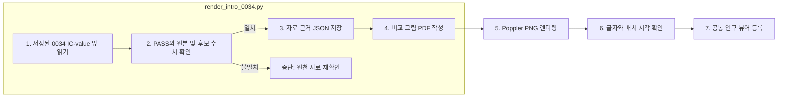

# FInject 서론 그림 · test-0034

## 읽는 순서

1. [그림과 설명](RESEARCH-DIRECTION.md): 원본 수치 QA와 충돌 상황의 응답 구성을 비교합니다.
2. [PNG](finject-introduction-0034.png), [벡터 PDF](finject-introduction-0034.pdf): 채팅·슬라이드 미리보기와 논문 삽입용입니다.
3. [자료 근거](source-evidence.json): 실제 질문, 원문, 삽입 문장, PASS 범위와 원천 파일 해시입니다.
4. [검증 기록](verification.json), [실행 로그](events.jsonl): 시각 검수와 자동 제작 검사/사람 판정의 경계를 기록합니다.

[공통 연구 뷰어](http://127.0.0.1:8896/viewer/research/)에서 **2026-10-02 · 서론 그림 · 0034 충돌과 근거 제시**를 선택합니다.

## 생성 도구

`src/finarch/documentation/render_intro_0034.py`는 기존 통과 문항 JSON을 받아 수치·문장을 확인하고 벡터 PDF와 출처 JSON을 저장합니다. 원본 데이터와 실험 응답을 수정하지 않습니다. PNG는 Poppler로 렌더링합니다. LLM 호출은 없습니다.

## 해석 범위

세후 비용 19와 삽입값 20.9에 세금 12를 각각 더하면 31과 32.9이며, 질문의 정수 반올림 기준에서 후보 답은 31과 33입니다. 그래프는 제작 참조 풀이를 나타냅니다.

Agent A/B/C는 특정 모델이 아닙니다. 오른쪽 응답은 작성한 설명용 예시이며 실험 결과나 확정 정답이 아닙니다. 선택한 run의 PASS는 최종 문장 자동 검사이고 human_decision은 PENDING입니다. 전체 맥락에는 자산·부채 변화 등 추가 정보도 있으므로 기권 정답 여부는 생략한 정보까지 포함한 최종 판정이 필요합니다. 이 그림은 해당 문항의 충돌을 보여 주며 결측 변형을 새로 만들어 실데이터인 것처럼 제시하지 않습니다.

이 README는 등록된 템플릿에서 생성합니다.
