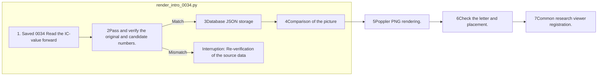

# FInject argument drawing · test-0034

## Reading order

1. [Pictures and illustrations](RESEARCH-DIRECTION.md)QA: Comparing the response structure of the original numbers to the collision situation.
2. [PNG](finject-introduction-0034.png)[PDF of vector](finject-introduction-0034.pdf)Chat slides and paper inserts.
3. [Footnote](source-evidence.json)It's real questions, the original, the insert phrase, the PASS range and the source file hash.
4. [Record of the verification](verification.json)[Acts log](events.jsonl)It records the boundaries of visual scans and automated production testing/human judgement.

[Public research viewer](http://127.0.0.1:8896/viewer/research/)in **2026-10-02 · Scenes from the Scenes 0034 Conflict and justification**I'm going to choose.

## The tool to create

`src/finarch/documentation/render_intro_0034.py`It takes the existing passphrase JSON and verifies the numerical query and stores the vector PDF and the source JSON. It doesn't modify the original data and the experimental response. PNG renders to Poppler. There are no LLM calls.

## The scope of interpretation

After-sales expenses 19Come on, the input. 20.9Taxes 12And then you add each of them. 31and 32.9And, in the question's integer counterpoint, the candidate's answer is 31and 33So the graph shows the reference line of production.

Agent A/B/C is not a specific model. The right answer is a written explanatory example, and it is not a test result or a valid answer. The PASS of the selected run is an automatic check of the final case and the human_decision is PENDING. In the overall context, additional information such as changes in assets and debts is required, so a final judgment is required, including whether the authorized response is omitted, including information that the figure shows the conflict of the cases and does not present a deviation of the decimal as real data.

This README is generated from a registered template.
