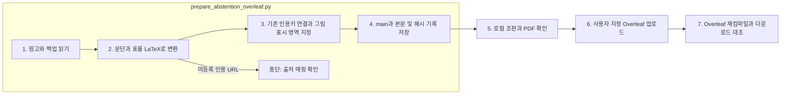

# Overleaf Abstention 원고 반영

## 읽는 순서

1. [변경 내역과 상태](RESEARCH-DIRECTION.md): 백업 위치, 반영 내용, 확인 결과.
2. [수정 main.tex](revised/main.tex), [새 본문](revised/revision-20261002-body.tex): 기존 ACL 형식에 영문 1–5장을 연결합니다.
3. [기존 소스 ZIP](backup/before-abstention-revision.zip), [기존 PDF](backup/before-abstention-revision.pdf), [파일 해시](backup/manifest.json): 변경 전 프로젝트 자료입니다.
4. [최신 Overleaf PDF](evidence/overleaf-taxonomy-final.pdf), [Taxonomy 이미지](revised/revision-taxonomy.pdf), [그림 편집 소스](revised/revision-taxonomy.tex): 최신 그림과 조판 결과입니다.
5. [변환 기록](evidence/conversion.json), [실행 기록](events.jsonl), [검증 기록](verification.json): 원본·변환·업로드 확인 범위를 구분합니다.

[공통 연구 뷰어](http://127.0.0.1:8896/viewer/research/)에서 **2026-10-02 · Overleaf 백업 및 Abstention 원고 반영**을 선택합니다. 별도 뷰어 HTML은 생성하지 않습니다.

## 변환 도구 역할과 순서

`src/finarch/documentation/prepare_abstention_overleaf.py`는 확정한 PAPER-EN.md와 내려받은 기존 프로젝트를 받아, 본문·표·인용을 LaTeX로 옮기고 원본 이미지와 ACL 의존 파일을 복사합니다. 연구 내용과 체크 판정은 새로 생성하지 않습니다.

1–4는 Python/Pandoc 처리이며, LLM 제작·실험 호출은 없습니다. 브라우저 업로드는 변환 스크립트가 수행하지 않습니다. 컴파일 오류는 로그를 읽어 조판만 수정하며, 원고 의미 검증으로 확대하지 않습니다. 사용자 검토 완료는 별도입니다.

이 README는 문서 템플릿에서 자동 생성합니다.

## 확정 초록 후속 적용

최신 [초록 적용 PDF](evidence/overleaf-approved-abstract.pdf)와 [초록 변경 기록](evidence/abstract-update-verification.json)을 먼저 확인합니다. 기존 ZIP은 앞선 그림 수정 시점의 자료입니다. 수정 전후 main.tex는 evidence에 보존했습니다.

초록 마지막의 자동화 프레임워크 문장 추가는 [후속 기록](evidence/framework-sentence-verification.json)을 참고합니다. 문장 저장은 확인했으나 별도 introduction 파일 오류로 이번 PDF 컴파일은 실패했습니다.
