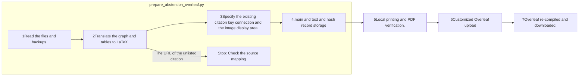

# Reflecting the Overleaf Abstention petition

## Reading order

1. [Switching and conditioning](RESEARCH-DIRECTION.md): backup location, reflection content, verification results.
2. [Repaired main.tex](revised/main.tex)[New text](revised/revision-20261002-body.tex)English: In the existing ACL format 1–5It connects the chapters.
3. [ZIP](backup/before-abstention-revision.zip)[PDF](backup/before-abstention-revision.pdf)[file hash](backup/manifest.json)It's the project data before the change.
4. [The latest overleaf PDF](evidence/overleaf-taxonomy-final.pdf)[Taxonomy image](revised/revision-taxonomy.pdf)[image editing source](revised/revision-taxonomy.tex)These are the latest images and prints.
5. [Transforming records](evidence/conversion.json)[Acts of the Law](events.jsonl)[Checking records](verification.json)It's a different sort of verification: copy, replace, upload.

[Public research viewer](http://127.0.0.1:8896/viewer/research/)in **2026-10-02 · Overleaf Backup and Abstention Reflections**The star viewer HTML does not generate.

## The role and order of the transformation tool

`src/finarch/documentation/prepare_abstention_overleaf.py`It takes a validated PAPER-EN.md and downloads an existing project, transfers the text stamp to LaTeX, and copies the original image and ACL dependent file.

1–4There is no call for an LLM build and experiment, and no Python/Pandoc processing. Browser uploads do not perform a conversion script. Compile errors only read logs and edit subtitles, and do not scale to verify subtitle meaning. User review completion is an exception.

This README automatically generates from a document template.

## Confirmation green follow-up application

The latest [original application PDF](evidence/overleaf-approved-abstract.pdf)And [First change record](evidence/abstract-update-verification.json)First, check out the existing ZIP, which is the data from the time of the pre-edit image, and then save it to the evidence.

The last automated frame phrase added to the green [post-record](evidence/framework-sentence-verification.json)The sentence repository has confirmed this, but the introduction file error has failed.
