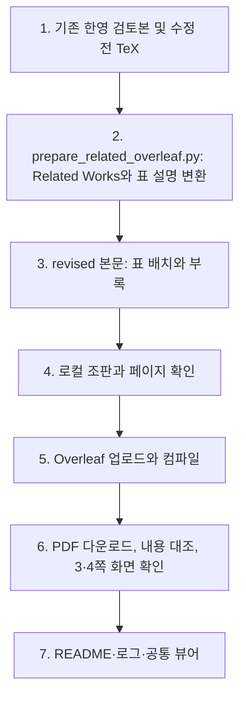

# Overleaf Related Works 반영

이 README는 문서 템플릿에서 생성합니다.

## 읽는 순서

1. [반영 결과](RESEARCH-DIRECTION.md): 표 배치와 화면 확인 결과.
2. [최종 PDF](evidence/overleaf-final.pdf): Overleaf에서 직접 내려받은 21쪽 문서.
3. [수정 본문](revised/revision-20261002-body.tex): 업로드한 파일. revised 폴더는 로컬 조판용 프로젝트이며 원격에서 다운로드한 최종 전체 프로젝트가 아닙니다.
4. [수정 전 본문](backup/revision-20261002-body.tex), [수정 전 main](backup/main.tex): 원격 편집기 내용과 공백 제외 해시를 대조한 보관본.
5. [검증 기록](verification.json), [작업 로그](events.jsonl), [해시](manifest.json).

[공통 연구 뷰어](http://127.0.0.1:8896/viewer/research/)에서 **2026-10-03 · Overleaf Related Works · 표별 페이지 분리**를 선택합니다. 실행 폴더에 별도 HTML 뷰어는 만들지 않습니다.

## 갱신 흐름

모델 호출은 없습니다. 원격 소스·PDF 대조와 조판 검증은 연구 결과 검증을 의미하지 않습니다. 변환 실패 시 업로드하지 않고, 원격 실패 시 성공으로 기록하지 않습니다.
