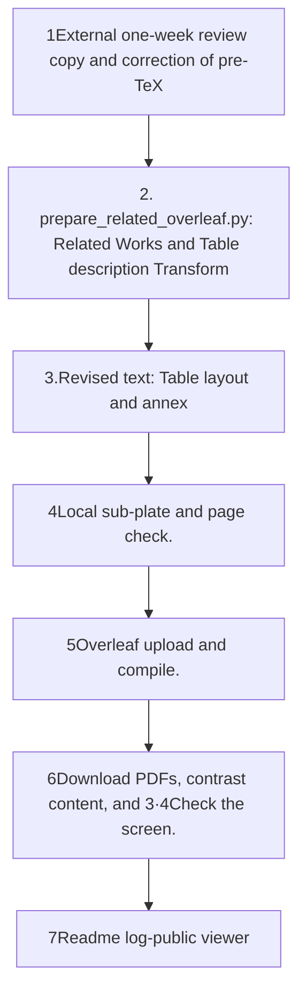

# Overleaf Related Works reflected

This README is generated from a document template.

## Reading order

1. [Results from the negative](RESEARCH-DIRECTION.md): table layout and screen check results.
2. [PDF](evidence/overleaf-final.pdf)It's a direct download from Overleaf. 21The other document.
3. [Recorded text](revised/revision-20261002-body.tex)The revised folder is a local sub-project, not the final complete project that you downloaded remotely.
4. [Previous reading](backup/revision-20261002-body.tex)[Repaired before main](backup/main.tex): Remote editor content and blank exclusion hash.
5. [Record of the verification](verification.json)[Operating log](events.jsonl)[Sighs](manifest.json).

[Public research viewer](http://127.0.0.1:8896/viewer/research/)in **2026-10-03 · Overleaf Related Works · Separation of the page**It doesn't create any HTML viewer in the run folder.

## The flow of renewal

No model calls. Remote source PDF contrast and sub-platform verification does not mean verification of the results of the study. It does not upload when the conversion fails, and it does not record as successful when the remote fails.
