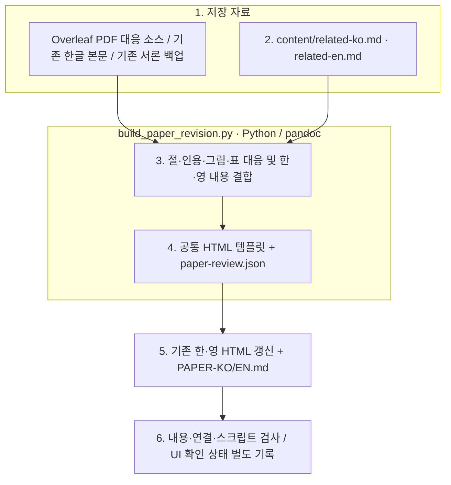

# FInject 논문 전체 한·영 검토 초안

## 읽는 순서

1. [이번 Related Works 수정안](RESEARCH-DIRECTION.md): 공통 연구 뷰어에서 실제 저장 내용을 읽습니다.
2. [한글 전체 본문](PAPER-KO.md), [영문 전체 본문](PAPER-EN.md): Abstract부터 References까지의 대응본입니다.
3. [한국어 2장 집필 원본](content/related-ko.md), [영어 2장 집필 원본](content/related-en.md): 다음 수정의 기준 파일입니다.
표 1·2 아래에는 각 열의 짧은 정의를 표시하며, 상세 기준은 검토본의 Appendix #에 연결합니다. 한·영 정의 원본은 [table-column-notes.json](content/table-column-notes.json)입니다.

4. [근거와 편집 범위](SOURCE-MAP.md), [검증 기록](verification.json), [로그](events.jsonl): 가져온 내용·이번 수정·확인 범위를 구분합니다.
5. [기존 영문 서론 백업](backup/finject-introduction-redline.html), [기존 한글 서론 백업](backup/finject-introduction-ko-redline.html): 이전 수정 이력을 보존합니다.

사용자가 보던 `finject-introduction-redline.html`과 `finject-introduction-ko-redline.html`을 같은 위치에서 전체 논문 검토본으로 확장했습니다. 경로는 SOURCE-MAP에 기록합니다. 한·영 전환, 함께 보기, 수정 표시 숨기기, 전체 절·그림·표 색인, 그림 확대를 제공합니다. Abstract·Introduction은 정리본, 2장은 이번 제안, 3장 이후는 기존 원고의 검토 대기 내용입니다. 이번 Related Works 수정과 표 설명은 Overleaf에 반영했습니다. 표 1은 3쪽, 표 2는 4쪽입니다.

[공통 연구 뷰어](http://127.0.0.1:8896/viewer/research/)에서 **2026-10-03 · 논문 전체 한·영 Revision Draft · Related Works**를 선택합니다. 실행 폴더에 별도 뷰어 HTML은 만들지 않습니다.

## 파일 역할과 갱신 순서

|파일|역할|
|---|---|
|content/related-ko.md, content/related-en.md|이번에 작성한 한·영 Related Works|
|paper-review.json|절 단위 한·영 본문·수정 전 내용·검토 상태|
|../../../src/finarch/documentation/build_paper_revision.py|기존 원고를 읽고 대응본과 기존 HTML 두 개를 함께 생성|
|../../../src/finarch/documentation/templates/research/paper-revision.html|색인·언어 전환·수정 표시를 제공하는 공통 화면 템플릿|
|PAPER-KO.md, PAPER-EN.md|생성한 전체 본문 대응본|
|manifest.json|집필 입력과 원고 기준 파일의 해시|

박스는 실제 파일과 작업 순서를 나타냅니다. 분홍 확장 노드나 모델 호출은 없습니다. 읽기·변환 실패는 생성 중단으로 남기며, 자동 검사가 통과해도 화면 확인으로 간주하지 않습니다. UI 접근 차단 시 사용자에게 확인 범위를 알립니다.

이 README는 문서 템플릿에서 생성합니다.
