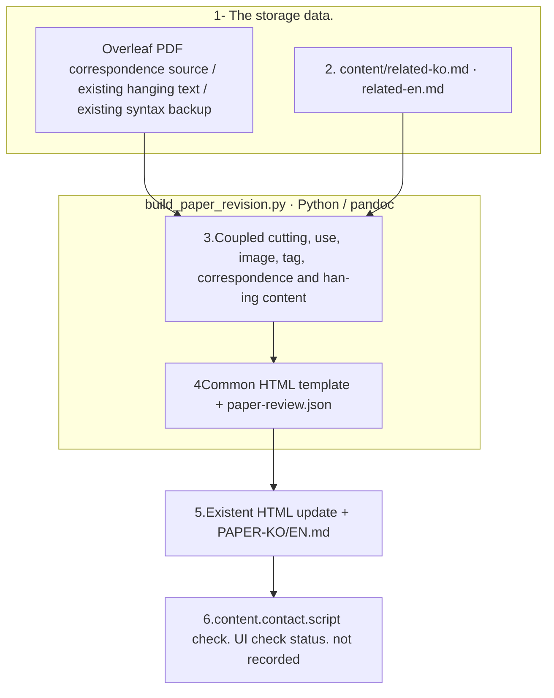

# FInject paper full one-page review draft

## Reading order

1. [This is a correction of Related Works.](RESEARCH-DIRECTION.md): Read the actual stored content in the Common Research Viewer.
2. [Full text in Hungarian](PAPER-KO.md)[Full text in English](PAPER-EN.md)It's a correspondence from abstract to reference.
3. [Korean 2The original.](content/related-ko.md)[ English ] 2The original.](content/related-en.md): This is the default file for the next amendment.
Table 1·2 Below you will see a short definition of each column, and the detailed criteria will be linked to Appendix # of the review text.](content/table-column-notes.json).

4. [Range of content and editing](SOURCE-MAP.md)[Checking records](verification.json)[Log](events.jsonl)So, we're going to sort of sort of sort out the content, the modification, the validation.
5. [Existing English dialogue backup](backup/finject-introduction-redline.html)[Existing language](backup/finject-introduction-ko-redline.html)It preserves the previously modified fission.

The user saw the `finject-introduction-redline.html`and `finject-introduction-ko-redline.html`The path is recorded on the SOURCE-MAP. The Han-Eng transition, the view together, the correction mark hiding, the full cut-out, the color of the graph, the image extension. Abstract-Introduction provides the sequence copy, 2John said this proposal, 3And then the chapters are all about the review of the existing papers, and this correction of the Related Works and the table description is reflected in the Overleaf. 1 3The side, the table. 2 4side.

[Public research viewer](http://127.0.0.1:8896/viewer/research/)in **2026-10-03 · Full text of the paper; Revision Draft · Related Works**It doesn't create any viewer HTML in the run folder.

## File roles and update order

|File|Role|
|---|---|
|content/related-ko.md, content/related-en.md|This is Han-ing's Related Works.|
|paper-review.json|Unit one, text, correction, pre-content, examination status|
|../../../src/finarch/documentation/build_paper_revision.py|You read the existing source code and you create a corresponding copy of the existing HTML together with two existing HTML.|
|../../../src/finarch/documentation/templates/research/paper-revision.html|Common screen template that provides color-in-language conversion-correction markings|
|PAPER-KO.md, PAPER-EN.md|The entire text correspondence created|
|manifest.json|The compile input and the file reference hash|

The box represents the actual file and work order. There are no pink extended nodes or model calls. Read-conversion failures remain as a production stop, and even if an automated check passes, it's not considered a screen check. When UI access is blocked, it tells the user the range of the check.

This README is generated from a document template.
