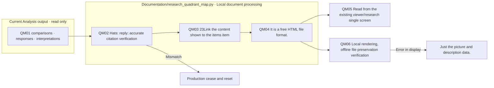

# The four-page documentation, the production verification, the recording.

I read the existing statistics and interpretations, and I created the charting and mapping data -- no experimental and analytical model calls -- and this README is generated from documentation/templates/research/quadrant-map-log-readme.md.

## Reading order

1. `build-verification.json`: Entries; images; exact citations; read source material; commentary; viewer code or preservation.
2. `browser-verification.json`: Chart boundaries, errors, mobile width, image interpretation of integrated viewers, check offline display of independent HTML.
3. `overview-luna.png`, `overview-haiku.png`: Check the full map screen.
4. `m01-luna.png`, `m14-luna.png`: Check the display of the pure map and the pure case map.
5. `research-viewer.png`, `mobile.png`: Single study viewer and mobile display verification.
6. `before-runs.json`: Copy before the list changes.

The raw materials are `reports/experiments-run`Put it in the same way, the explanatory data is `reports/run/20260928-analysis-quadrant-map`I'm going to save it. `viewer/research/index.html`In the selection of data, **Analysis square map**It opens up.

The browser checker uses a traditional viewer that replaces local files and network requests with local files, and it doesn't replace the actual localhost server status or user authentication. 48I'm going to check that all the items pictures are embedded and that they're displayed separately without JavaScript.

## The data generation flow

There's no new LLM processing or Evaluation/Analysis running, the box represents file responsibility, and no color and color extension nodes.
